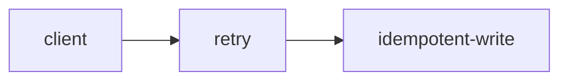
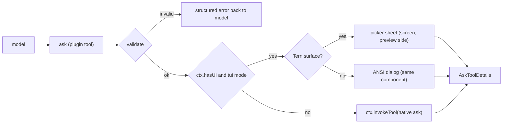

# omp-ask-more

English | [简体中文](README.zh-CN.md)

Status: **design only**. No code is written yet; nothing here ships behavior.

`omp-ask-more` is an omp plugin that keeps the native `ask` tool's name, schema, answer shape and lifecycle contract, and replaces only two things: what the model is required to put in it, and what the user sees when answering.

## The failure this addresses

Native `ask` already has the fields this feature needs: `question` is rendered as Markdown (Tern: an `md` node, `packages/tui/src/overlays/ask-dialog.ts:882-887`; TUI: Markdown with fenced-code highlighting, `:298-311`), and every option has a free-form `preview` (Tern: the focused option's `preview` as `md`, `:936-940`; TUI: rendered under the focused option, `:501-503`).

Two things stop those fields from being used:

1. The model is told not to. The whole tool prompt is seven lines and says "short labels, tradeoffs in `description`" (`packages/coding-agent/src/prompts/tools/ask.md:1-7`); `preview` is never mentioned, and `description` is a single line.
2. The surface is small. The dialog is mounted in the composer container (`packages/coding-agent/src/modes/controllers/extension-ui-controller.ts:887-905`), its header is capped at four rows and the whole panel at 70% of the terminal (`packages/tui/src/overlays/ask-dialog.ts:116-123`), and in Tern it describes as `omp.editor.ask` — a dock `col` with `md` question, a `list` of options, and exactly one option's `preview` (`:762-940`). A brief of any length has nowhere to go, so the model writes a one-liner, the user cannot decide from it, and the ask is discarded.

## What changes, what does not

| Kept exactly as native | Replaced |
|---|---|
| Tool name `ask`, and the parameter schema `{questions: [{id, question, header?, options: [{label, description?, preview?}], multi?, recommended?}]}` (`packages/coding-agent/src/tools/ask.ts:52-88`) | The model-facing tool description: it states the contract below instead of "short labels" |
| Answer shape `AskToolDetails` and the `askToolRenderer` result card (renderers are selected by tool name, `packages/tui/src/tools/index.ts:37`) | The answering surface when a Tern pane is available: a full-size `picker` sheet |
| Persisted call arguments, so `/tree` re-answer still recovers the same questions (`recoverAskQuestions`, `packages/coding-agent/src/tools/ask.ts:94-109`) | Nothing else. `AskTool.execute()`'s own validation, timeout, speech, images, note and chat redirect stay reachable through delegation |
| Subagent, RPC and print sessions: the tool delegates to the native implementation when no rich UI is available | — |

Keeping the schema is deliberate. It means the rich content lives in the fields every other path already renders and persists: a `/tree` re-answer, a collaborator's mirror, or a fallback to the native dialog still shows the brief and the per-option tradeoff, only in the smaller surface. A separate `brief` object would fail native recovery (`arktype` objects reject undeclared keys) and every non-ask-more path would lose the content.

## The contract the model must satisfy

`question` is Markdown and must open with three headings; the headings are protocol tokens and are not translated:

```
## Where
What exists now: paths, symbols, the failing observation. Cite `path:line`.

## What
The decision being made, and why it cannot be taken from code/docs/conventions.

## How
What happens after each answer, and which constraint decides it.


```

Every option's `preview` must carry its own tradeoff, with a `取舍` / `Tradeoff` line, a `成立条件` / `Holds when` line, and a `成本` / `Cost` line. `description` stays a one-line disambiguator: it is what the option row shows when the preview is not open.

```
ask({
  questions: [{
    id: "retry-strategy",
    question: "## Where\n...\n## What\n...\n## How\n...\n```mermaid\nflowchart LR\n  c --> r\n```",
    header: "重试策略",
    recommended: 0,
    options: [
      { label: "指数退避 + 幂等键",
        description: "需要 1 张表、2 个字段",
        preview: "### 取舍\n重试安全，代价是迁移。\n### 成立条件\n下游能给出稳定请求键。\n### 成本\n1 张表、2 个字段，可回滚。\n```ts src/retry.ts:41-58\n```" },
      { label: "固定 3 次重试", description: "改动最小", preview: "### 取舍\n..." }
    ]
  }]
})
```

A fenced block whose info string is `lang path:lines` is an evidence reference. The renderer reads the file at render time and draws the real lines through a `code` node with `path` and `start` set (`packages/wire/src/tsp.ts:222-236`), so the snippet cannot be hallucinated: if the file or range cannot be read, the surface shows the model's text in an error tone plus the reason.

## Validation

Validation runs at the tool boundary, before any UI opens, and returns a structured tool error listing every violation. It never silently downgrades to a thin ask.

| Rule | Rejection message |
|---|---|
| `questions.length === 1` | one decision per call; split the call |
| `question` contains `## Where`, `## What`, `## How` (in order) | missing section, with the expected heading |
| every option has non-empty `preview` with a tradeoff line | option `<label>` has no tradeoff |
| at least one evidence reference (`path:lines`) or an `http(s)` link | no evidence: cite a path or a URL |
| reserved labels rejected (`Other (type your own)`, `Chat about this`, `Next →`) | mirrors the native rule, `ask.ts:52-58` |
| `multi` unset | the sheet selects one answer; ask twice for two |

## Surfaces



Both rich surfaces are one pi-tui component mounted with `ui.custom()` (`extension-ui-controller.ts:1283-1360`); the Tern backend calls its `describe()` instead of `render()` when the terminal speaks TSP (`packages/tui/src/tui.ts:264-272,294-305`).

**Tern.** The component reports `nativeSheet(cx) => cx.supports("picker")` and `describe()` returns a `picker` node:

| Part | Node | Content |
|---|---|---|
| Head | `picker.title` / `subtitle` | the decision, the session's language |
| Rows | `picker.items`, `layout: "cards"` | one card per option: label, one-line `description`, `Recommended` badge, tone |
| Preview | `picker.preview: "side"` children | `card`(brief) with `section.collapsible` per WHERE/WHAT/HOW, resolved `code` nodes, `md` with the Mermaid fence, then `section.collapsible` per option holding its tradeoff |
| Actions | `picker.actions` | `Submit` (enter), `Skip` (esc), `Other` (o), each with keycaps |

`picker` (`packages/wire/src/tsp.ts:532-620`) at `size: "screen"`, `layout: "cards"`, `preview: "side"` and a preview subtree of `col → md/code/card → table` were exercised on the installed Tern 0.9.6; the hello at `/tmp/tern-catalog-events.jsonl:1` advertises `picker`, `section`, `el`, `editor`, `md`, `code` among 45 kinds, and a folded `section` inside the preview toggled locally and reported `toggle` (`:7`), then expanded after the program sent `set(collapsed:false)` (`:16-17`). Mermaid renders inside `md` natively (figure caption `mermaid · flowchart`). Keyboard stays with the component: `ui.custom` focuses it (`extension-ui-controller.ts:1358`) and pointer events come back through `handleNativeEvent` (`packages/tui/src/native/backend.ts:860-932`).

If the picker root turns out not to be hoisted from the dock, the fallback is `ui.custom(factory, {overlay: true})` with the same `describe()` — the path `reconcile.ts:27-28,426,484` already uses for `overlay`/`picker` nodes.

**Plain TUI.** The same component's `render(width)` draws the brief with `Markdown`, the options as radio/checkbox rows, and a `Ctrl+O`-style expand for each folded section; Mermaid renders as ASCII through `@oh-my-pi/pi-utils/mermaid-ascii` (`packages/tui/src/theme/mermaid-cache.ts:66,100`), the same path assistant Markdown uses.

**Fallback.** When `ctx.hasUI` is false, the mode is not `tui`, or the component throws before mounting, the tool calls `ctx.invokeTool(params)` — the native built-in of the same name, depth-guarded (`packages/coding-agent/src/extensibility/extensions/types.ts:780-799`). The native dialog then shows the same rich `question` and `preview`, so the user still gets context, in the smaller surface.

## Answer and lifecycle

| Concern | Behavior |
|---|---|
| Answer | native `AskToolDetails`: `results[{id, question, options, multi, selectedOptions, customInput}]`, rendered by `askToolRenderer` |
| Cancel | `ctx.abort()` (`types.ts:699`) then a cancelled result; `ToolAbortError` is not exported to extensions, so the result text states the cancellation |
| Concurrent asks | one in flight; a second call returns an error instead of opening a second sheet (a mutex over the shared composer is exactly what the native `exclusive` mark avoids, `ask.ts:568-573`) |
| Timeout | none. The native auto-select-on-timeout reads session settings the extension cannot reach (`ask.ts:742-745`), so the design drops it rather than running a second timer |
| Approval | `approval: "read"`, matching `ask.ts:544-551` |
| Subagent, RPC, print | delegates to native, which aborts with "requires interactive mode" exactly as today |

## Known limitations

- **`/tree` re-answer** runs `new AskTool()` directly (`packages/coding-agent/src/modes/controllers/selector-controller.ts:1723-1748`) and validates the persisted arguments against the native schema. Because the schema is unchanged, recovery succeeds and the full `question`/`preview` come back — but in the native dock surface, not the picker.
- **Collaborator guests** answer through the native ask mirroring channel (`extension-ui-controller.ts:923-1025`), which has no representation for a `ui.custom` surface. While the ask-more sheet is open, a guest cannot answer; the host-only case is the accepted scope.
- **Plan-mode timeout auto-select** is unavailable while the ask-more surface is used.
- **Multiple questions and `multi: true`** are rejected, not implemented.
- The tool is registered under the native name, so the model-facing prompt is ask-more's description, not `prompts/tools/ask.md`. Other extensions that rewrite ask's prompt through `tool-topics` keep working only if they target the final description.

## Files (planned)

```
index.ts                 plugin entry; registers the ask tool, delegates, gates on UI
src/schema.ts            native-shaped schema, boundary parse, validation rules
src/contract.ts          heading/tradeoff parsing of question and preview, evidence refs
src/component.ts         one pi-tui component: render() for ANSI, describe() for Tern
src/nodes.ts             picker/card/section/code/md composition, tone and fold state
src/evidence.ts          path:lines resolution against ctx.cwd, bounded reads
src/result.ts            AskToolDetails construction and the cancelled result
src/i18n.ts              UI labels; protocol headings stay English
tern/plugin.toml         optional: only if a Tern-side command is ever needed
```

## Verification plan

1. Unit: schema acceptance and each rejection message; heading parser; `path:lines` resolution against a fixture file; evidence read bounds.
2. Tern end to end in a real pane: `/update-omp`-style install of the plugin, `omp` in a Tern pane, model asks a decision; observe the picker at `size: screen`, fold and unfold a code section, press `o` for Other, submit; confirm the tool result contains the chosen label and that the transcript card renders through the native renderer.
3. Fallbacks: same ask in a non-Tern terminal (ANSI dialog), with `tui` mode off, and inside a subagent (native delegation).
4. Regression: a persisted ask with the same arguments re-answered through `/tree` opens the native dialog with the brief intact.
