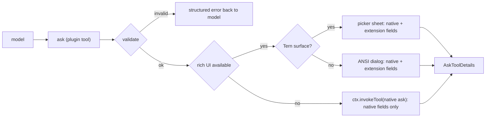

# omp-ask-more

English | [简体中文](README.zh-CN.md)

Status: **design only**. No code is written yet; nothing here ships behavior.

`omp-ask-more` is an omp plugin that shadows the native `ask` tool. Its parameters are the native ones **plus** extension fields. The native component renders the native part and ignores the rest; the ask-more component renders both. The answer shape, the result renderer and the persisted-call contract stay native.

## The failure this addresses

Native `ask` already has the fields this feature needs: `question` is rendered as Markdown (Tern: an `md` node, `packages/tui/src/overlays/ask-dialog.ts:884`; TUI: Markdown with fenced-code highlighting, `:298-311`), and every option has a free-form `preview` (Tern: the focused option's `preview` as `md`, `:939`; TUI: rendered under the focused option, `:501-503`).

Two things stop those fields from being used:

1. The model is told not to. The whole tool prompt is seven lines and says "short labels, tradeoffs in `description`" (`packages/coding-agent/src/prompts/tools/ask.md:1-7`); `preview` is never mentioned, and `description` is a single line.
2. The surface is small. The dialog is mounted in the composer container (`packages/coding-agent/src/modes/controllers/extension-ui-controller.ts:887-905`), its header is capped at four rows and the whole panel at 70% of the terminal (`packages/tui/src/overlays/ask-dialog.ts:116-123`), and in Tern it describes as `omp.editor.ask` — a dock `col` with `md` question, a `list` of options, and exactly one option's `preview` (`:762-940`). A brief of any length has nowhere to go, so the model writes a one-liner, the user cannot decide from it, and the ask is discarded.

Free-form Markdown inside `question` and `preview` cannot fix this either: nothing validates that a brief exists, and the surface still gives it four rows.

## What changes, what does not

The parameter schema is **native plus extension fields**, the same shape omp-todo-more uses for `todo`: the native component draws what it knows and ignores what it does not.

| Kept | Added | Replaced |
|---|---|---|
| Tool name `ask`; every native field (`id`, `question`, `header?`, `options[{label, description?, preview?}]`, `multi?`, `recommended?`) and its meaning (`packages/coding-agent/src/tools/ask.ts:52-88`) | Top level: `brief {where, what, how, evidence?, diagram?, risks?}` | The model-facing tool description: the contract below replaces "short labels" |
| Answer shape `AskToolDetails` and the `askToolRenderer` result card (renderers are selected by tool name, `packages/tui/src/tools/index.ts:37`) | Per option: `tradeoff`, `holds_when?`, `cost?` | The answering surface when a rich UI is available |
| Persisted call arguments and `/tree` recovery: `arktype` keeps undeclared keys, so `recoverAskQuestions` accepts the extended arguments and still returns `questions` (`packages/coding-agent/src/tools/ask.ts:94-109`; behaviour measured with the repo's own `arktype`: a payload carrying `brief` and `tradeoff` comes back unchanged) | — | — |
| Delegation to the native built-in when no rich UI exists (`ctx.invokeTool`, `packages/coding-agent/src/extensibility/extensions/types.ts:780-799`), which sees the extras and ignores them | — | — |

Extension fields are `required` where they carry the decision (`brief.where/what/how`, each option's `tradeoff`), because a schema that asks politely does not change model behaviour. Fields that only qualify a decision (`evidence`, `diagram`, `risks`, `holds_when`, `cost`) stay optional, matching "必要时要附上代码片段和 mermaid 图".

## The contract

`question` stays a question: one or two sentences, no brief smuggled into it. The brief is its own field.

```
ask({
  questions: [{
    id: "retry-strategy",
    header: "重试策略",
    question: "重试应该怎么做？",
    recommended: 0,
    brief: {
      where: "retry() 与 3 处调用点，429 后上游出现重复写入。",
      what: "选择失败后的重试策略，决定是否引入幂等键。",
      how: "选 A 要加迁移；选 B 只改 retry() 内部，不动调用方。",
      evidence: [
        { path: "src/retry.ts", lines: "41-58", note: "现有重试只有 1 次" },
        { path: "src/order/paid.ts", lines: "88-96" }
      ],
      diagram: "flowchart LR\n  client --> retry --> write",
      risks: ["迁移期间双写"]
    },
    options: [
      { label: "指数退避 + 幂等键",
        description: "需要 1 表 2 字段",
        tradeoff: "重试安全，代价是迁移",
        holds_when: "下游能给出稳定请求键",
        cost: "1 张表、2 个字段，可回滚" },
      { label: "固定 3 次重试", description: "改动最小",
        tradeoff: "不动 schema，但重复写会继续发生",
        cost: "只改 retry() 内部" }
    ]
  }]
})
```

- `brief.where/what/how` are prose the user reads before deciding; they are rendered above the options, never collapsed by default.
- `evidence[].path` with optional `lines` is resolved by the tool against `ctx.cwd` and read at render time, so the panel shows the real lines in a `code` node with `path` and `start` (`packages/wire/src/tsp.ts:222-236`) instead of model-typed code. A reference that cannot be read is drawn in an error tone with the reason, and never blocks the ask.
- `diagram` is Mermaid source, drawn by the `md` node natively in Tern and as ASCII in the TUI.
- `tradeoff` / `holds_when` / `cost` are one line each; the panel renders them as a three-row `kv` under the option, and the transcript card shows nothing of them (they are extension fields).

## Validation

Validation runs at the tool boundary, before any UI opens, and returns a structured tool error listing every violation. It never silently downgrades to a thin ask.

| Rule | Rejection message |
|---|---|
| `questions.length === 1` | one decision per call; split the call |
| `brief.where`, `brief.what`, `brief.how` non-empty | missing `brief.<field>` |
| every option has non-empty `tradeoff` | option `<label>` has no tradeoff |
| `evidence` entries have `path`; `lines` parses as `N` or `N-M` | evidence `<i>` is not `path[:lines]` |
| reserved labels rejected (`Other (type your own)`, `Chat about this`, `Next →`) | mirrors the native rule, `ask.ts:52-58` |
| `multi` unset | the sheet selects one answer; ask twice for two |

Evidence paths are checked for existence but never gate the call: a missing file is reported in the panel as unreadable, because a path may belong to a target that does not exist yet, another checkout, or an `ssh` host.

## Surfaces



Both rich surfaces are one pi-tui component mounted with `ui.custom()` (`extension-ui-controller.ts:1283-1360`); the Tern backend calls its `describe()` instead of `render()` when the terminal speaks TSP (`packages/tui/src/tui.ts:264-272,294-305`).

**Tern.** The component reports `nativeSheet(cx) => cx.supports("picker")` and `describe()` returns a `picker` node:

| Part | Node | Content |
|---|---|---|
| Head | `picker.title` / `subtitle` | `header`, then `question` |
| Rows | `picker.items`, `layout: "cards"` | one card per option: label, one-line `description`, `Recommended` badge, tone |
| Preview | `picker.preview: "side"` children | `card`(brief) with `section.collapsible` for WHERE / WHAT / HOW, the resolved `code` nodes, the Mermaid `md`, `risks`, then the focused option's `tradeoff` / `holds_when` / `cost` as a `kv` |
| Actions | `picker.actions` | `Submit` (enter), `Skip` (esc), `Other` (o), each with keycaps |

`picker` (`packages/wire/src/tsp.ts:532-620`) at `size: "screen"`, `layout: "cards"`, `preview: "side"` with a preview subtree of `col → md/code/card → table` was exercised on the installed Tern 0.9.6: the hello at `/tmp/tern-catalog-events.jsonl:1` advertises `picker`, `section`, `el`, `editor`, `md`, `code` among 45 kinds; a folded `section` in the preview toggled locally and reported `toggle` (`:7`), then expanded after the program sent `set(collapsed:false)` (`:16-17`); Mermaid rendered inside `md` (figure caption `mermaid · flowchart`). Keyboard stays with the component: `ui.custom` focuses it (`extension-ui-controller.ts:1358`), and pointer events return through `handleNativeEvent` (`packages/tui/src/native/backend.ts:860-932`).

If the picker root is not hoisted from the dock, the fallback is `ui.custom(factory, {overlay: true})` with the same `describe()` — the path `reconcile.ts:27-28,426,484` already uses for `overlay`/`picker` nodes.

**Plain TUI.** The same component's `render(width)` draws the brief with `Markdown`, each option as a radio/checkbox row with its tradeoff rows, and `Ctrl+O` expand/collapse per section; Mermaid renders as ASCII through `@oh-my-pi/pi-utils/mermaid-ascii` (`packages/tui/src/theme/mermaid-cache.ts:66,100`), the path assistant Markdown already uses.

**Native surfaces.** Wherever the native component draws — `ctx.invokeTool` delegation, a `/tree` re-answer — it renders the native fields and drops the extension fields: `question`, `description`, the focused option's `preview`. The brief, the tradeoffs and the diagram are not shown there. That is the accepted cost of keeping one tool name and one answer contract.

## Answer and lifecycle

| Concern | Behavior |
|---|---|
| Answer | native `AskToolDetails`: `results[{id, question, options, multi, selectedOptions, customInput}]`, rendered by `askToolRenderer` |
| Cancel | `ctx.abort()` (`types.ts:699`) then a cancelled result; `ToolAbortError` is not exported to extensions, so the result text states the cancellation |
| Concurrent asks | one in flight; a second call returns an error instead of opening a second sheet |
| Timeout | none. The native auto-select-on-timeout reads session settings the extension cannot reach (`ask.ts:742-745`), so the design drops it rather than running a second timer |
| Approval | `approval: "read"`, matching `ask.ts:544-551` |
| Subagent, RPC, print | delegates to native, which aborts with "requires interactive mode" exactly as today |

## Known limitations

- **`/tree` re-answer** runs `new AskTool()` directly (`packages/coding-agent/src/modes/controllers/selector-controller.ts:1723-1748`). The extended arguments survive its schema check, so the ask reopens — in the native dock, with the native fields only.
- **Collaborator guests** answer through the native ask mirroring channel (`extension-ui-controller.ts:923-1025`), which has no representation for a `ui.custom` surface. While the ask-more sheet is open, a guest cannot answer; host-only is the accepted scope.
- **Plan-mode timeout auto-select** is unavailable while the ask-more surface is used.
- **Multiple questions and `multi: true`** are rejected, not implemented.
- **No UI**: the native dialog shows a question and option labels, because the brief lives in extension fields the native component ignores. The design does not smuggle the brief into `question` or `preview` to fake parity; the fallback is honestly thinner.
- The tool is registered under the native name, so the model-facing description is ask-more's, not `prompts/tools/ask.md`.

## Files (planned)

```
index.ts                 plugin entry; registers the ask tool, delegates, gates on UI
src/schema.ts            native fields + brief/tradeoff, boundary parse, validation rules
src/brief.ts             brief/evidence parsing, path:lines resolution against ctx.cwd
src/component.ts         one pi-tui component: render() for ANSI, describe() for Tern
src/nodes.ts             picker/card/section/code/md/kv composition, tone and fold state
src/result.ts            AskToolDetails construction and the cancelled result
src/i18n.ts              UI labels; field names stay English
tern/plugin.toml         optional: only if a Tern-side command is ever needed
```

## Verification plan

1. Unit: schema acceptance and each rejection message; `path:lines` resolution against a fixture; evidence read bounds; a native-shaped payload without extension fields is rejected with the missing-brief message.
2. Tern end to end in a real pane: install the plugin with `omp plugin link`, run `omp` in a Tern pane, have the model ask a decision; observe the picker at `size: screen`, fold/unfold a code section, press `o` for Other, submit; confirm the tool result carries the chosen label and the transcript card renders through the native renderer.
3. Fallbacks: the same ask in a non-Tern terminal (ANSI dialog), with `tui` mode off, and inside a subagent (native delegation, native fields only).
4. Regression: a persisted call with the extended arguments re-answered through `/tree` still opens the native dialog and returns an answer.
