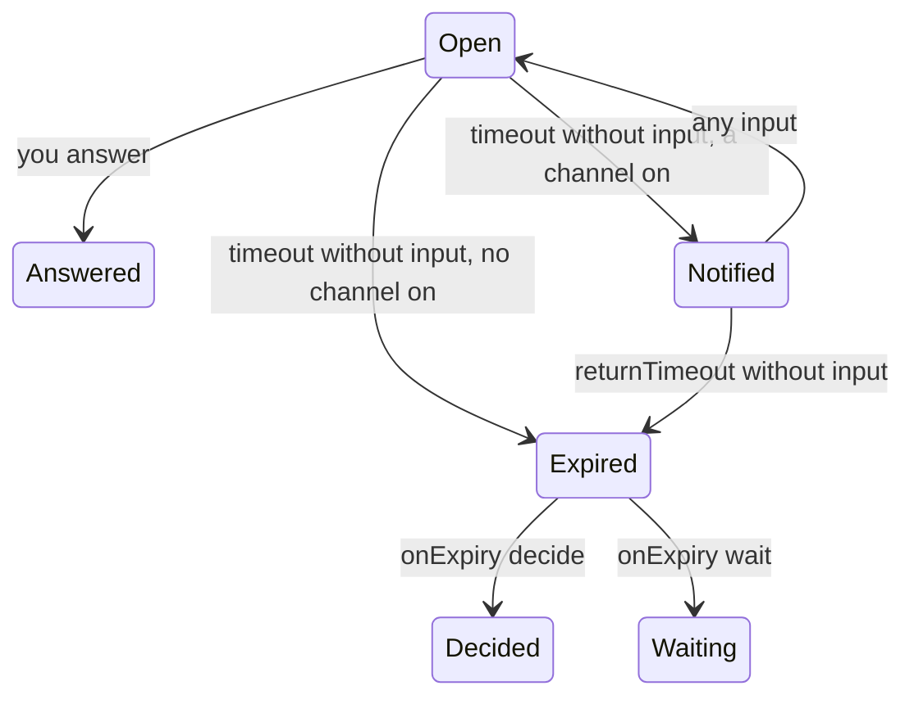

# omp-ask-more

English | [简体中文](README.zh-CN.md)

An OMP plugin that replaces the native `ask` tool and makes it the one place where the agent puts a decision to you. Every question comes with what exists now, what is being decided and what follows; every option with its tradeoff; and the answer page fills the screen — the alternate screen in a plain terminal, a sheet over the transcript in Tern. The answer reaches the model in the native shape, so tools that read the session work unchanged.

Status: **implemented, v0.1.0**, verified on omp 18.14.0 with Tern 0.9.6 ([verification](docs/verification.md)). How it is built: [design](docs/design.md).

## Why

The native `ask` is weak and models do not use it to say things plainly, so decisions get made in chat: skills that "grill" the user ask in prose because they cannot count on an ask tool. The native tool already has fields for richer questions — `question` is Markdown and every option has a free-form `preview` — but its prompt tells the model to keep labels short and never mentions `preview`, and its dialog sits in the composer, capped at four header rows and 70% of the terminal.

This plugin requires every question to carry where/what/how and every option its tradeoff, invites real file lines, quoted output, diagrams and demo animations, and draws the answer surface full screen. Its `xd://ask/routing` topic tells the model to put every question it needs the user to answer through `ask`, including the ones a skill tells it to ask in chat, and a skill the user invokes reaches the model with the same rule at its end; whether a model follows it depends on the model ([Known limitations](#known-limitations)).

## Demo videos

Three silent videos, recorded in a headless Tern 0.9.8 window with omp 18.14.0 and a real model, `opencode-go/deepseek-v4.1-flash`, working on a small orders service whose payment retry writes a row twice. The person's requests are typed as shown; every question, option, cited line range, diagram and demo on screen is the model's own output. Waits for the model are cut, and the caption says how long they took. Each caption names who acts: the person, the model or ask-more.

| Video | What it shows |
|---|---|
| [1. Before and after: one decision](#1-before-and-after-one-decision) | the same request to the same model, first with omp's native ask, then with ask-more; Where / What / How; the Tradeoff / Holds when / Cost card following the cursor; evidence read from disk; a Mermaid diagram; risks; a GIF demo on an option; Submit; the native result shape and the model going on |
| [2. Several decisions, then walk away](#2-several-decisions-then-walk-away) | three questions in one ask; tabs with `✓`; an own answer through `Other…`; switching tabs keeps answers; a frames demo on a question; Review with one question unanswered; the countdown line, the terminal notification and `(timed out: …)`; the model deciding the open question and saying what it chose |
| [3. Plain terminal](#3-plain-terminal) | the same request with omp's classic renderer (`PI_TUI_NATIVE=0`): the alternate-screen page, key hints, scrollbar, a frames demo with its counter, `PgDn`, `ctrl+o`, answering with `enter` |

Not shown: the plain-terminal half-block picture of a GIF or video, APNG/WebP/video demo files, `esc` / `Cancel all`, `onExpiry: wait`, the notify command, sessions without the TUI, `/tree` re-answer, observers and collaborator guests.

### 1. Before and after: one decision

https://github.com/user-attachments/assets/eb2ad931-fe61-475e-ab5b-6261b2c190a9

### 2. Several decisions, then walk away

https://github.com/user-attachments/assets/a8dcf3b9-61eb-4ce1-b477-7a7f1838de80

### 3. Plain terminal

https://github.com/user-attachments/assets/4b4f696c-136b-440b-a4d5-798a0f47e519

## Install

```sh
omp plugin install https://github.com/oh-my-omp/omp-ask-more
```

For local development, `omp plugin link /path/to/omp-ask-more`. Nothing needs configuring: the [timeout settings](#timeout-and-notifications) and the [readability check](#readability-check) have defaults. Keep the native `ask` enabled; sessions without the TUI hand the ask to it.

In Tern, also install the styles-only Tern plugin in `tern/`:

```sh
tern plugin install github.com/oh-my-omp/omp-ask-more/tern
```

or `tern plugin link /path/to/omp-ask-more/tern` while developing. Either one reloads Tern's plugins; no restart is needed. It gives the ask sheet the sans text face of omp's other overlays and, in the Console chat style, the gutter the question's `?` marker hangs in. Without it the sheet works and shows the brief in the terminal face.

## UI language

Ask-more runs on OMP, not Pi. Its UI labels and notifications resolve their language when text is generated:

1. `OMOMP_LANG`, trimmed and case-insensitive, if it is `en` or `zh`.
2. The first nonempty, trimmed value of `LC_ALL`, `LC_MESSAGES`, then `LANG`: a case-insensitive `zh` prefix means Chinese; anything else means English.
3. English.

Environment variables are read on each resolution. Text sent to the model stays English. The Tern companion is styles only and has no separate language setting.


## What you see

One page per question:

- the question, then **Where** (what exists now), **What** (what is being decided) and **How** (what follows from each answer), never folded;
- the options, the recommended one marked, then `Other…` for your own answer;
- under the focused option its **Tradeoff**, **Holds when** and **Cost**, and its demo if it has one;
- the question's demo, the **Evidence**, the Mermaid diagram and the risks. Evidence is of two kinds: lines of a file, which ask-more reads itself when the ask opens, so what you read is the file, not the model's copy of it; and text the model quotes from elsewhere (a command's output, a page, a log), headed by the source the model names and marked as not read by ask-more. A file that cannot be read shows its reason and does not block the ask. Each entry shows its first 10 lines in a plain terminal and 12 in Tern, the rest behind `ctrl+o` or Tern's `N more lines`; a line wider than the plain-terminal page ends in `… N more characters`;
- a countdown line when the ask times out ([Timeout and notifications](#timeout-and-notifications)).

Several independent questions come as one batch: a tab row (`✓` on answered questions) and a last **Review** page listing every answer and how many are unanswered. A cursor resting on an option is not an answer; switching tabs loses nothing.

In a plain terminal the page is on the alternate screen, with the title and tabs at the top, the key hints at the bottom and a scrolling body between. In Tern it is a modal sheet over the pane, styled by Tern's color themes and its Reader, Spine and Console chat styles; Tern scrolls it itself.

### Demos

A demo shows behaviour over time: on the question for how things behave now, on an option for the result of picking it (it restarts whenever the cursor moves onto that option, so moving between options compares them).

| Source | Tern | Plain terminal |
|---|---|---|
| frames the model writes | each frame as Markdown, with a `1/3` counter and `Previous` / `Pause` / `Next` | the same frames, stepped with the keys below |
| GIF, APNG, WebP | played by Tern at the file's own timing | a coarse 64 × 20-cell color picture, stepped like frames |
| mp4, mov, webm, mkv, m4v | converted to a GIF by ffmpeg and played | decoded like an animation |

The plain-terminal page and videos need `ffmpeg`/`ffprobe` on `PATH`; a missing tool, file or format becomes an error row with the reason, and the ask still opens.

### Keys and pointer

| Input | Question page | Review page |
|---|---|---|
| `↑` `↓` / row click | move the cursor (the row under it is not yet an answer) | scroll |
| `enter` / `dblclick` / `Next`, `Submit` | answer the row; one question submits, a batch moves to the next question and from the last one to Review | submit the batch |
| `o` / click `Other…` | open the Other field; `enter` saves a non-blank text as the answer, `esc` closes the field | — |
| `tab` `→` / `shift+tab` `←` / tab click | next / previous question (batch only) | same |
| `PgUp` `PgDn` `Home` `End` `Shift+↑↓` / wheel | scroll the page | same |
| `ctrl+o` | unfold every evidence entry of the page in the plain terminal; in Tern each entry has its own `N more lines` | — |
| `p` / `Pause`, `Play` | pause or play the page's demos | — |
| `[` `]` / `Previous`, `Next` | step the page's demos back or forward one frame | — |
| `esc` / `Cancel all` | cancel the whole call | same |

## Timeout and notifications

An open ask counts down while nobody touches it. These are native **plugin settings**, declared in `package.json` under `omp.settings`. Set global values in `/settings` → Plugins → `omp-ask-more` or with `omp plugin config set omp-ask-more <key> <value>`. Project values go in `.omp/plugin-overrides.json` and override global ones. Each ask reads and validates one snapshot when it opens; a change applies from the next ask. Timeout values must be whole seconds from 0 to 2147483.

| Setting | Default | Meaning |
|---|---|---|
| `timeout` | `1800` | seconds without input before the first step; `0` turns timing off |
| `notify.terminal` | `true` | at that step, a terminal notification (OSC 99, OSC 9 or BEL, whichever the terminal takes) |
| `notify.command` | unset | at that step, a shell command run as `sh -c`; `OMP_ASK_MORE_NOTIFY_COMMAND` takes precedence, even when empty (which disables the command). A project command differing from the trusted global baseline is ignored with a warning |
| `returnTimeout` | `1200` | seconds after the notification for you to come back |
| `onExpiry` | `decide` | when the last countdown ends: `decide` hands the unanswered questions to the model, `wait` keeps the ask open |

For example, a project `.omp/plugin-overrides.json` can shorten the countdown without providing a shell command:

```json
{
  "settings": {
    "omp-ask-more": {
      "timeout": 60,
      "returnTimeout": 30,
      "notify.terminal": true,
      "onExpiry": "decide"
    }
  }
}
```



- Any key, click, wheel notch on the plain-terminal page, or typing in the Other field starts the first countdown over. Coming back after a notification does too, so a later idle stretch notifies again.
- With both channels off, the first countdown ends the ask (`decide`), or nothing happens (`wait`).
- When the model takes over, the answers you gave stand and each unanswered question reaches it as `(timed out: …)`; the model decides those itself, says what it chose, and the turn goes on. Text left unsaved in the Other field is not an answer.
- The countdown line changes only at these steps: `No input for 30 min: you get notified, and 20 min later the model decides`, then `Notified at 14:03; the model decides at 14:23 unless you act`.
- A notification carries no question text, evidence or answers. The terminal one reads `omp: <title>: waiting for your answer; the model decides at 14:23`.
- The command runs in the session's working directory with its own environment plus:

  | Variable | Value |
  |---|---|
  | `OMP_ASK_MORE_EVENT` | `timeout` |
  | `OMP_ASK_MORE_TITLE` | the sheet title: the question's chip, or "N decisions" |
  | `OMP_ASK_MORE_BODY` | the terminal notification's text |
  | `OMP_ASK_MORE_QUESTIONS` | the number of questions |
  | `OMP_ASK_MORE_CWD` | the working directory |
  | `OMP_ASK_MORE_DUE` | when the model takes over (ISO 8601), empty with `wait` |

  Its output is ignored and it is killed after 30 seconds. A non-zero exit, a kill or a failed start shows a warning naming only the outcome, since the command may carry a token; nothing is retried, and a failure never changes the ask.
- Keep secrets in the environment the command reads, not in its text. For example, with `NTFY_TOPIC` exported by whoever starts omp:

  ```sh
  omp plugin config set omp-ask-more notify.command 'curl -fsS -d "$OMP_ASK_MORE_BODY" "https://ntfy.sh/$NTFY_TOPIC"'
  ```

- A project override may not introduce a command: a cloned repository's `.omp/plugin-overrides.json` could otherwise run a program on your machine and choose where your notifications go. Set it globally through the plugin settings UI/CLI, or use the trusted environment variable. A project value identical to the trusted global baseline is allowed because it runs only the command you already chose. Machine-admin root-level overrides are included in that baseline. Other project timeout settings still apply when a project command is refused.
- The native `ask.timeout` and `ask.notify` are not used here: they belong to the native dialog, where `ask.timeout` picks the recommended option for you.

## What the model sends and gets

The parameters are the native ones, without `multi`, plus extension fields:

| Kept from the native `ask` | Added |
|---|---|
| tool name `ask`; `questions[]` with `id`, `question`, `header?`, `options[{label, description?, preview?}]`, `recommended?` | per question `brief {where, what, how, evidence?, diagram?, demo?, risks?}`; per option `tradeoff`, `holds_when?`, `cost?`, `demo?` |

The tool is registered for strict tool calling, so the provider holds the model's arguments to the schema. The shapes are written for it: a demo is one of two kinds, `{kind: "frames", frames, interval_ms?}` or `{kind: "file", path}`, and so is an evidence entry, `{kind: "file", path, start?, end?}`, whose lines are numbers, never text, or `{kind: "text", source, text, lang?}`. In strict mode the model fills every optional field it does not use with `null`, which omp removes before the call is checked.

The tool description contains the purpose and pointers to body-only topics served by `docTopics()`: `xd://ask/routing` (questions and skill/workflow mapping), `xd://ask/rounds` (dialog behavior, batching and retries), and `xd://ask/results` (answer variants). Together they explain:

- `ask` opens a full-screen dialog, one tab per question with its brief and options, and blocks until the user answers. The cursor starts on the `recommended` option, so Enter accepts the recommendation, the same as answering "yes". The answers come back as the tool result and the model goes on in the same turn.
- The model MUST put every question whose answer it needs from the user through `ask`: a decision, a preference, the scope, a fact only the user knows, a confirmation before a risky or irreversible step. It NEVER writes such questions in its reply or ends a turn on one.
- This holds when a skill, workflow or other instruction tells it to ask, interview, confirm or let the user choose, including when the instruction says to ask in chat or prescribes how the questions look in the reply: such instructions assume there is no dialog, and with `ask` available, calling it is how the model follows them. The routing topic maps the parts of such a question onto `ask` in general terms (number or title → `header`, background and analysis → `brief`, choices and the recommendation → `options` with `recommended`, waiting for the answers → the call itself); everything else the instruction requires still applies.
- It does not ask for facts its tools can find or for choices that are its own to make.
- It writes for someone who has not read the session; the independent questions of a round go in one call, or one per call when the instruction asks one at a time, and a question whose options depend on an answer goes in a later call; a rejected call lists every problem, and the model fixes them and calls again.
- How to read the result, and that a question reading `id: (timed out: …)` is the model's to decide, saying what it chose.

When the user invokes a skill (`/skill:<name>`) while `ask` is active, the copy of the skill message sent to the model ends, after the skill and the user's words, with one more paragraph: "[IMPORTANT: Any question, confirmation or choice the skill above puts to the user MUST go through the `ask` tool, NEVER into your reply, even where the skill says to ask in chat or shows how the questions look in your reply. Keep their content, order and recommendations.]" omp renders that message from a fixed template, so the paragraph is added in omp's `context` event, on the way to the model: the session file, `/tree` and exported transcripts show the skill message without it. Skills a subagent loads on its own are left as they are.

What each field means is in the parameter schema. The limits below are not in the description: a call that breaks one is rejected with a message naming it, and a demo file the page cannot play shows an error row there instead.

`question` stays a question: one or two sentences. The brief is its own field.

```
ask({
  questions: [{
    id: "retry-strategy",
    header: "重试策略",
    question: "重试应该怎么做？",
    recommended: 0,
    brief: {
      where: "retry() 与 3 处调用点，429 后上游出现重复写入。",
      what: "选择失败后的重试策略，决定是否引入幂等键。",
      how: "选 A 要加迁移；选 B 只改 retry() 内部，不动调用方。",
      evidence: [
        { kind: "file", path: "src/retry.ts", start: 41, end: 58, note: "现有重试只有 1 次" },
        { kind: "file", path: "src/order/paid.ts", start: 88, end: 96 },
        { kind: "text", source: "server.log, 2026-10-30 14:02", text: "POST /orders 429\nPOST /orders 200\nPOST /orders 200", note: "同一笔订单写了两次" }
      ],
      diagram: "flowchart LR\n  client --> retry --> write",
      demo: {
        kind: "frames",
        frames: [
          { body: "`write #1` → 429", caption: "第一次写入被限流" },
          { body: "`write #1` → 200 · `write #1` → 200", caption: "重试后同一笔写了两次" }
        ],
        interval_ms: 1500
      },
      risks: ["迁移期间双写"]
    },
    options: [
      { label: "指数退避 + 幂等键",
        description: "需要 1 表 2 字段",
        tradeoff: "重试安全，代价是迁移",
        holds_when: "下游能给出稳定请求键",
        cost: "1 张表、2 个字段，可回滚",
        demo: { kind: "file", path: "docs/retry-idempotent.gif", caption: "第二次写入被幂等键拦下" } },
      { label: "固定 3 次重试", description: "改动最小",
        tradeoff: "不动 schema，但重复写会继续发生",
        cost: "只改 retry() 内部" }
    ]
  }, {
    id: "log-level",
    header: "日志级别",
    question: "默认日志级别用哪一档？",
    brief: { where: "…", what: "…", how: "…" },
    options: [ /* … */ ]
  }]
})
```

Limits: 2–5 options per question; no `multi`. Evidence has no count or length limit: a file entry's window is read up to its `end` and no further, so a few lines of a large file cost no more than a small file; `start` alone is one line, neither shows the file's first 40, and lines that are not adjacent are separate entries. A text entry's `source` is one line. Demos: 2–12 frames at 300–5000 ms each (default 1200); files up to 16 MB, of which the first 15 seconds play. A call that breaks a rule is rejected with every problem listed before anything opens, and the model calls again.

The result is the native one: `User answers:` and one line per question, in the order asked:

| Line | Meaning |
|---|---|
| `id: label` | you picked that option |
| `id: "text"` | you wrote your own answer |
| `id: (cancelled)` | left unanswered when you submitted from Review, or every question after `esc` / `Cancel all`, which also ends the turn |
| `id: (timed out: …)` | left unanswered when the ask timed out; the model decides it and the turn goes on |

One ask is open at a time; a second call is rejected instead of opening a second sheet.

## Readability check

Before you see an ask, OMP's `judge` role checks each question on its own, exactly as its page (or, without the TUI, the native dialog) will show it, for a software engineer who sees only that dialog and has never seen the project's tracker, documents or code or the agent's work. It answers yes/no questions about every sentence (does it say who or what acts; does it mention a test, review round, result, set of items or earlier decision only by a name or number; does it hold a word, abbreviation, name or number that reader could not explain) and about every code or abbreviation found in the text, such as `F106`, `#243`, `§3`, a commit hash or `VM110` (would an engineer who never worked on the project know it; could that reader say what it is from the dialog alone).

One failing sentence or one code that is neither common knowledge nor explained rejects the whole call before anything opens; a wrongly rejected ask costs one rewrite, a missed one costs your decision. The rejection quotes each failing sentence with the reason and lists each failing code, and tells the model to write sentences that say who does what, spell out abbreviations and say in plain words what each name, number or earlier decision is; on the native dialog it adds that the brief and tradeoffs are not shown there. The model rewrites and calls again; that second call goes through without being judged, so one rejection is the most a session pays for, and a judge that rejects clear text cannot keep the ask from you. The call after that is judged again.

The judge is OMP's `judge` role chain, resolved the way OMP resolves it for its own judgments: the models of `modelRoles.judge` and its fallbacks, then, only when that chain holds no native judgment model, the session model as OMP's fallback. Every sentence and code is one request, at most sixteen at a time, billed to the session as `ask-readability`. The questions were chosen on `typesafe/jev-1.14.0`; on 44 recorded asks it rejected all of them, among them the PR #265 ask on 18 sentences and 5 codes, and passed a rewrite of that ask with a subject in every sentence ([verification](docs/verification.md#readability-check)). `futureppo-jev/decision-model-preview` answered the same questions wrongly against the text. Set `retry.fallbackChains.judge: []` in the omp config so a failing judge fails visibly instead of passing to another model.

| Setting | Default | Meaning |
|---|---|---|
| `readability.judge` | `true` | run the check whenever the judge chain resolves a model; `false` never calls one |

It is a native plugin setting like the [timeout settings](#timeout-and-notifications), read when each ask is called. A judge that fails or does not answer within 30 seconds lets the ask through with a warning, and so does an invalid setting; aborting the turn while the check runs cancels the ask.

## Sessions without the TUI

When the session has no UI or is not in TUI mode, ask-more hands every question's native fields to the native `ask`, which renders them in its own dialog with its own `ask.timeout` and `ask.notify`; the [readability check](#readability-check) reads those native fields only. Without a native ask to hand to — print mode, for instance — the model gets a rejection instead of a hang. If the full-screen surface fails while opening, a warning shows and the native dialog takes the whole batch.

## Observers

Answers in `ask` are tool results, not user messages, so tools that read the session have to look for them. The companion changes that do:

- [omp-config](https://github.com/oh-my-omp/omp-config) `turn-judge` puts `用户在ask中回答` (one `question → answer` line per answered question) into the judge's timeline, and its `gpt-talk-only` rule counts those answers as the user speaking: confirming a decision is a proper end when deciding was all the user asked for, while restating a picked approach without doing the work is still caught.
- omp-config `user-prompt-inject` renders `{{ask_answers}}`, so `mentor:default` and `discuss:*` see the decisions the user made in `ask` next to the typed requests.
- [omp-todo-more](https://github.com/oh-my-omp/omp-todo-more) leaves time spent waiting on the user in `ask` out of in-progress time, so a long discussion does not raise an overtime warning, and runs no deadline while an ask is open.

They read the native result shape, so they work the same with the native `ask`.

## Known limitations

- **A skill that prescribes chat questions can still win on some models.** With the `grilling` skill invoked as `/skill:grilling`, `opencode-go/kimi-k2.7-code` put its first round into `ask` in 15 of 15 runs with the rule appended to the invoked skill, against 11 of 15 with the same code without it, eleven different requests across the runs. With the tool description alone, before the rule was added, `opencode-go/deepseek-v4.1-flash` (9 of 9 runs), `qwen3.8-flash` and `glm-5.3-flash` and the `openai-codex` models `gpt-5.6-luna`, `gpt-6-luna` and `gpt-6.1-terra` put their first round into `ask`, and `opencode-go/minimax-m3.1-flash` wrote the round in its reply and then put the same questions into `ask`. Without this plugin deepseek and kimi asked in chat, native `ask` included. Runs, transcripts, the earlier descriptions and the changes tried: [verification](docs/verification.md#a-skill-that-asks-in-chat).
- **The readability check has no measured precision.** The questions were chosen on `typesafe/jev-1.14.0` against 44 recorded asks, 16 of them labelled by the agent itself and none by a person; the check rejected every one, including the 10 labelled readable, and it passes 28 of 575 sentences that were read only in the eval output, some doubtful. A rewrite of the PR #265 ask passed. It was not run through `resolveJudge` inside a session, and the sentence and code questions have not been measured on any other judge model.
- **`/tree` re-answer** reopens an extended ask in the native dialog, with the native fields only.
- **Collaborator guests** cannot answer while the ask-more sheet is open.
- **Print and RPC without a native ask** get a rejection; the native tool would abort the operation instead.
- **The timeout runs in plan mode too**; the native ask turns its own timeout off there. No `multi`, no notes.
- **The transcript card shows a timed-out question as `Cancelled`**: every `ask` result is drawn by the native renderer, which has no state for "unanswered, left to the model". The model reads `(timed out: …)`.
- **In sessions without the TUI** the native `ask.timeout` and `ask.notify` apply and this plugin's timeout settings do nothing.
- **A terminal notification shows only where the terminal turns OSC 99, OSC 9 or BEL into one**; the notify command needs a POSIX `sh`.
- **Plain-terminal demos are coarse.** A file plays at 64 × 20 cells, two pixels per cell: motion reads, small text inside a recording does not, so the caption says what to watch. Each frame rewrites up to 20 rows of 24-bit color (about 16–17 KB for a busy picture), noticeable over a slow SSH link. The picture's width is fixed when the ask opens and does not follow a resize.
- **Quoted text evidence is unchecked.** ask-more draws it as the model wrote it, under the source the model names; only file evidence is read by ask-more itself.
- **Evidence has no size bound, and Tern gets all of it at once.** The sheet carries every cited line when it opens, folded or not: 211 KB for one 3,000-line entry and 1.24 MB for six, which a headless Tern 0.9.8 opened with no frame over 17 ms; a real window or a remote link was not measured. Tern shows about 4,000 characters of one line, then its own `… N more characters`; scrolling a long line sideways moves the line numbers out of view too.
- **Without the Tern stylesheet plugin** the sheet shows the brief in the terminal face under Reader and Spine, and in Console the question's `?` marker sits on the sheet's left edge.
- The model reads this plugin's tool description, not the native `ask` prompt; an extension that rewrites the ask prompt must target the final description.
