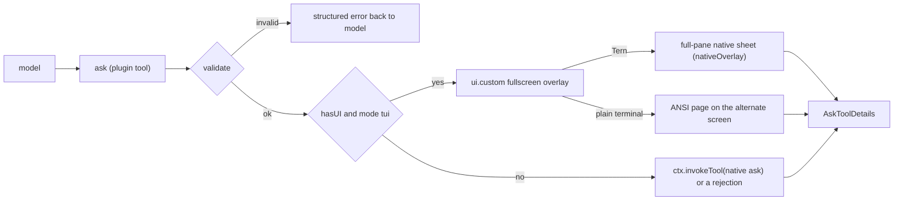

# omp-ask-more

English | [简体中文](README.zh-CN.md)

An OMP plugin that shadows the native `ask` tool and makes it the one place where the agent puts a decision to the user. Its parameters are the native ones **plus** extension fields: the native component renders the native part and ignores the rest; the ask-more component renders both. The answer shape, the result renderer and the persisted-call contract stay native.

Status: **implemented, v0.1.0**. Verified on omp 18.13.3 with Tern 0.9.6: unit tests, the ANSI page and the Tern sheet end to end (one question, a batch of three, and demos from frames, a GIF and an mp4), and the no-UI path. See [Verification](#verification).

## Why

The native `ask` is weak and models do not use it to say things plainly, so decisions get made in chat: skills that "grill" the user ask in prose because they cannot count on an ask tool. Native `ask` already has fields for richer questions — `question` is Markdown (Tern: an `md` node, `packages/tui/src/overlays/ask-dialog.ts:884`; TUI: Markdown with fenced-code highlighting, `:298-311`) and every option has a free-form `preview` (`:939`, `:501-503`) — but two things stop them from being used:

1. The model is told not to. The native tool prompt is seven lines and says "short labels, tradeoffs in `description`" (`packages/coding-agent/src/prompts/tools/ask.md:1-7`); `preview` is never mentioned.
2. The surface is small. The dialog is mounted in the composer container (`packages/coding-agent/src/modes/controllers/extension-ui-controller.ts:887-905`), capped at four header rows and 70% of the terminal (`packages/tui/src/overlays/ask-dialog.ts:116-123`), and in Tern it describes as `omp.editor.ask` — a dock `col` with the `md` question, a `list` of options, and exactly one option's `preview` (`:762-940`).

This plugin requires every question to carry where/what/how and every option its tradeoff, invites real code lines, diagrams and demo animations, and draws the answer surface full screen. Its tool description routes every user decision through `ask`, so nothing needs deciding in chat; the observers that read the session ([Observers](#observers)) treat the answers as the user speaking.

## Install

```sh
omp plugin install https://github.com/oh-my-omp/omp-ask-more
```

For local development, `omp plugin link /path/to/omp-ask-more`. The plugin entry is the package-root `index.ts`, declared by `omp.extensions` in `package.json`; no config section is needed, and the native `ask` must stay enabled so the no-UI path can delegate to it.

## Parameters

The schema is the native one extended the way `omp-todo-more` extends `todo`:

| Kept | Added |
|---|---|
| Tool name `ask`; `questions[]` with `id`, `question`, `header?`, `options[{label, description?, preview?}]`, `multi?`, `recommended?` (`packages/coding-agent/src/tools/ask.ts:52-88`) | per question `brief {where, what, how, evidence?, diagram?, demo?, risks?}`; per option `tradeoff`, `holds_when?`, `cost?`, `demo?` |

`arktype` keeps undeclared keys, so a persisted extended call still passes `recoverAskQuestions` (`ask.ts:94-109`) and `/tree` re-answer reopens it; the native dialog there renders the native fields only.

## The contract

The tool description (`src/description.ts`) tells the model:

- `ask` is the only way to put a decision to the user — an approach, a tradeoff, a preference, the scope, a risky or irreversible step. Ending a turn on a question or a list of options in text is wrong.
- When a skill, workflow or other instruction says to ask the user, confirm with them or let them pick, it does so with `ask`; everything else that instruction requires still applies.
- It does not ask for facts its tools can find or for choices that are its own to make.
- It writes for someone who has not read the session: plain words, short sentences, concrete names.
- It cites the real code lines a decision is about and draws a Mermaid diagram whenever a flow, sequence, states, dependencies or a structure is involved. Both stay optional in the schema.
- It shows a demo whenever the decision is about behaviour over time — a UI interaction, the states a request goes through, before and after a change: on the question for how things behave now, on an option for the result of picking it. A demo is frames it writes, or an animation or video file, which may be a recording it made for this ask.
- Independent decisions go in one call, one question each; a decision whose options depend on another answer goes in a later call.

`question` stays a question: one or two sentences. The brief is its own field.

```
ask({
  questions: [{
    id: "retry-strategy",
    header: "重试策略",
    question: "重试应该怎么做？",
    recommended: 0,
    brief: {
      where: "retry() 与 3 处调用点，429 后上游出现重复写入。",
      what: "选择失败后的重试策略，决定是否引入幂等键。",
      how: "选 A 要加迁移；选 B 只改 retry() 内部，不动调用方。",
      evidence: [
        { path: "src/retry.ts", lines: "41-58", note: "现有重试只有 1 次" },
        { path: "src/order/paid.ts", lines: "88-96" }
      ],
      diagram: "flowchart LR\n  client --> retry --> write",
      demo: {
        frames: [
          { body: "`write #1` → 429", caption: "第一次写入被限流" },
          { body: "`write #1` → 200 · `write #1` → 200", caption: "重试后同一笔写了两次" }
        ],
        interval_ms: 1500
      },
      risks: ["迁移期间双写"]
    },
    options: [
      { label: "指数退避 + 幂等键",
        description: "需要 1 表 2 字段",
        tradeoff: "重试安全，代价是迁移",
        holds_when: "下游能给出稳定请求键",
        cost: "1 张表、2 个字段，可回滚",
        demo: { path: "docs/retry-idempotent.gif", caption: "第二次写入被幂等键拦下" } },
      { label: "固定 3 次重试", description: "改动最小",
        tradeoff: "不动 schema，但重复写会继续发生",
        cost: "只改 retry() 内部" }
    ]
  }, {
    id: "log-level",
    header: "日志级别",
    question: "默认日志级别用哪一档？",
    brief: { where: "…", what: "…", how: "…" },
    options: [ /* … */ ]
  }]
})
```

- `brief.where/what/how` are drawn above the options and never collapsed.
- `evidence[].path` with optional `lines` is resolved against the session's working directory and read when the ask opens, so the page shows the real lines (in Tern a `code` node with `path` and `start`, `packages/wire/src/tsp.ts:222-236`) instead of model-typed code. An unreadable reference is drawn in an error tone with the reason and never blocks the ask.
- `diagram` is Mermaid source: the `md` node draws it natively in Tern, and the TUI Markdown renderer draws it as ASCII (`packages/tui/src/theme/mermaid-cache.ts:66,100`).
- `tradeoff` / `holds_when` / `cost` are one line each and are drawn under the focused option.
- `demo` gives exactly one source. `frames[{body, caption?}]` with `interval_ms` are Markdown frames the sheet steps through in a loop (text, a ` ```mermaid ` diagram, a fenced text drawing), every frame padded to the tallest so nothing below moves. `path` names an animation (GIF, APNG, WebP) or a video (mp4, mov, webm, mkv, m4v), resolved against the session's working directory like evidence. A question's demo sits under the decision; an option's demo sits in its tradeoff card and restarts whenever the cursor moves onto that option, so moving between options compares them. `caption` says what to watch.

Limits: 2–5 options per question, at most 6 evidence references per question, at most 80 lines per reference, no `multi`. Demos: 2–12 frames at 300–5000 ms each (default 1200); files up to 16 MB, of which the first 15 seconds play.

## Validation

Validation runs at the tool boundary, before any UI opens, checks every question, returns every problem at once, and never degrades into a thinner ask.

| Rule | Rejection |
|---|---|
| at least one question | `questions: empty` |
| ids non-empty and unique in the call | `questions[i].id: duplicate "<id>"` |
| `brief.where/what/how` non-empty | `questions[i].brief.<field>: empty` |
| every option has a non-empty `tradeoff` | `questions[i].options[j].tradeoff: empty` |
| ≥ 2 options | a decision needs at least two options |
| labels unique within a question and not reserved (`Other (type your own)`, `Chat about this`, `Next →`) | named per option |
| `multi` unset | not supported; split it into separate questions |
| `recommended` is an index into the options | names the bad value |
| ≤ 6 evidence references; `lines` is `N` or `N-M` and spans ≤ 80 lines | names the reference and the span |
| a demo gives exactly one of `frames` and `path` | `….demo: give exactly one of frames (an animation you write) or path (an animation or video file)` |
| 2–12 frames, none blank; `interval_ms` a whole number from 300 to 5000, and only with `frames` | names the count, the frame or the interval |
| `path` ends in `.gif`, `.png`, `.apng`, `.webp`, `.mp4`, `.mov`, `.webm`, `.mkv` or `.m4v` | names the path and the accepted extensions |

## Surfaces



One pi-tui component (`src/component.ts`) is mounted with `ui.custom(factory, { overlay: true, overlayOptions: { fullscreen: true, width: "100%", maxHeight: "100%", margin: 0 } })` (`extension-ui-controller.ts:1283-1369`). Per-question state (`src/state.ts`) holds the cursor, the answer (a cursor resting on an option is not an answer), the Other field, evidence folding, scrolling and demo playback, so switching questions loses nothing. The component holds the overlay focus and hands keys to an open Other field itself.

**ANSI.** `fullscreen` puts the page on the alternate screen. The title and, for a batch, a tab row (`✓` on answered questions, then `Review`) stay at the top; the key hints stay at the bottom; the body between them is a pi-tui `ScrollView` sized from the live terminal height, with a scrollbar, scrolled by `PgUp`/`PgDn`/`Home`/`End`/`Shift+↑↓` and the mouse wheel, and pulled to the focused option when `↑↓` moves it.

**Tern.** The component declares `nativeOverlay` (`role: "omp.overlay.askMore"`, `size: "full"`, `head`: the question's `header`, or "N decisions" for a batch), so the backend wraps it in one opaque sheet filling the pane (`packages/tui/src/native/backend.ts:873-900`), and `describe()` returns the content: a `tabs` node for a batch (positional ids, `✓` on answered questions, `Review` last; click switches), the question and Where/What/How, then the decision — the options as a list keyed `qN` per question (`click` selects, `dblclick` answers, `Other…` is the last row), the focused option's tradeoff card, the Other field and the action bar (`Cancel all`, and `Next` / `Submit` / `Save answer`) — then the evidence `code` nodes (folded to 12 lines behind Tern's own "more lines" control), the Mermaid `md` and the risks. Tern scrolls a sheet body as one column and brings a list's selection into view against the body's bottom edge, so the action bar sits right after the decision and reveals itself when a page opens: after a long brief the whole decision is in view. Keyboard scrolling reaches Tern as `scroll` requests on the body.

**Demos.** Files are loaded with the evidence, before the surface opens, for the surface in use (`src/demo.ts`):

| Source | Tern | ANSI page |
|---|---|---|
| `frames` | an `md` node per frame plus the frame's caption, a `1/3` counter and `Previous` / `Pause` / `Next` buttons; the component steps the frame and Tern receives only the changed text | the frame's Markdown rows in a slot as tall as the tallest frame, with the counter and the key hints under it |
| GIF, APNG, WebP | the file's bytes as an `image` node (a content-addressed blob, sent once); Tern plays the animation itself at the file's own timing, so there are no buttons | decoded by ffmpeg to 10 frames per second, at most 64 × 20 cells, and drawn as `▀` half-blocks in 24-bit color (upper pixel as foreground, lower as background); stepped like frames |
| mp4, mov, webm, mkv, m4v | converted by ffmpeg to a GIF (12 frames per second, at most 720 px wide, a palette per frame) and shown as an image; every container goes through the same ffmpeg call, of which mp4 was exercised | decoded like an animation |

One timer, scheduled on the TUI's render clock, steps the playing demos of the open page, each at its own interval; it runs only while that page is open, the Other field is closed and something plays, and it stops when the ask closes. ffmpeg and ffprobe run without a shell, under a 20-second timeout, killed on abort, and stop as soon as their output passes its bound (the decoded frames, or 16 MB for a converted GIF). A file that is missing, unreadable, not an image the sheet can play, too large, or needs ffmpeg that is not on `PATH` becomes an error row with the reason; the ask still opens.

**Keys and pointer.**

| Input | Question page | Review page |
|---|---|---|
| `↑` `↓` / row click | move the cursor (the row under it is not yet an answer) | scroll |
| `enter` / `dblclick` / `Next`, `Submit` | answer the row; one question submits, a batch moves to the next question and from the last one to Review | submit the batch |
| `o` / click `Other…` | open the Other field; `enter` saves a non-blank text as the answer, `esc` closes the field | — |
| `tab` `→` / `shift+tab` `←` / tab click | next / previous question (batch only) | same |
| `ctrl+o` | unfold evidence lines in the ANSI page | — |
| `p` / `Pause`, `Play` | pause or play the page's demos | — |
| `[` `]` / `Previous`, `Next` | step the page's demos back or forward one frame | — |
| `esc` / `Cancel all` | cancel the whole call | same |

The Other field is a pi-tui `Input`, one per question: its value is the only copy of the text, edited by the keys the component forwards and, in Tern, by the terminal's own edit/undo events (the field is a child component, so the reconciler routes them to it).

When `ctx.hasUI` is false or the mode is not `tui`, the tool calls `ctx.invokeTool` with the native subset of every question (`src/schema.ts#nativeQuestion`), so the native dialog renders the native fields; without a native resolver — print mode, for instance — it returns a structured rejection instead of hanging.

## Answer and lifecycle

| Concern | Behavior |
|---|---|
| Answer | native `AskToolDetails`: `results[{id, question, options, multi, selectedOptions, customInput}]`, one entry per question in input order; text `User answers:` then `id: label`, `id: "own text"` or `id: (cancelled)` per line, matching the native multi-question wording. Rendered by `askToolRenderer` because renderers are keyed by tool name (`packages/tui/src/tools/index.ts:37`) |
| Unanswered questions | the Review page lists them; submitting still sends the rest, an unanswered question reads `id: (cancelled)` (as in the native dialog) |
| Cancel (`esc`, `Cancel all`, abort signal) | `ctx.abort()`, then every question as `(cancelled)`; nothing already answered is submitted |
| Concurrent asks | one in flight; a second call is rejected instead of opening a second sheet |
| Timeout | none; the native auto-select reads session settings an extension cannot reach (`ask.ts:742-745`) |
| Approval | `approval: "read"`, matching `ask.ts:544-551` |
| Failure inside the surface | `ui.notify` warning, then delegation of the whole batch to the native dialog |
| Demo playback | starts when its page opens; an option's demo restarts when the cursor moves onto that option; nothing plays while the Other field is open; no timer outlives the ask |

## Observers

Answers in `ask` are tool results, not user messages, so tools that read the session have to look for them. The companion changes that do:

- [omp-config](https://github.com/oh-my-omp/omp-config) `turn-judge` puts `用户在ask中回答` (one `question → answer` line per answered question) into the judge's timeline, and its `gpt-talk-only` rule counts those answers as the user speaking: confirming a decision is a proper end when deciding was all the user asked for, while restating a picked approach without doing the work is still caught.
- omp-config `user-prompt-inject` renders `{{ask_answers}}`, so `mentor:default` and `discuss:*` see the decisions the user made in `ask` next to the typed requests.
- [omp-todo-more](https://github.com/oh-my-omp/omp-todo-more) leaves time spent waiting on the user in `ask` out of in-progress time, so a long discussion does not raise an overtime warning, and runs no deadline while an ask is open.

Both read the native result shape, so they work the same with the native `ask`.

## Known limitations

- **`/tree` re-answer** runs `new AskTool()` directly (`packages/coding-agent/src/modes/controllers/selector-controller.ts:1723-1748`). The extended arguments survive its schema check, so the ask reopens — in the native dock, with the native fields only.
- **Collaborator guests** answer through the native mirroring channel (`extension-ui-controller.ts:923-1025`), which has no representation for a `ui.custom` surface: while the ask-more sheet is open, a guest cannot answer.
- **Print and RPC without a native resolver** get a structured rejection; the native tool would abort the operation instead.
- **No plan-mode timeout auto-select**, no `multi`, no notes.
- **ANSI demos are coarse.** A file plays at 64 × 20 cells, two pixels per cell: motion reads, small text inside a recording does not, so the caption has to say what to watch. Each frame rewrites up to 20 rows of 24-bit color (about 16–17 KB per frame for a busy picture), which is noticeable over a slow SSH link. The raster width is fixed when the ask opens and is not redrawn on resize.
- **Files need ffmpeg for the ANSI page and for videos.** Without `ffmpeg`/`ffprobe` on `PATH` such a demo is an error row; a GIF, APNG or WebP in Tern needs neither.
- The tool is registered under the native name: the model reads this plugin's description, not `prompts/tools/ask.md`. Extensions that rewrite ask's prompt must target the final description.

## Files

```
index.ts           plugin entry: registers ask, validates, mounts the fullscreen overlay, delegates
src/schema.ts      native fields + brief/tradeoff, zod parameters, per-question validation
src/brief.ts       path:lines resolution against the working directory, bounded reads
src/demo.ts        demo specs, file loading and ffmpeg decoding per surface, half-block rows
src/state.ts       per-question state (cursor, answer, Other field, folding, scroll, demo playback) and the active tab
src/component.ts   one component: the ANSI page (render) and the Tern content (describe), keys and events
src/nodes.ts       the Tern content: tabs, brief blocks, options list, tradeoff card, actions, review page
src/result.ts      Answer variants, AskToolDetails construction, cancelled and rejected results
src/i18n.ts        UI labels from OMOMP_LANG / LC_*; protocol fields stay English
src/description.ts the model-facing tool description
test/              validation, native projection, demo loading and half-block tests (bun test)
```

## Verification

Executed on 2026-10-29 with omp 18.13.3, Tern 0.9.6, `opencode-go/deepseek-v4.1-flash`.

| Check | Command | Observed |
|---|---|---|
| Types | `bun run check` | `tsc --noEmit` clean |
| Unit | `bun test` | 24 pass, 0 fail: every rejection message, per-question indices and duplicate ids, evidence bounds, demo source and bounds rules, `nativeQuestion` projection, half-block colors, raster sizing, demo loading of a missing file, a fake image, a real GIF and default frame timing |
| ANSI, batch | `omp --no-extensions -e …/index.ts` in a 130×40 PTY, a prompt asking for three independent questions | the alternate-screen page drew the title, the tab row `重试上限 日志级别 缓存 汇总`, a scrollbar and the hints; `enter` answered question 1 (`✓ 重试上限`) and opened question 2; `o`, `warn`, `enter` answered it; `PgDn` scrolled question 3; `tab` opened the review listing both answers and `1 题未回答`; `enter` returned `retry-limit: 固定 3 次，指数退避`, `log-level: "warn"`, `cache: (cancelled)` |
| ANSI, one question | same session | no tab row; `↓`, `enter` submitted at once: `cap: 3 次` |
| Tern, batch | headless `tern serve --control …`, omp run in its pane with `PI_TUI_TSP_RECORD`; `ctl shot`, `tree`, `click`, `dblclick`, `key`, `type` | one `sf-overlay sz-full at-center modal` sheet titled `3 decisions` with a `tabs` row; a row click sent `select … q0/option:2` and switched the tradeoff card; `Next` answered and opened the next tab; a tab click returned to question 2 with its answer kept; `Other…` opened a focused `sf-input`, typed text reached it and `Save answer` answered and advanced; `tab` opened Review; `enter` returned `retry-limit: 10 次(长退避)`, `log-level: "warn and above"`, `cache: 定时过期(TTL 固定)` and the sheet left `layer`. With `OMOMP_LANG=zh` the review rows and the tradeoff rows read label then value without overlap, `esc` returned all three as `(cancelled)` |
| Tern, long brief | same, one question whose Where/What/How run past a screen | the sheet opened with the options, the tradeoff and `Cancel all` / `Submit` in view; after `↓↓` the selected row (y 659) and the bar (y 852–886) stayed inside the body (100–886); `enter` returned `cache-invalidation: 生存时间被动过期` |
| No-UI path | `omp -p … "调用一次 ask 工具，一次问两个问题…"` | `ask rejected: … no native ask is available to delegate to here`, after the payload passed validation |
| Demo loading | a script calling `loadDemo` on a 3 s GIF and a 4 s mp4 (ffmpeg `testsrc2`) for both surfaces, then the error paths | Tern: the GIF as its own 246280 bytes; the mp4 converted to a 2621279-byte GIF in 672 ms. ANSI: 64 × 18 cells, 30 and 40 frames at 100 ms. A missing file, a text file named `.gif`, an abort mid-decode and `PATH` without ffmpeg each gave an error row (`文件不存在`, `不是 GIF、PNG 或 WebP 图片`, `已中止`, `播放这个文件需要 PATH 里有 ffmpeg`); with that `PATH` a GIF for Tern still loaded |
| ANSI, demos | 120×45 PTY, cwd holding the two files; prompts for a question with GIF and mp4 option demos, then one with a three-frame demo at 1500 ms | the GIF drew under the focused option's tradeoff as 18 rows of `38;2;…;48;2;…m▀` cells with its caption and `24/30 ▶`; `p` showed `⏸`, and `]` moved `17/30` to `18/30` with output flat for 3 s after; `↓` to the video option drew its 40-frame raster from frame 1; the frames demo showed `加载中 50%` · `第二步` · `2/3`, then `完成 ✓` · `3/3`; paused at `1/3`, `[` wrapped to `3/3`; `esc` returned `render: (cancelled)`, `enter` returned `progress: 显示` |
| Tern, demos | headless Tern as above, one question with a three-frame question demo and GIF / mp4 option demos | the GIF played in the tradeoff card (time code `00:00:00.000` frame 0, then `00:00:01.000` frame 10 a second later; PSNR 14.2 dB between the two crops); the recorded TSP stream carried one frame op every 1500 ms (the changed text, caption and counter only) and kept the sheet scrolled to the end through them; `Pause` sent `demo:question:toggle`, relabelled the button `Play` and no frame op followed for 22 s; `Next` sent one frame (`2/3`); a click on the video row swapped the image blob to the converted GIF, which also played (PSNR 17.1 dB a second apart); `enter` returned `render: 视频` and no demo op followed the close |
| APNG and animated WebP | a 3 s APNG made by ffmpeg and a WebP made from the GIF by `gif2webp`: `loadDemo` for both surfaces, then a headless Tern ask with one on each option | ANSI: both decoded to 64 × 18 cells, 30 frames, all 30 distinct. Tern: the APNG went as `image/png` (211294 bytes) and the WebP as `image/webp` (105182 bytes); each played in the tradeoff card, PSNR 14.05 dB and 13.71 dB between crops a second apart |

Not yet exercised at runtime: the native-delegation path itself (needs an environment where `ctx.invokeTool` exists but `ui.custom` does not), collaborator guests, `/tree` re-answer with an extended call, and terminal resize while the ANSI page is open (each row is cut to the current width, the raster is not redrawn).
