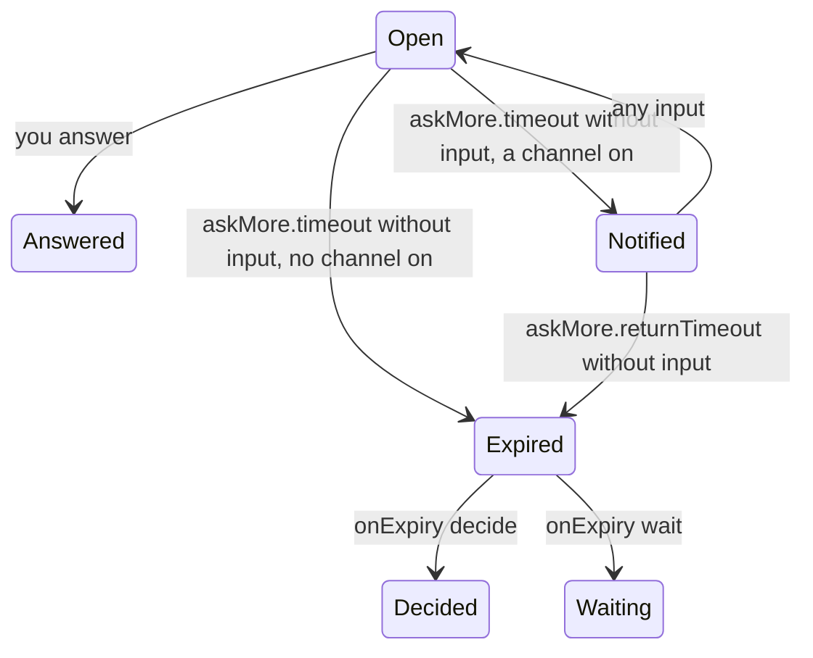

# omp-ask-more

English | [简体中文](README.zh-CN.md)

An OMP plugin that replaces the native `ask` tool and makes it the one place where the agent puts a decision to you. Every question comes with what exists now, what is being decided and what follows; every option with its tradeoff; and the answer page fills the screen — the alternate screen in a plain terminal, a sheet over the transcript in Tern. The answer reaches the model in the native shape, so tools that read the session work unchanged.

Status: **implemented, v0.1.0**, verified on omp 18.14.0 with Tern 0.9.6 ([verification](docs/verification.md)). How it is built: [design](docs/design.md).

## Why

The native `ask` is weak and models do not use it to say things plainly, so decisions get made in chat: skills that "grill" the user ask in prose because they cannot count on an ask tool. The native tool already has fields for richer questions — `question` is Markdown and every option has a free-form `preview` — but its prompt tells the model to keep labels short and never mentions `preview`, and its dialog sits in the composer, capped at four header rows and 70% of the terminal.

This plugin requires every question to carry where/what/how and every option its tradeoff, invites real code lines, diagrams and demo animations, and draws the answer surface full screen. Its tool description routes every user decision through `ask`, so nothing needs deciding in chat.

## Demo videos

Three silent videos, recorded in a headless Tern 0.9.8 window with omp 18.14.0 and a real model, `opencode-go/deepseek-v4.1-flash`, working on a small orders service whose payment retry writes a row twice. The person's requests are typed as shown; every question, option, cited line range, diagram and demo on screen is the model's own output. Waits for the model are cut, and the caption says how long they took. Each caption names who acts: the person, the model or ask-more.

| Video | What it shows |
|---|---|
| [1. Before and after: one decision](#1-before-and-after-one-decision) | the same request to the same model, first with omp's native ask, then with ask-more; Where / What / How; the Tradeoff / Holds when / Cost card following the cursor; evidence read from disk; a Mermaid diagram; risks; a GIF demo on an option; Submit; the native result shape and the model going on |
| [2. Several decisions, then walk away](#2-several-decisions-then-walk-away) | three questions in one ask; tabs with `✓`; an own answer through `Other…`; switching tabs keeps answers; a frames demo on a question; Review with one question unanswered; the countdown line, the terminal notification and `(timed out: …)`; the model deciding the open question and saying what it chose |
| [3. Plain terminal](#3-plain-terminal) | the same request with omp's classic renderer (`PI_TUI_NATIVE=0`): the alternate-screen page, key hints, scrollbar, a frames demo with its counter, `PgDn`, `ctrl+o`, answering with `enter` |

Not shown: the plain-terminal half-block picture of a GIF or video, APNG/WebP/video demo files, `esc` / `Cancel all`, `onExpiry: wait`, the notify command, sessions without the TUI, `/tree` re-answer, observers and collaborator guests.

### 1. Before and after: one decision

https://github.com/user-attachments/assets/eb2ad931-fe61-475e-ab5b-6261b2c190a9

### 2. Several decisions, then walk away

https://github.com/user-attachments/assets/a8dcf3b9-61eb-4ce1-b477-7a7f1838de80

### 3. Plain terminal

https://github.com/user-attachments/assets/4b4f696c-136b-440b-a4d5-798a0f47e519

## Install

```sh
omp plugin install https://github.com/oh-my-omp/omp-ask-more
```

For local development, `omp plugin link /path/to/omp-ask-more`. Nothing needs configuring: the [timeout settings](#timeout-and-notifications) have defaults. Keep the native `ask` enabled; sessions without the TUI hand the ask to it.

In Tern, also install the styles-only Tern plugin in `tern/`:

```sh
tern plugin install github.com/oh-my-omp/omp-ask-more/tern
```

or `tern plugin link /path/to/omp-ask-more/tern` while developing. Either one reloads Tern's plugins; no restart is needed. It gives the ask sheet the sans text face of omp's other overlays and, in the Console chat style, the gutter the question's `?` marker hangs in. Without it the sheet works and shows the brief in the terminal face.

## What you see

One page per question:

- the question, then **Where** (what exists now), **What** (what is being decided) and **How** (what follows from each answer), never folded;
- the options, the recommended one marked, then `Other…` for your own answer;
- under the focused option its **Tradeoff**, **Holds when** and **Cost**, and its demo if it has one;
- the question's demo, the **Evidence** — real lines read from the files when the ask opens, so what you read is the code, not the model's copy of it; an unreadable reference shows its reason and does not block the ask — the Mermaid diagram and the risks;
- a countdown line when the ask times out ([Timeout and notifications](#timeout-and-notifications)).

Several independent questions come as one batch: a tab row (`✓` on answered questions) and a last **Review** page listing every answer and how many are unanswered. A cursor resting on an option is not an answer; switching tabs loses nothing.

In a plain terminal the page is on the alternate screen, with the title and tabs at the top, the key hints at the bottom and a scrolling body between. In Tern it is a modal sheet over the pane, styled by Tern's color themes and its Reader, Spine and Console chat styles; Tern scrolls it itself.

### Demos

A demo shows behaviour over time: on the question for how things behave now, on an option for the result of picking it (it restarts whenever the cursor moves onto that option, so moving between options compares them).

| Source | Tern | Plain terminal |
|---|---|---|
| frames the model writes | each frame as Markdown, with a `1/3` counter and `Previous` / `Pause` / `Next` | the same frames, stepped with the keys below |
| GIF, APNG, WebP | played by Tern at the file's own timing | a coarse 64 × 20-cell color picture, stepped like frames |
| mp4, mov, webm, mkv, m4v | converted to a GIF by ffmpeg and played | decoded like an animation |

The plain-terminal page and videos need `ffmpeg`/`ffprobe` on `PATH`; a missing tool, file or format becomes an error row with the reason, and the ask still opens.

### Keys and pointer

| Input | Question page | Review page |
|---|---|---|
| `↑` `↓` / row click | move the cursor (the row under it is not yet an answer) | scroll |
| `enter` / `dblclick` / `Next`, `Submit` | answer the row; one question submits, a batch moves to the next question and from the last one to Review | submit the batch |
| `o` / click `Other…` | open the Other field; `enter` saves a non-blank text as the answer, `esc` closes the field | — |
| `tab` `→` / `shift+tab` `←` / tab click | next / previous question (batch only) | same |
| `PgUp` `PgDn` `Home` `End` `Shift+↑↓` / wheel | scroll the page | same |
| `ctrl+o` | unfold evidence lines in the plain-terminal page | — |
| `p` / `Pause`, `Play` | pause or play the page's demos | — |
| `[` `]` / `Previous`, `Next` | step the page's demos back or forward one frame | — |
| `esc` / `Cancel all` | cancel the whole call | same |

## Timeout and notifications

An open ask counts down while nobody touches it. The settings are omp settings, read like native ones from `~/.omp/agent/config.yml`, a project's `.omp/config.yml`, `--config` or `cfg://`; each ask reads them when it opens, so a change applies from the next ask.

| Setting | Default | Meaning |
|---|---|---|
| `askMore.timeout` | `1800` | seconds without input before the first step; `0` turns timing off |
| `askMore.notify.terminal` | `true` | at that step, a terminal notification (OSC 99, OSC 9 or BEL, whichever the terminal takes) |
| `askMore.notify.command` | unset | at that step, a shell command run as `sh -c`; also `OMP_ASK_MORE_NOTIFY_COMMAND`. Ignored, with a warning, when it comes from a project config |
| `askMore.returnTimeout` | `1200` | seconds after the notification for you to come back |
| `askMore.onExpiry` | `decide` | when the last countdown ends: `decide` hands the unanswered questions to the model, `wait` keeps the ask open |



- Any key, click, wheel notch on the plain-terminal page, or typing in the Other field starts the first countdown over. Coming back after a notification does too, so a later idle stretch notifies again.
- With both channels off, the first countdown ends the ask (`decide`), or nothing happens (`wait`).
- When the model takes over, the answers you gave stand and each unanswered question reaches it as `(timed out: …)`; the model decides those itself, says what it chose, and the turn goes on. Text left unsaved in the Other field is not an answer.
- The countdown line changes only at these steps: `No input for 30 min: you get notified, and 20 min later the model decides`, then `Notified at 14:03; the model decides at 14:23 unless you act`.
- A notification carries no question text, evidence or answers. The terminal one reads `omp: <title>: waiting for your answer; the model decides at 14:23`.
- The command runs in the session's working directory with its own environment plus:

  | Variable | Value |
  |---|---|
  | `OMP_ASK_MORE_EVENT` | `timeout` |
  | `OMP_ASK_MORE_TITLE` | the sheet title: the question's chip, or "N decisions" |
  | `OMP_ASK_MORE_BODY` | the terminal notification's text |
  | `OMP_ASK_MORE_QUESTIONS` | the number of questions |
  | `OMP_ASK_MORE_CWD` | the working directory |
  | `OMP_ASK_MORE_DUE` | when the model takes over (ISO 8601), empty with `wait` |

  Its output is ignored and it is killed after 30 seconds. A non-zero exit, a kill or a failed start shows a warning naming only the outcome, since the command may carry a token; nothing is retried, and a failure never changes the ask.
- Keep secrets in the environment the command reads, not in its text. For example, with `NTFY_TOPIC` exported by whoever starts omp:

  ```yaml
  askMore:
    notify:
      command: 'curl -fsS -d "$OMP_ASK_MORE_BODY" "https://ntfy.sh/$NTFY_TOPIC"'
  ```

- A project config may not set the command: a cloned repository's `.omp/config.yml` could otherwise run a program on your machine and choose where your notifications go. The environment variable, `--config`, a runtime override and the global config may.
- The native `ask.timeout` and `ask.notify` are not used here: they belong to the native dialog, where `ask.timeout` picks the recommended option for you.

## What the model sends and gets

The parameters are the native ones plus extension fields:

| Kept from the native `ask` | Added |
|---|---|
| tool name `ask`; `questions[]` with `id`, `question`, `header?`, `options[{label, description?, preview?}]`, `multi?`, `recommended?` | per question `brief {where, what, how, evidence?, diagram?, demo?, risks?}`; per option `tradeoff`, `holds_when?`, `cost?`, `demo?` |

The tool description tells the model:

- `ask` is the only way to put a decision to the user — an approach, a tradeoff, a preference, the scope, a risky or irreversible step. Ending a turn on a question or a list of options in text is wrong.
- When a skill, workflow or other instruction says to ask the user, confirm with them or let them pick, it does so with `ask`; everything else that instruction requires still applies.
- It does not ask for facts its tools can find or for choices that are its own to make.
- It writes for someone who has not read the session: plain words, short sentences, concrete names.
- It cites the real code lines a decision is about and draws a Mermaid diagram whenever a flow, sequence, states, dependencies or a structure is involved. Both stay optional in the schema.
- It shows a demo whenever the decision is about behaviour over time — a UI interaction, the states a request goes through, before and after a change. A demo is frames it writes, or an animation or video file, which may be a recording it made for this ask.
- Independent decisions go in one call, one question each; a decision whose options depend on another answer goes in a later call.
- A question that reads `id: (timed out: …)` in the result was not answered before the ask's timeout: it decides that question itself with its best judgment, says what it chose, and continues.

`question` stays a question: one or two sentences. The brief is its own field.

```
ask({
  questions: [{
    id: "retry-strategy",
    header: "重试策略",
    question: "重试应该怎么做？",
    recommended: 0,
    brief: {
      where: "retry() 与 3 处调用点，429 后上游出现重复写入。",
      what: "选择失败后的重试策略，决定是否引入幂等键。",
      how: "选 A 要加迁移；选 B 只改 retry() 内部，不动调用方。",
      evidence: [
        { path: "src/retry.ts", lines: "41-58", note: "现有重试只有 1 次" },
        { path: "src/order/paid.ts", lines: "88-96" }
      ],
      diagram: "flowchart LR\n  client --> retry --> write",
      demo: {
        frames: [
          { body: "`write #1` → 429", caption: "第一次写入被限流" },
          { body: "`write #1` → 200 · `write #1` → 200", caption: "重试后同一笔写了两次" }
        ],
        interval_ms: 1500
      },
      risks: ["迁移期间双写"]
    },
    options: [
      { label: "指数退避 + 幂等键",
        description: "需要 1 表 2 字段",
        tradeoff: "重试安全，代价是迁移",
        holds_when: "下游能给出稳定请求键",
        cost: "1 张表、2 个字段，可回滚",
        demo: { path: "docs/retry-idempotent.gif", caption: "第二次写入被幂等键拦下" } },
      { label: "固定 3 次重试", description: "改动最小",
        tradeoff: "不动 schema，但重复写会继续发生",
        cost: "只改 retry() 内部" }
    ]
  }, {
    id: "log-level",
    header: "日志级别",
    question: "默认日志级别用哪一档？",
    brief: { where: "…", what: "…", how: "…" },
    options: [ /* … */ ]
  }]
})
```

Limits: 2–5 options per question, at most 6 evidence references per question, at most 80 lines per reference, no `multi`. Demos: 2–12 frames at 300–5000 ms each (default 1200); files up to 16 MB, of which the first 15 seconds play. A call that breaks a rule is rejected with every problem listed before anything opens, and the model calls again.

The result is the native one: `User answers:` and one line per question, in the order asked:

| Line | Meaning |
|---|---|
| `id: label` | you picked that option |
| `id: "text"` | you wrote your own answer |
| `id: (cancelled)` | left unanswered when you submitted from Review, or every question after `esc` / `Cancel all`, which also ends the turn |
| `id: (timed out: …)` | left unanswered when the ask timed out; the model decides it and the turn goes on |

One ask is open at a time; a second call is rejected instead of opening a second sheet.

## Sessions without the TUI

When the session has no UI or is not in TUI mode, ask-more hands every question's native fields to the native `ask`, which renders them in its own dialog with its own `ask.timeout` and `ask.notify`. Without a native ask to hand to — print mode, for instance — the model gets a rejection instead of a hang. If the full-screen surface fails while opening, a warning shows and the native dialog takes the whole batch.

## Observers

Answers in `ask` are tool results, not user messages, so tools that read the session have to look for them. The companion changes that do:

- [omp-config](https://github.com/oh-my-omp/omp-config) `turn-judge` puts `用户在ask中回答` (one `question → answer` line per answered question) into the judge's timeline, and its `gpt-talk-only` rule counts those answers as the user speaking: confirming a decision is a proper end when deciding was all the user asked for, while restating a picked approach without doing the work is still caught.
- omp-config `user-prompt-inject` renders `{{ask_answers}}`, so `mentor:default` and `discuss:*` see the decisions the user made in `ask` next to the typed requests.
- [omp-todo-more](https://github.com/oh-my-omp/omp-todo-more) leaves time spent waiting on the user in `ask` out of in-progress time, so a long discussion does not raise an overtime warning, and runs no deadline while an ask is open.

They read the native result shape, so they work the same with the native `ask`.

## Known limitations

- **`/tree` re-answer** reopens an extended ask in the native dialog, with the native fields only.
- **Collaborator guests** cannot answer while the ask-more sheet is open.
- **Print and RPC without a native ask** get a rejection; the native tool would abort the operation instead.
- **The timeout runs in plan mode too**; the native ask turns its own timeout off there. No `multi`, no notes.
- **The transcript card shows a timed-out question as `Cancelled`**: every `ask` result is drawn by the native renderer, which has no state for "unanswered, left to the model". The model reads `(timed out: …)`.
- **In sessions without the TUI** the native `ask.timeout` and `ask.notify` apply and the `askMore.*` settings do nothing.
- **A terminal notification shows only where the terminal turns OSC 99, OSC 9 or BEL into one**; the notify command needs a POSIX `sh`.
- **Plain-terminal demos are coarse.** A file plays at 64 × 20 cells, two pixels per cell: motion reads, small text inside a recording does not, so the caption says what to watch. Each frame rewrites up to 20 rows of 24-bit color (about 16–17 KB for a busy picture), noticeable over a slow SSH link. The picture's width is fixed when the ask opens and does not follow a resize.
- **Without the Tern stylesheet plugin** the sheet shows the brief in the terminal face under Reader and Spine, and in Console the question's `?` marker sits on the sheet's left edge.
- The model reads this plugin's tool description, not the native `ask` prompt; an extension that rewrites the ask prompt must target the final description.
