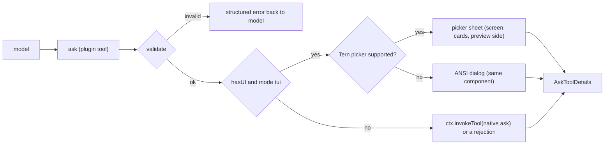

# omp-ask-more

English | [简体中文](README.zh-CN.md)

An OMP plugin that shadows the native `ask` tool. Its parameters are the native ones **plus** extension fields: the native component renders the native part and ignores the rest; the ask-more component renders both. The answer shape, the result renderer and the persisted-call contract stay native.

Status: **implemented, v0.1.0**. Verified on omp 18.13.3 with Tern 0.9.6: unit tests, the ANSI dialog end to end, the Tern picker end to end with pointer input, and the no-UI path. See [Verification](#verification).

## Why

Native `ask` already has fields for this: `question` is Markdown (Tern: an `md` node, `packages/tui/src/overlays/ask-dialog.ts:884`; TUI: Markdown with fenced-code highlighting, `:298-311`), and every option has a free-form `preview` (`:939`, `:501-503`). Two things stop them from being used:

1. The model is told not to. The native tool prompt is seven lines and says "short labels, tradeoffs in `description`" (`packages/coding-agent/src/prompts/tools/ask.md:1-7`); `preview` is never mentioned.
2. The surface is small. The dialog is mounted in the composer container (`packages/coding-agent/src/modes/controllers/extension-ui-controller.ts:887-905`), capped at four header rows and 70% of the terminal (`packages/tui/src/overlays/ask-dialog.ts:116-123`), and in Tern it describes as `omp.editor.ask` — a dock `col` with the `md` question, a `list` of options, and exactly one option's `preview` (`:762-940`).

This plugin changes what the model must write and how the answer surface is drawn. It does not change what a question *is*.

## Install

```sh
omp plugin install https://github.com/oh-my-omp/omp-ask-more
```

For local development, `omp plugin link /path/to/omp-ask-more`. The plugin entry is the package-root `index.ts`, declared by `omp.extensions` in `package.json`; no config section is needed, and the native `ask` must stay enabled so the no-UI path can delegate to it.

## Parameters

The schema is the native one extended the way `omp-todo-more` extends `todo`:

| Kept | Added |
|---|---|
| Tool name `ask`; `id`, `question`, `header?`, `options[{label, description?, preview?}]`, `multi?`, `recommended?` (`packages/coding-agent/src/tools/ask.ts:52-88`) | `brief {where, what, how, evidence?, diagram?, risks?}`; per option `tradeoff`, `holds_when?`, `cost?` |

`arktype` keeps undeclared keys, so a persisted extended call still passes `recoverAskQuestions` (`ask.ts:94-109`) and `/tree` re-answer reopens it; the native dialog there renders the native fields only.

## The contract

`question` stays a question: one or two sentences. The brief is its own field.

```
ask({
  questions: [{
    id: "retry-strategy",
    header: "重试策略",
    question: "重试应该怎么做？",
    recommended: 0,
    brief: {
      where: "retry() 与 3 处调用点，429 后上游出现重复写入。",
      what: "选择失败后的重试策略，决定是否引入幂等键。",
      how: "选 A 要加迁移；选 B 只改 retry() 内部，不动调用方。",
      evidence: [
        { path: "src/retry.ts", lines: "41-58", note: "现有重试只有 1 次" },
        { path: "src/order/paid.ts", lines: "88-96" }
      ],
      diagram: "flowchart LR\n  client --> retry --> write",
      risks: ["迁移期间双写"]
    },
    options: [
      { label: "指数退避 + 幂等键",
        description: "需要 1 表 2 字段",
        tradeoff: "重试安全，代价是迁移",
        holds_when: "下游能给出稳定请求键",
        cost: "1 张表、2 个字段，可回滚" },
      { label: "固定 3 次重试", description: "改动最小",
        tradeoff: "不动 schema，但重复写会继续发生",
        cost: "只改 retry() 内部" }
    ]
  }]
})
```

- `brief.where/what/how` are rendered above the options and never collapsed by default.
- `evidence[].path` with optional `lines` is resolved against the session's working directory and read at render time, so the panel shows the real lines in a `code` node with `path` and `start` (`packages/wire/src/tsp.ts:222-236`) instead of model-typed code. An unreadable reference is drawn in an error tone with the reason and never blocks the ask.
- `diagram` is Mermaid source: the `md` node draws it natively in Tern, and the TUI Markdown renderer draws it as ASCII (`packages/tui/src/theme/mermaid-cache.ts:66,100`).
- `tradeoff` / `holds_when` / `cost` are one line each and are drawn under the focused option.

Limits: one question per call, 2–5 options, at most 6 evidence references, at most 80 lines per reference, no `multi`.

## Validation

Validation runs at the tool boundary, before any UI opens, returns every problem at once, and never degrades into a thinner ask.

| Rule | Rejection |
|---|---|
| exactly one question | `questions: expected exactly one question` |
| `brief.where/what/how` non-empty | `questions[0].brief.<field>: empty` |
| every option has a non-empty `tradeoff` | `questions[0].options[i].tradeoff: empty` |
| ≥ 2 options | a decision needs at least two options |
| labels unique and not reserved (`Other (type your own)`, `Chat about this`, `Next →`) | named per option |
| `multi` unset | not supported; ask twice |
| `recommended` is an index into the options | names the bad value |
| ≤ 6 evidence references; `lines` is `N` or `N-M` and spans ≤ 80 lines | names the reference and the span |

## Surfaces



One pi-tui component (`src/component.ts`) mounted with `ui.custom` (`extension-ui-controller.ts:1283-1360`) draws both surfaces: the Tern backend calls `describe()` instead of `render()` when the terminal speaks TSP (`packages/tui/src/tui.ts:264-272,294-305`). Keys stay with the component in both cases, so `↑↓`, `enter`, `o`, `esc` and `ctrl+o` behave identically.

In Tern the component describes a `picker` docked as a child named `picker` (`dockedPicker`'s shape, `packages/tui/src/native/picker.ts`), which the reconciler hoists into `layer` (`packages/tui/src/native/reconcile.ts:27-28,426,484`): `size: "screen"`, `layout: "cards"`, `preview: "side"`, one card per option, the preview holding the brief sections, the evidence `code` nodes, the Mermaid `md`, the risks and the focused option's tradeoffs, and an action bar with `Submit`, `Other`, `Cancel`.

When `ctx.hasUI` is false or the mode is not `tui`, the tool calls `ctx.invokeTool` with the native subset (`src/schema.ts#nativeQuestion`), so the native dialog renders the native fields; without a native resolver — print mode, for instance — it returns a structured rejection instead of hanging.

## Answer and lifecycle

| Concern | Behavior |
|---|---|
| Answer | native `AskToolDetails` (`results[{id, question, options, multi, selectedOptions, customInput}]`), rendered by `askToolRenderer` because renderers are keyed by tool name (`packages/tui/src/tools/index.ts:37`) |
| Cancel | `ctx.abort()`, then a cancelled result (`id: (cancelled)`), matching the native wording |
| Concurrent asks | one in flight; a second call is rejected instead of replacing the open component |
| Timeout | none; the native auto-select reads session settings an extension cannot reach (`ask.ts:742-745`) |
| Approval | `approval: "read"`, matching `ask.ts:544-551` |
| Failure inside the surface | `ui.notify` warning, then delegation to the native dialog |

## Known limitations

- **`/tree` re-answer** runs `new AskTool()` directly (`packages/coding-agent/src/modes/controllers/selector-controller.ts:1723-1748`). The extended arguments survive its schema check, so the ask reopens — in the native dock, with the native fields only.
- **Collaborator guests** answer through the native mirroring channel (`extension-ui-controller.ts:923-1025`), which has no representation for a `ui.custom` surface: while the ask-more sheet is open, a guest cannot answer.
- **Print and RPC without a native resolver** get a structured rejection; the native tool would abort the operation instead.
- **No plan-mode timeout auto-select**, no `multi`, no multi-question tabs, no notes.
- The tool is registered under the native name: the model reads this plugin's description, not `prompts/tools/ask.md`. Extensions that rewrite ask's prompt must target the final description.

## Files

```
index.ts        plugin entry: registers ask, validates, chooses the surface, delegates
src/schema.ts   native fields + brief/tradeoff, zod parameters, semantic validation
src/brief.ts    path:lines resolution against the working directory, bounded reads
src/nodes.ts    picker/card/section/code/md/kv composition, preview children
src/component.ts one component: render() for ANSI, describe() for Tern
src/result.ts   AskToolDetails construction, cancelled and rejected results
src/i18n.ts     UI labels from OMOMP_LANG / LC_*; protocol fields stay English
src/description.ts the model-facing tool description
test/           validation and native-projection tests (bun test)
```

## Verification

Executed on 2026-10-28 with omp 18.13.3, Tern 0.9.6, `opencode-go/deepseek-v4.1-flash`.

| Check | Command | Observed |
|---|---|---|
| Types | `bun run check` | `tsc --noEmit` clean |
| Unit | `bun test` | 10 pass, 0 fail: every rejection message, evidence bounds, `nativeQuestion` projection |
| ANSI surface | `omp --no-extensions -e /tmp/ask-more-verify/index.ts` in a PTY, prompt "调用 ask 工具…" | the dialog drew the brief sections, options with radio markers and the focused option's tradeoff; `↓` moved the cursor and swapped the tradeoff; `o` + text + `enter` returned `User answers: fixture: "…"`; a second run submitted with plain `enter` and returned `User answers: verify-dir-lifecycle: 一次性脚手架目录` |
| Tern surface | headless `tern serve --control …`, `run` an omp wrapper with `PI_TUI_TSP_RECORD`, `ctl tree` and `ctl click` | `tree .sf-layer .sf-picker` → one node `sf-picker sz-screen lay-cards pv-side`, rect 1268×754; `tree .pk-pv-slot .sf` → 11 nodes including `sf-section collapsible` with the Where/What/How text; click on `.pk-row[data-v=o1]` swapped the preview to that option's tradeoff; click on `.pk-btn.primary` emitted `{"ev":"action","act":"submit"}` and the transcript showed `User answers: first_move: 我先给一份改动提案` |
| No-UI path | `omp -p … "调用 ask…"` | `ask rejected: … no native ask is available to delegate to here`, after the payload passed validation |

Not yet exercised at runtime: the native-delegation path itself (needs an environment where `ctx.invokeTool` exists but `ui.custom` does not), collaborator guests, and `/tree` re-answer with an extended call.
