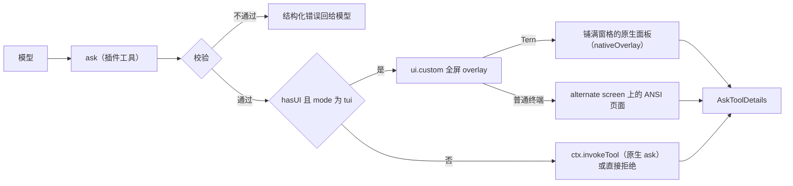
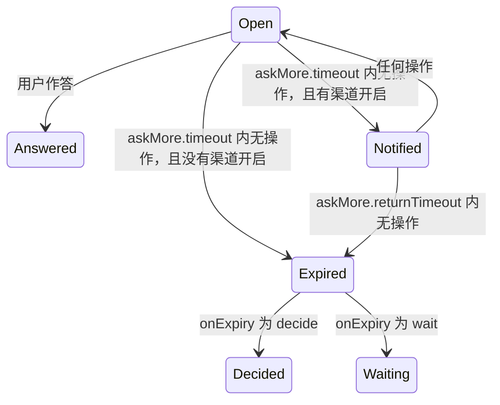

# omp-ask-more

[English](README.md) | 简体中文

一个影子替换原生 `ask` 的 OMP 插件，让 `ask` 成为代理把决定交给用户的唯一入口。参数是原生参数**加上扩展字段**：原生组件渲染原生部分、忽略其余；ask-more 组件两者都渲染。答案形状、结果渲染器与持久化调用的契约保持原生。

状态：**已实现，v0.1.0**。均在 Tern 0.9.6 上验证。omp 18.14.0：单测、Tern 内置全部 102 个配色主题在 Reader、Spine、Console 三种聊天风格下的 Tern 面板、面板按钮动作、一次真实 ask 的端到端，以及 ANSI 页面与 Tern 中的 ask 超时及其通知。omp 18.13.3：ANSI 页面，Tern 面板的多题、长简报与演示流程（分步画面、GIF 和 mp4），以及无 UI 路径。见[验证](#验证)。

## 为什么

原生 `ask` 太弱，模型也不用它把话说清楚，于是决定都在 chat 里做：“grill”一类的 skill 不能指望宿主有 ask 工具，只能在对话里问用户。原生 `ask` 其实已有承载更多内容的字段——`question` 按 Markdown 渲染（Tern 是 `md` 节点，`packages/tui/src/overlays/ask-dialog.ts:884`；TUI 走带代码高亮的 Markdown，`:298-311`），每个选项都有自由文本 `preview`（`:939`、`:501-503`）——但两件事让它们用不起来：

1. 模型被要求不要用。原生工具 prompt 只有七行，写着 "short labels, tradeoffs in `description`"（`packages/coding-agent/src/prompts/tools/ask.md:1-7`）；`preview` 一次都没出现。
2. 表面太小。对话框挂在 composer 容器里（`packages/coding-agent/src/modes/controllers/extension-ui-controller.ts:887-905`），标题最多四行、整块最多占终端 70%（`packages/tui/src/overlays/ask-dialog.ts:116-123`），在 Tern 里 describe 成 `omp.editor.ask`——dock 里的 `col`：`md` 问题、选项 `list`、以及只有一个选项的 `preview`（`:762-940`）。

本插件要求每个问题写明现状/决定/后果、每个选项写明取舍，鼓励引用真实代码行、画示意图和放演示动画，并把作答界面画成全屏。工具说明把所有需要用户决定的事都导向 `ask`，因此不必在 chat 里做决定；读取会话的观察者（见[观察者](#观察者)）把这些回答当作用户亲口说的话。

## 安装

```sh
omp plugin install https://github.com/oh-my-omp/omp-ask-more
```

本地开发用 `omp plugin link /path/to/omp-ask-more`。插件入口是包根 `index.ts`，由 `package.json` 的 `omp.extensions` 声明；不需要任何配置（超时设置都有默认值，见[超时与通知](#超时与通知)），并必须保留原生 `ask` 开启，供无 UI 路径委托。

在 Tern 中还要安装 `tern/` 里的纯样式 Tern 插件：

```sh
tern plugin install github.com/oh-my-omp/omp-ask-more/tern
```

开发时用 `tern plugin link /path/to/omp-ask-more/tern`。两者都会让 Tern 重新加载插件，无需重启。它让 ask 面板用上 omp 其他 overlay 的无衬线字体，并在 Console 聊天风格下留出问题前 `?` 标记所在的左侧空白。不装它面板照常可用，简报以终端字体显示（见 [Tern](#表面)）。

## 参数

schema 是原生参数按 omp-todo-more 扩展 `todo` 的方式加上扩展字段：

| 保持 | 新增 |
|---|---|
| 工具名 `ask`；`questions[]`，每题 `id`、`question`、`header?`、`options[{label, description?, preview?}]`、`multi?`、`recommended?`（`packages/coding-agent/src/tools/ask.ts:52-88`） | 每题 `brief {where, what, how, evidence?, diagram?, demo?, risks?}`；每选项 `tradeoff`、`holds_when?`、`cost?`、`demo?` |

`arktype` 保留未声明键，因此持久化的扩展调用仍能通过 `recoverAskQuestions`（`ask.ts:94-109`），`/tree` 重答会重新打开它；那里原生对话框只渲染原生字段。

## 契约

工具说明（`src/description.ts`）要求模型：

- `ask` 是把决定交给用户的唯一途径——方案、取舍、偏好、范围、有风险或不可逆的步骤都算。在文字里以提问或列选项结束本轮是错的。
- skill、工作流或其他指令要求问用户、请用户确认或让用户挑选时，用 `ask` 来做；该指令的其余要求照旧。
- 不问工具查得到的事实，不问本该自己做的选择。
- 写给没看过会话的人：说人话、短句、写具体名字。
- 决定涉及代码时引用真实代码行；涉及流程、时序、状态、依赖或结构时画 Mermaid 图。两者在 schema 中都是可选字段。
- 决定涉及随时间变化的行为——界面交互、请求经历的状态、改动前后——时放演示：放在问题上演示现在的行为，放在选项上演示选它之后的结果。演示可以是模型自己写的分步画面，也可以是动画或视频文件，包括它为这次 ask 现录的。
- 彼此独立的决定放进同一次调用、每题一个；选项依赖另一个答案的决定放到后一次调用。
- 结果里某题为 `id: (timed out: …)` 时，表示用户在 ask 超时前没有回答：由模型按最佳判断自己决定这一题、说明选了什么，然后继续。

`question` 只当问题用：一两句话。简报是独立字段。

```
ask({
  questions: [{
    id: "retry-strategy",
    header: "重试策略",
    question: "重试应该怎么做？",
    recommended: 0,
    brief: {
      where: "retry() 与 3 处调用点，429 后上游出现重复写入。",
      what: "选择失败后的重试策略，决定是否引入幂等键。",
      how: "选 A 要加迁移；选 B 只改 retry() 内部，不动调用方。",
      evidence: [
        { path: "src/retry.ts", lines: "41-58", note: "现有重试只有 1 次" },
        { path: "src/order/paid.ts", lines: "88-96" }
      ],
      diagram: "flowchart LR\n  client --> retry --> write",
      demo: {
        frames: [
          { body: "`write #1` → 429", caption: "第一次写入被限流" },
          { body: "`write #1` → 200 · `write #1` → 200", caption: "重试后同一笔写了两次" }
        ],
        interval_ms: 1500
      },
      risks: ["迁移期间双写"]
    },
    options: [
      { label: "指数退避 + 幂等键",
        description: "需要 1 表 2 字段",
        tradeoff: "重试安全，代价是迁移",
        holds_when: "下游能给出稳定请求键",
        cost: "1 张表、2 个字段，可回滚",
        demo: { path: "docs/retry-idempotent.gif", caption: "第二次写入被幂等键拦下" } },
      { label: "固定 3 次重试", description: "改动最小",
        tradeoff: "不动 schema，但重复写会继续发生",
        cost: "只改 retry() 内部" }
    ]
  }, {
    id: "log-level",
    header: "日志级别",
    question: "默认日志级别用哪一档？",
    brief: { where: "…", what: "…", how: "…" },
    options: [ /* … */ ]
  }]
})
```

- `brief.where/what/how` 画在选项上方，不折叠。
- `evidence[].path` 加可选 `lines` 由工具按会话工作目录解析、在 ask 打开时读取，因此页面画的是**真实行**（Tern 中为带 `path` 与 `start` 的 `code` 节点，`packages/wire/src/tsp.ts:222-236`），而不是模型敲进去的代码。读不到的引用用错误色画出原因，不阻塞这次 ask。
- `diagram` 是 Mermaid 源码：Tern 由 `md` 节点原生绘制，TUI 由 Markdown 渲染器画成 ASCII（`packages/tui/src/theme/mermaid-cache.ts:66,100`）。
- `tradeoff` / `holds_when` / `cost` 各一行，画在聚焦选项下方。
- `demo` 只能给一种来源。`frames[{body, caption?}]` 加 `interval_ms` 是面板循环播放的 Markdown 帧（文字、` ```mermaid ` 图或代码块里的字符画），每帧补齐到最高一帧的高度，下面的内容不会跳动。`path` 指向动画（GIF、APNG、WebP）或视频（mp4、mov、webm、mkv、m4v），和证据一样按会话工作目录解析。问题的演示在决定区下方；选项的演示在它的取舍卡里，光标每次移到该选项都从头播放，在选项间移动就能对比。`caption` 写看什么。

限制：每题 2–5 个选项，每题最多 6 条证据引用，每条引用最多 80 行，不支持 `multi`。演示：2–12 帧，每帧 300–5000 毫秒（默认 1200）；文件最大 16 MB，只播前 15 秒。

## 校验

校验发生在工具边界、任何 UI 打开之前，检查每一题，一次返回全部问题，绝不降级成更薄的 ask。

| 规则 | 拒绝信息 |
|---|---|
| 至少一个问题 | `questions: empty` |
| id 非空且在本次调用内唯一 | `questions[i].id: duplicate "<id>"` |
| `brief.where/what/how` 非空 | `questions[i].brief.<field>: empty` |
| 每个选项 `tradeoff` 非空 | `questions[i].options[j].tradeoff: empty` |
| 至少两个选项 | 决定至少需要两个选项 |
| 同一题内标签唯一且不是保留标签（`Other (type your own)`、`Chat about this`、`Next →`） | 逐项指明 |
| 不设 `multi` | 不支持；拆成多个问题 |
| `recommended` 是选项下标 | 指明非法值 |
| 证据 ≤ 6 条；`lines` 为 `N` 或 `N-M` 且跨度 ≤ 80 行 | 指明第几条与跨度 |
| 演示只给 `frames` 和 `path` 之一 | `….demo: give exactly one of frames (an animation you write) or path (an animation or video file)` |
| 2–12 帧且没有空帧；`interval_ms` 是 300 到 5000 的整数，且只能配 `frames` | 指明帧数、第几帧或间隔 |
| `path` 以 `.gif`、`.png`、`.apng`、`.webp`、`.mp4`、`.mov`、`.webm`、`.mkv` 或 `.m4v` 结尾 | 指明路径与可用扩展名 |

## 表面



一个 pi-tui 组件（`src/component.ts`）经 `ui.custom(factory, { overlay: true, overlayOptions: { fullscreen: true, width: "100%", maxHeight: "100%", margin: 0 } })` 挂载（`extension-ui-controller.ts:1283-1369`）。每题状态（`src/state.ts`）保存光标、答案（光标停在某个选项上不等于作答）、Other 输入框、证据折叠、滚动与演示播放进度，切换题目不丢任何东西。组件持有 overlay 焦点，Other 输入框打开时由它把按键转交给输入框。

**ANSI。** `fullscreen` 把页面放到 alternate screen。标题和（多题时的）标签行（已答题带 `✓`，最后是 `汇总`）固定在顶部，键位提示（ask 有倒计时时，其上方还有倒计时那一行）固定在底部；中间的正文是按实时终端高度调整的 pi-tui `ScrollView`，带滚动条，可用 `PgUp`/`PgDn`/`Home`/`End`/`Shift+↑↓` 和鼠标滚轮滚动，`↑↓` 移动选项时自动滚到聚焦选项。

**Tern。** 组件声明 `nativeOverlay`（`role: "omp.askMore"`、`size: "full"`，`head` 为该题的 `header`，多题时为“N 个决定”），后端把它包进一张铺满窗格的不透明面板（`packages/tui/src/native/backend.ts:873-900`），`describe()` 只返回内容，并使用原生 ask 的 role，Tern 的配色主题与 Reader、Spine、Console 三种聊天风格本就为这些 role 写了样式：多题时一个 `omp.ask.head` 行，内含 `omp.ask.questions` 标签（按位置编号，已答题带 `✓`，最后是 `汇总`，点击切换）；问题（`omp.ask.question`）与 Where/What/How；然后是决定区——每题一个以 `qN` 为 key 的 `omp.ask.options` 选项列表，各行为 `omp.ask.option`、最后一行为 `omp.ask.other`（单击选中、双击作答；已作答的行带强调色，Tern 把它画成实心单选标记，Console 下为 `(•)`，光标则是列表的高亮行）、聚焦选项的取舍卡、Other 输入框和动作条（ask 有倒计时时左侧是倒计时那一行，然后是 `全部取消`，以及 `下一题` / `提交` / `保存答案`）；最后是证据 `code` 节点（折叠到 12 行，由 Tern 自带的 "more lines" 展开）、Mermaid 的 `md` 和风险。汇总页是一行 `omp.ask.notice`，加上每题一行“标签 答案”：Reader 给原生答案网格（`omp.ask.answers`）设了固定宽度的键列，较长的 CJK 标签会压到答案上。面板 role 有意不放在 `omp.overlay.*` 下：Tern 给这类 overlay 写的列表规则（`.sf-overlay[data-role^='omp.overlay.'] .sf-ov-card .sf-list .sf-item`）优先级高于 ask 列表样式，会把每个选项的标记画在文字上。Tern 把面板正文当作一列整体滚动，并按正文底边把列表选中项滚进视野，因此动作条紧跟决定区，并在每页打开时把自己滚进视野：简报再长，打开时整个决定区也在视野内。键盘滚动以正文上的 `scroll` 请求交给 Tern。

每个按钮的动作 id 都写明它绘制时所属的页面与状态（`answer:<page>:<option>`、`other:<page>`、`save:<page>`、`demo:<page>:question:<move>`、`demo:<page>:option:<option>:<move>`、`submit`、`cancel`；见 `src/nodes.ts#SheetAct`）。面板重画后，Tern 仍会把点击路由到已被替换的节点，因此在页面、光标所在行或 Other 输入框变化之后才到达的点击——再点一次 `下一题`、光标已离开的选项的演示控件、离开汇总后的 `提交`——会被丢弃，而不是作用在新状态上。选项列表按题目编 key 也是出于同一原因。

**Tern 样式表。** 不在 `omp.overlay.*` 下时，面板沿用 Tern 基础 overlay 的外观。`tern/` 是一个纯样式的 Tern 插件（`plugin.toml`、`ask-more.css`，以及因清单至少需要一个入口而放的只含一行注释的 `window.luau`），三条规则只匹配 `omp.askMore`：omp overlay 的无衬线字体；Console 下保留终端字体，并留出问题前 `?` 标记所在的三格左侧空白。

**演示。** 文件和证据一起、在界面打开前按当前界面加载（`src/demo.ts`）：

| 来源 | Tern | ANSI 页面 |
|---|---|---|
| `frames` | 每帧一个 `md` 节点，加上帧说明、`1/3` 计数和 `Previous` / `Pause` / `Next` 按钮；组件负责换帧，Tern 只收到变化的文字 | 帧的 Markdown 行放在一块与最高一帧等高的区域里，下面是计数和按键提示 |
| GIF、APNG、WebP | 文件原始字节作为 `image` 节点（按内容寻址的 blob，只发一次），由 Tern 按文件自身的节奏播放，因此没有按钮 | 由 ffmpeg 解成每秒 10 帧、最大 64 × 20 格的画面，用 24 位色的 `▀` 半块画出（上像素作前景，下像素作背景），和分步画面一样换帧 |
| mp4、mov、webm、mkv、m4v | 由 ffmpeg 转成 GIF（每秒 12 帧、最宽 720 px、每帧独立调色板）后当图片显示；各容器格式走同一条 ffmpeg 调用，实测过的是 mp4 | 和动画一样解码 |

打开的那一页上所有正在播放的演示由一个计时器推进，计时器挂在 TUI 的渲染时钟上，各演示按自己的间隔换帧；只有该页打开、Other 输入框关闭且有演示在播放时它才运行，ask 关闭即停止。ffmpeg 和 ffprobe 不经 shell 运行，有 20 秒超时，中止时被结束，输出一超过上限（解出的帧，或转出的 GIF 16 MB）就立即结束。文件不存在、读不了、不是面板能播放的图片、太大，或者需要的 ffmpeg 不在 `PATH` 里时，都显示为写明原因的错误行；ask 照常打开。

**按键与指针。**

| 输入 | 问题页 | 汇总页 |
|---|---|---|
| `↑` `↓` / 单击一行 | 移动光标（光标下的行还不是答案） | 滚动 |
| `enter` / 双击 / `下一题`、`提交` | 以该行作答；单题直接提交，多题跳到下一题，最后一题之后进入汇总 | 提交整批 |
| `o` / 点击 `其他…` | 打开 Other 输入框；`enter` 把非空文字存为答案，`esc` 关闭输入框 | — |
| `tab` `→` / `shift+tab` `←` / 点击标签 | 下一题 / 上一题（仅多题） | 同左 |
| `ctrl+o` | ANSI 页面中展开证据行 | — |
| `p` / `Pause`、`Play` | 暂停或继续本页的演示 | — |
| `[` `]` / `Previous`、`Next` | 本页的演示后退或前进一帧 | — |
| `esc` / `全部取消` | 取消整次调用 | 同左 |

Other 输入框是 pi-tui `Input`，每题一个：它的值是文本的唯一一份，由组件转交的按键编辑；在 Tern 中也由终端自己的 edit/undo 事件编辑（输入框是子组件，reconciler 把事件路由给它）。

`ctx.hasUI` 为假或模式不是 `tui` 时，工具把每一题的原生子集交给 `ctx.invokeTool`（`src/schema.ts#nativeQuestion`），由原生对话框渲染原生字段；没有原生解析器时（例如 print 模式）返回结构化拒绝，而不是挂住。

## 超时与通知

打开的 ask 在没人操作时倒计时。这些设置是插件注册的 omp 设置（`src/settings.ts`），与原生设置一样从 `~/.omp/agent/config.yml`、项目的 `.omp/config.yml`、`--config` 或 `cfg://` 读取。ask 打开时从发起提问的会话取一份快照，改动从下一次 ask 生效。

| 设置 | 默认 | 含义 |
|---|---|---|
| `askMore.timeout` | `1800` | 无操作多少秒后进入第一步；`0` 关闭计时 |
| `askMore.notify.terminal` | `true` | 在这一步发终端通知，经 omp 的 `TERMINAL.sendNotification`（`@oh-my-pi/pi-tui`），按终端写出 OSC 99、OSC 9 或 BEL |
| `askMore.notify.command` | 未设置 | 在这一步以 `sh -c` 运行的 shell 命令；也可用 `OMP_ASK_MORE_NOTIFY_COMMAND`。来自项目配置时忽略并给出警告 |
| `askMore.returnTimeout` | `1200` | 通知之后留给用户回来的秒数 |
| `askMore.onExpiry` | `decide` | 最后一段倒计时结束时：`decide` 把未答的问题交给模型，`wait` 让 ask 一直开着 |



- 任何按键、点击、ANSI 页面里的滚轮，或终端在 Other 输入框里的编辑，都让第一段倒计时从头开始；Tern 自己滚动面板，不会上报滚动。通知之后回来操作也一样，之后再闲置会再次通知。
- 两个渠道都关闭时，第一段倒计时结束就结束 ask（`decide`），或什么都不发生（`wait`）。
- 超时的 ask 和提交一样返回已给出的答案；每道未答的题为 `id: (timed out: the user did not answer; decide it yourself with your best judgment)`。它不调用 `ctx.abort()`：本轮继续，工具说明要求模型自己决定这些题、说明选了什么，然后继续。没保存的 Other 文字不算答案。
- 面板显示一行倒计时，只在上述步骤变化：`无操作 30 分钟 后通知你，再过 20 分钟 交给模型决定`，之后是 `14:03 已通知；14:23 前无操作则交给模型决定`。时钟在组件里（`src/component.ts`，渲染时钟的 `scheduleAfter`），面板建立时开始，关闭时停止。
- 通知不带问题正文、证据或答案。终端通知为 `omp: <标题>：等待你的回答；14:23 交给模型决定`。命令在会话工作目录运行，环境是它自己的环境加上 `OMP_ASK_MORE_EVENT`（`timeout`）、`OMP_ASK_MORE_TITLE`（面板标题）、`OMP_ASK_MORE_BODY`（终端通知的文字）、`OMP_ASK_MORE_QUESTIONS`（题数）、`OMP_ASK_MORE_CWD` 与 `OMP_ASK_MORE_DUE`（ISO 8601 的交接时间，`wait` 时为空）。输出被忽略；30 秒后被结束；非零退出、被结束或启动失败都成为一条会话警告，只写结果，因为命令里可能带 token。不重试，失败也不改变 ask。
- 密钥放在命令读取的环境里，不写进命令文字。例如由启动 omp 的一方导出 `NTFY_TOPIC`：

  ```yaml
  askMore:
    notify:
      command: 'curl -fsS -d "$OMP_ASK_MORE_BODY" "https://ntfy.sh/$NTFY_TOPIC"'
  ```

- 项目配置不能设置命令：否则克隆来的仓库可以借 `.omp/config.yml` 在第一次闲置的 ask 上运行程序，并决定通知发往哪里。插件读取提供该值的层（`Setting.provenance`），接受环境变量、`--config`、运行时覆盖和全局配置。
- 不读取原生 `ask.timeout` 与 `ask.notify`：它们属于原生对话框，`ask.timeout` 在那里会自动选推荐项，还限制 `cfg://` 审批。ask-more 委托给原生 ask 时，原生 ask 仍按它们执行。

## 答案与生命周期

| 关注点 | 行为 |
|---|---|
| 答案 | 原生 `AskToolDetails`：`results[{id, question, options, multi, selectedOptions, customInput}]`，每题一项、按输入顺序；文本为 `User answers:` 加每行 `id: 选项`、`id: "自填文字"`、`id: (cancelled)` 或 `id: (timed out: …)`，与原生多题措辞一致。由 `askToolRenderer` 渲染（渲染器按工具名选取，`packages/tui/src/tools/index.ts:37`） |
| 未作答的题 | 汇总页列出；提交仍会发送其余答案，未作答的题为 `id: (cancelled)`（与原生对话框一致） |
| 取消（`esc`、`全部取消`、abort signal） | `ctx.abort()`，然后所有题都为 `(cancelled)`；已作答的部分不提交 |
| 并发 | 同时只允许一个；第二次调用被拒绝，而不是再开一张面板 |
| 超时 | 返回已给出的答案，其余为 `(timed out: …)` 由模型决定；不调用 `ctx.abort()`（见[超时与通知](#超时与通知)） |
| 审批 | `approval: "read"`，与 `ask.ts:544-551` 一致 |
| 表面内部失败 | `ui.notify` 警告，然后把整批委托给原生对话框 |
| 演示播放 | 所在页打开时开始；光标移到某个选项时它的演示从头播放；Other 输入框打开时不播放；计时器不会比 ask 活得更久 |

## 观察者

`ask` 里的回答是工具结果，不是用户消息，读取会话的工具要专门去找。配套的改动：

- [omp-config](https://github.com/oh-my-omp/omp-config) 的 `turn-judge` 把 `用户在ask中回答`（每个已作答的问题一行 `问题 → 答案`）放进判定时间线，其 `gpt-talk-only` 规则把这些回答当作用户亲口说的话：用户只要求作出决定时，确认决定后结束是正当的；复述已选的做法却不去做，仍会被拦下。
- omp-config 的 `user-prompt-inject` 渲染 `{{ask_answers}}`，让 `mentor:default` 和 `discuss:*` 在用户打字的请求旁边看到用户在 `ask` 中作的决定。
- [omp-todo-more](https://github.com/oh-my-omp/omp-todo-more) 把在 `ask` 里等用户作答的时间从 in_progress 用时中扣除，长时间讨论不会触发超时警告；ask 未结束时不运行任何 deadline。

它们读取的是原生结果形状，对原生 `ask` 同样有效。

## 已知限制

- **`/tree` 重答**直接 `new AskTool()`（`packages/coding-agent/src/modes/controllers/selector-controller.ts:1723-1748`）。扩展参数能通过它的 schema 检查，所以 ask 会重新打开——用原生 dock，只画原生字段。
- **协作 guest** 走原生镜像通道（`extension-ui-controller.ts:923-1025`），该通道没有 `ui.custom` 表面的表示：ask-more 面板打开期间 guest 无法作答。
- **print 与没有原生解析器的 RPC** 得到结构化拒绝；原生工具会中止整个操作。
- **plan mode 下同样计时**；原生 ask 在那里会关闭自己的超时。没有 `multi`，没有 note。
- **对话记录里的卡片把超时的题显示为 `Cancelled`。** 所有 `ask` 结果都由原生渲染器绘制，它没有“未作答、交给模型”这种状态；面向模型的文字是 `(timed out: …)`。
- **ask-more 委托给原生 ask 时**（无 TUI，或表面出错后），生效的是原生 `ask.timeout` 与 `ask.notify`，`askMore.*` 设置不起作用。
- **终端通知只在终端会把 OSC 99、OSC 9 或 BEL 变成通知时出现**；通知命令需要 POSIX `sh`。
- **ANSI 下的演示很粗。** 文件按 64 × 20 格播放、每格两个像素：动作看得出，录屏里的小字看不清，所以要在 caption 写清看什么。每帧最多重写 20 行 24 位色（画面复杂时每帧约 16–17 KB），慢速 SSH 下会有感觉。画面宽度在 ask 打开时就定了，改变终端大小不会重画。
- **ANSI 页面和视频需要 ffmpeg。** `PATH` 里没有 `ffmpeg`/`ffprobe` 时，这类演示显示为错误行；Tern 里的 GIF、APNG、WebP 两者都不需要。
- 工具以原生名注册：模型读到的是本插件的描述，而不是 `prompts/tools/ask.md`。改写 ask prompt 的扩展必须针对最终描述。
- **不装 Tern 样式插件时**，Reader 与 Spine 下简报以终端字体显示，Console 下问题前的 `?` 标记贴在面板左边缘。

## 文件

```
index.ts           插件入口：注册 ask、校验、挂载全屏 overlay、委托
src/schema.ts      原生字段 + brief/tradeoff、zod 参数、逐题校验
src/brief.ts       按工作目录解析 path:lines，限界读取
src/demo.ts        演示规格、按界面加载文件与 ffmpeg 解码、半块画面
src/state.ts       每题状态（光标、答案、Other 输入框、折叠、滚动、演示播放）与当前标签
src/component.ts   单个组件：ANSI 页面（render）与 Tern 内容（describe）、按键与事件、倒计时
src/nodes.ts       使用原生 ask role 的 Tern 内容，以及面板按钮动作（SheetAct）
src/result.ts      Answer 变体、AskToolDetails 构造、取消、超时与拒绝结果
src/settings.ts    注册在 omp 设置表里的 askMore.* 设置，从发起提问的会话取快照
src/timeout.ts     由该快照解析出的超时策略，以及倒计时那一行
src/notify.ts      超时通知：终端通知与通知命令
src/i18n.ts        界面标签取自 OMOMP_LANG / LC_*；协议字段保持英文
src/description.ts 面向模型的工具描述
tern/              纯样式 Tern 插件：面板字体与 Console 左侧空白
test/              校验、原生投影、演示加载、半块画面、超时策略与结果，以及经 pi-tui reconciler 与参考 TSP
                   applier 驱动的 Tern 面板（含倒计时）（bun test）

## 验证

均使用 Tern 0.9.6 与 `opencode-go/deepseek-v4.1-flash`。标 *18.14.0* 的行于 2026-10-30 在 Tern 样式改动之后用 omp 18.14.0 执行；其余行于 2026-10-29 用 omp 18.13.3 执行。

| 检查 | 命令 | 观察结果 |
|---|---|---|
| 类型 *18.14.0* | `bun run check` | `tsc --noEmit` 无错误 |
| 单测 *18.14.0* | `bun test` | 53 通过 0 失败：每条拒绝信息、逐题下标与重复 id、证据上下界、演示来源与上下界规则、`nativeQuestion` 投影、半块颜色、画面尺寸、演示加载、超时策略（默认值、0 即关闭、没有渠道开启、两个渠道加 `wait`、拒绝项目配置里的命令）与超时结果文字，以及 Tern 面板：每一帧都被 pi-tui 的参考 applier 接受；原生 ask role，光标停在别处时已选行仍有标记；单击与双击；过期点击（再点一次 `下一题`、光标移动或 Other 打开之前画出的 `下一题`、光标已离开的选项的演示控件、离开汇总后的 `提交`、重复 `全部取消`）被丢弃；以及测试时钟上的倒计时（无人操作时交回已给出的答案；按键与终端在 Other 输入框里的编辑让倒计时重来；通知一次、请求重画、再进入回来窗口；通知后回来操作从头计时；`wait` 永不关闭；到点前作答时只有这一个结果；关闭计时时没有倒计时那一行）。去掉选项列表的 role、把面板 role 改回 `omp.overlay.*`、或去掉作答动作对页面与光标的核对，分别有 5、1、3 个测试失败 |
| ANSI 多题 | 130×40 PTY 里 `omp --no-extensions -e …/index.ts`，提示词要求一次问三个独立问题 | alternate screen 页面画出标题、标签行 `重试上限 日志级别 缓存 汇总`、滚动条与键位提示；`enter` 回答第 1 题（`✓ 重试上限`）并打开第 2 题；`o`、`warn`、`enter` 作答；第 3 题 `PgDn` 滚动；`tab` 打开汇总，列出两题答案与 `1 题未回答`；`enter` 返回 `retry-limit: 固定 3 次，指数退避`、`log-level: "warn"`、`cache: (cancelled)` |
| ANSI 单题 | 同一会话 | 无标签行；`↓`、`enter` 直接提交：`cap: 3 次` |
| Tern 多题 | 无头 `tern serve --control …`，在其窗格里带 `PI_TUI_TSP_RECORD` 运行 omp；`ctl shot`、`tree`、`click`、`dblclick`、`key`、`type` | 一张 `sf-overlay sz-full at-center modal` 面板，标题 `3 decisions`，带 `tabs` 行；单击一行发出 `select … q0/option:2` 并切换取舍卡；`Next` 作答并打开下一题；点击标签回到第 2 题，原答案保留；`Other…` 打开获得焦点的 `sf-input`，键入的文字进入其中，`Save answer` 作答并前进；`tab` 打开汇总；`enter` 返回 `retry-limit: 10 次(长退避)`、`log-level: "warn and above"`、`cache: 定时过期(TTL 固定)`，面板离开 `layer`。`OMOMP_LANG=zh` 下汇总行与取舍行为“标签 值”且不重叠，`esc` 返回三题均为 `(cancelled)` |
| Tern 长简报 | 同上，单题且 Where/What/How 超过一屏 | 打开即可见选项、取舍与 `Cancel all` / `Submit`；`↓↓` 后选中行（y 659）与动作条（y 852–886）仍在正文区（100–886）内；`enter` 返回 `cache-invalidation: 生存时间被动过期` |
| 无 UI 路径 | `omp -p … "调用一次 ask 工具，一次问两个问题…"` | 载荷通过校验后得到 `ask rejected: … no native ask is available to delegate to here` |
| 演示加载 | 脚本对 3 秒 GIF 和 4 秒 mp4（ffmpeg `testsrc2` 生成）按两种界面调用 `loadDemo`，再跑错误路径 | Tern：GIF 原样 246280 字节；mp4 在 672 ms 内转成 2621279 字节的 GIF。ANSI：64 × 18 格，分别 30 帧和 40 帧，每帧 100 ms。文件不存在、文本冒充 `.gif`、解码中途中止、`PATH` 里没有 ffmpeg，分别得到错误行（`文件不存在`、`不是 GIF、PNG 或 WebP 图片`、`已中止`、`播放这个文件需要 PATH 里有 ffmpeg`）；同样的 `PATH` 下 Tern 的 GIF 仍能加载 |
| ANSI 演示 | 120×45 PTY，工作目录里放着这两个文件；先让模型问一题、两个选项各带 GIF 和 mp4 演示，再问一题、带 1500 ms 的三帧演示 | GIF 画在聚焦选项的取舍下方，是 18 行 `38;2;…;48;2;…m▀` 半块，带说明和 `24/30 ▶`；`p` 后显示 `⏸`，`]` 把 `17/30` 推到 `18/30`，之后 3 秒输出不再增长；`↓` 到视频选项后画出它 40 帧的画面并从第 1 帧开始；分步演示显示 `加载中 50%` · `第二步` · `2/3`，随后 `完成 ✓` · `3/3`；暂停在 `1/3` 时 `[` 回绕到 `3/3`；`esc` 返回 `render: (cancelled)`，`enter` 返回 `progress: 显示` |
| Tern 演示 | 同上的无头 Tern，一题带三帧的问题演示和 GIF / mp4 选项演示 | GIF 在取舍卡里播放（时间码 `00:00:00.000`、第 0 帧，一秒后 `00:00:01.000`、第 10 帧；两次截取的 PSNR 14.2 dB）；记录的 TSP 帧流每 1500 ms 一次更新，只含变化的文字、说明和计数，期间面板一直停在滚到底的位置；`Pause` 使按钮变成 `Play`，之后 22 秒没有帧更新；`Next` 只发一帧（`2/3`）；单击视频行后图片 blob 换成转出的 GIF，它也在播放（相隔一秒 PSNR 17.1 dB）；`enter` 返回 `render: 视频`，关闭后再无演示更新 |
| APNG 与动态 WebP | 用 ffmpeg 生成 3 秒 APNG，用 `gif2webp` 由那个 GIF 生成 WebP：两种界面各调一次 `loadDemo`，再在无头 Tern 里问一题、两个选项各带其一 | ANSI：两者都解成 64 × 18 格、30 帧，30 帧互不相同。Tern：APNG 以 `image/png`（211294 字节）、WebP 以 `image/webp`（105182 字节）发送；两者都在取舍卡里播放，相隔一秒截取的 PSNR 分别为 14.05 dB 和 13.71 dB |
| Tern 配色主题与聊天风格 *18.14.0* | 无头 `tern serve`；在其窗格里用脚本经真实 `ProcessTerminal` 挂载面板（两题，Postgres 已作答，光标回到带分步演示的 SQLite）；`ctl css` 加载 `tern/ask-more.css`；对 Tern 0.9.6 内置的 102 个主题逐个执行 `plugins run chat:reader\|spine\|console` 与 `theme dark "<name>"`；脚本检查每张截图的 layout JSON 与像素 | 改动前，102 张 Reader 截图中选项文字距行左边缘都只有 10 px，已选标记不可见（Postgres 与 Files 标记区的像素差为 0.3–1.2，和两个未选行之间一样）。改动后 306 张截图全部：文字距行左边缘 40 / 34 / 54 px（Reader / Spine / Console）；已选与未选标记差 25–51 / 6–20 / 1.4–5.6，两个未选行之间 ≤ 1.8 / 0 / 0（Console 的 `(•)` 与 `( )` 只差一个圆点）；WCAG 对比度最低为选项文字 4.84、说明 4.51、简报 5.50 |
| Tern CJK 汇总 *18.14.0* | 同上，三道中文题，其一标签 15 个字，Other 以中文作答；每种聊天风格下 1280 与 640 px 窗格 | 各风格、各宽度下汇总行都是“标签 答案”且不重叠；先试过的原生 `kv`（`omp.ask.answers`）在 Reader 1280 px 下把长标签画到了答案上 |
| Tern 按钮动作 *18.14.0* | 同上，带 `PI_TUI_TSP_RECORD` 记录；点击选项演示的 `Pause` 与 `Next` | Tern 发出 `demo:0:option:0:toggle`（按钮变成 `Play`）与 `answer:0:0`（`✓ Storage`，打开 Format） |
| Tern 端到端 *18.14.0* | Console 风格的无头 Tern 中运行 `omp --no-extensions -e …/index.ts --model opencode-go/deepseek-v4.1-flash`，提示词要求一次问两个独立问题；只用键盘 | 模型的 ask 以 `2 decisions` 面板打开，标记为 `( )`，光标 `›` 在其推荐行；`enter`、`↓`、`enter` 到达汇总（`✓ 重试上限`、`✓ 日志级别`、`All answered · Submit sends them`）；`enter` 返回 `retry: 固定 3 次`、`log_level: info`，模型据此复述 |
| Tern 插件 *18.14.0* | `tern plugin link …/tern` 后 `tern plugin list --json`，先以临时目录作 `TERN_CONFIG_DIR`，再在运行中的 Tern 里；在该 Tern 窗口执行 `tern ctl css` | `omp-ask-more` 0.1.0，`window: true`，状态 `ready`，无问题，原有插件不受影响；未重启，窗口的样式表中即出现 `plugin:local:omp-ask-more:styles`，3 条规则 |
| ANSI 超时 *18.14.0* | 130×40 PTY，工作目录的 `.omp/config.yml` 设 `askMore.timeout: 20` 与 `askMore.returnTimeout: 15`，环境里 `OMP_ASK_MORE_NOTIFY_COMMAND='env \| grep ^OMP_ASK_MORE_ > …/notice.txt'`；提示词要求一次问两个独立问题 | 键位提示上方显示 `无操作 20 秒 后通知你，再过 15 秒 交给模型决定`；`enter` 回答第 1 题；20 秒后该行变为 `13:31 已通知；13:31 前无操作则交给模型决定`，`notice.txt` 写有 `OMP_ASK_MORE_EVENT=timeout`、`OMP_ASK_MORE_TITLE=2 个决定`、`OMP_ASK_MORE_QUESTIONS=2`、`OMP_ASK_MORE_DUE=2026-10-30T04:31:50.015Z` 与正文，PTY 输出中有一段带正文文字的 OSC 通知（屏幕上从不显示这段文字）；13:31:50 结果为 `retry: 3 attempts`、`loglevel: (timed out: …)`，模型在同一轮继续：`日志级别你未作答，我按诊断价值优先定为 info` |
| ANSI 项目命令 *18.14.0* | 同上，工作目录的 `.omp/config.yml` 设 `askMore.notify.terminal: false` 与 `askMore.notify.command: "touch …/ran.txt"`；只问一题 | 该行为 `无操作 20 秒 后，未答的问题交给模型决定`；会话显示 `Warning: ask-more: askMore.notify.command is ignored in a project config; …`；20 秒后 `ttl: (timed out: …)`，模型自己选了 300 秒；`ran.txt` 始终没有生成 |
| Tern 超时 *18.14.0* | 带 `PI_TUI_TSP_RECORD` 的无头 `tern serve --control …`，配置、命令与提示词同 ANSI 超时一行；`ctl tree`、`ctl shot`、`ctl type` | `omp.actions` 行开头是 `No input for 20 s: you get notified, and 15 s later the model decides`；向第 2 题的 Other 输入框 `ctl type "abc"` 后，通知推迟到这次编辑之后 20 秒。第一轮在通知后仍显示空闲时那一行（由计时器引起的变化没有请求重画；已在 `src/component.ts` 修复）。修复后，最后一次输入之后 20.03 秒，TSP 帧流把该行改为 `Notified at 13:43; the model decides at 13:43 unless you act`，Tern 弹出提示 `omp 2 decisions: waiting for your answer; the model decides at 13:43`；15 秒后面板离开 `layer`，结果保留 `retry_limit: 3 attempts`，另有 `log_level: (timed out: …)`，模型选了 `info` |
| 通知命令失败 *18.14.0* | 在仓库里用 `bun -e` 调用 `sendNotice`，命令为 `exit 3` 与 `sleep 40` | `sendNotice` 2 ms 后返回；7 ms 时警告 `通知命令退出码 3`；30012 ms 时警告 `通知命令运行超过 30 秒，已终止` |

尚未在 runtime 验证：委托原生这条路本身（需要一个 `ctx.invokeTool` 存在而 `ui.custom` 不存在的环境；超时功能不改变它）、协作 guest、带扩展参数的 `/tree` 重答、ANSI 页面打开时调整终端大小（每行按当前宽度截断，画面不会重画）、由已安装插件提供样式的 Tern 窗口中一次 ask 的截图（上面的截图用 `ctl css` 加载同一份 `tern/ask-more.css`，因为无头 Tern 只以 fixture 方式加载插件）、从 GitHub `tern plugin install`，以及 Tern 以外终端里的桌面通知（PTY 运行看到的是 OSC 字节，不是弹窗）。
