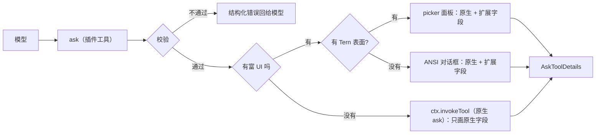

# omp-ask-more

[English](README.md) | 简体中文

状态：**仅设计**。尚未写代码，本文件不声明任何已实现行为。

`omp-ask-more` 是一个 omp 插件，影子替换原生 `ask`。它的参数是原生参数**加上扩展字段**：原生组件渲染原生部分、忽略其余；ask-more 组件两者都渲染。答案形状、结果渲染器与持久化调用的契约保持原生。

## 这个设计要解决的问题

原生 `ask` 已经具备本功能需要的字段：`question` 按 Markdown 渲染（Tern 是 `md` 节点，`packages/tui/src/overlays/ask-dialog.ts:884`；TUI 走带代码高亮的 Markdown，`:298-311`），每个选项都有自由文本 `preview`（Tern 画当前聚焦选项的 `preview`，`:939`；TUI 画在聚焦选项下方，`:501-503`）。

这两个字段没被用起来，原因有两层：

1. 模型被要求不要用。工具 prompt 总共七行，写着 "short labels, tradeoffs in `description`"（`packages/coding-agent/src/prompts/tools/ask.md:1-7`）；`preview` 一次都没出现，而 `description` 只是单行。
2. 表面太小。对话框挂在 composer 容器里（`packages/coding-agent/src/modes/controllers/extension-ui-controller.ts:887-905`），标题最多四行、整块最多占终端 70%（`packages/tui/src/overlays/ask-dialog.ts:116-123`），在 Tern 里 describe 成 `omp.editor.ask`——dock 里的 `col`：`md` 问题、选项的 `list`、以及**只有一个**选项的 `preview`（`:762-940`）。再长的简报也没地方放，于是模型写一行，用户无法据此决定，ask 被丢掉重问。

把简报塞进 `question`、把取舍塞进 `preview` 也治不了：没有任何东西校验简报是否存在，表面照样只给它四行。

## 改什么、不改什么

参数 schema 是**原生加扩展字段**，与 omp-todo-more 对 `todo` 的做法同构：原生组件画它认识的部分，不认识的就忽略。

| 保持 | 新增 | 替换 |
|---|---|---|
| 工具名 `ask`；全部原生字段（`id`、`question`、`header?`、`options[{label, description?, preview?}]`、`multi?`、`recommended?`）及其含义（`packages/coding-agent/src/tools/ask.ts:52-88`） | 顶层：`brief {where, what, how, evidence?, diagram?, risks?}` | 面向模型的工具描述：写清下面的契约，而不是 "short labels" |
| 答案形状 `AskToolDetails` 与 `askToolRenderer` 结果卡片（渲染器按工具名选取，`packages/tui/src/tools/index.ts:37`） | 每个选项：`tradeoff`、`holds_when?`、`cost?` | 有富 UI 时可用的作答表面 |
| 持久化调用参数与 `/tree` 恢复：`arktype` 保留未声明键，所以 `recoverAskQuestions` 接受扩展参数并照旧返回 `questions`（`packages/coding-agent/src/tools/ask.ts:94-109`；用仓库自带的 `arktype` 实测：带 `brief` 与 `tradeoff` 的载荷原样返回） | — | — |
| 没有富 UI 时委托原生内建（`ctx.invokeTool`，`packages/coding-agent/src/extensibility/extensions/types.ts:780-799`），它看见扩展字段并忽略 | — | — |

承载决定本身的扩展字段是**必填**（`brief.where/what/how`、每个选项的 `tradeoff`），因为"礼貌地请求"不会改变模型行为；只做限定的字段（`evidence`、`diagram`、`risks`、`holds_when`、`cost`）可选，对应"必要时要附上代码片段和 mermaid 图"。

## 契约

`question` 只当问题用：一两句话，不把简报塞进去。简报是独立字段。

```
ask({
  questions: [{
    id: "retry-strategy",
    header: "重试策略",
    question: "重试应该怎么做？",
    recommended: 0,
    brief: {
      where: "retry() 与 3 处调用点，429 后上游出现重复写入。",
      what: "选择失败后的重试策略，决定是否引入幂等键。",
      how: "选 A 要加迁移；选 B 只改 retry() 内部，不动调用方。",
      evidence: [
        { path: "src/retry.ts", lines: "41-58", note: "现有重试只有 1 次" },
        { path: "src/order/paid.ts", lines: "88-96" }
      ],
      diagram: "flowchart LR\n  client --> retry --> write",
      risks: ["迁移期间双写"]
    },
    options: [
      { label: "指数退避 + 幂等键",
        description: "需要 1 表 2 字段",
        tradeoff: "重试安全，代价是迁移",
        holds_when: "下游能给出稳定请求键",
        cost: "1 张表、2 个字段，可回滚" },
      { label: "固定 3 次重试", description: "改动最小",
        tradeoff: "不动 schema，但重复写会继续发生",
        cost: "只改 retry() 内部" }
    ]
  }]
})
```

- `brief.where/what/how` 是用户在决定前读的正文，画在选项上方，默认不折叠。
- `evidence[].path` 加可选 `lines` 由工具按 `ctx.cwd` 解析、在渲染时读取，因此面板用带 `path` 与 `start` 的 `code` 节点画**真实行**（`packages/wire/src/tsp.ts:222-236`），而不是模型敲进去的代码。读不到的引用用错误色画出原因，不阻塞这次 ask。
- `diagram` 是 Mermaid 源码，Tern 由 `md` 节点原生绘制，TUI 画 ASCII。
- `tradeoff` / `holds_when` / `cost` 各一行，面板在选项下方用 `kv` 三行呈现；transcript 卡片里不出现这些扩展字段。

## 校验

校验发生在工具边界、任何 UI 打开之前，返回结构化工具错误并列出全部违规项，绝不静默降级成薄 ask。

| 规则 | 拒绝信息 |
|---|---|
| `questions.length === 1` | 一次一个决定；拆成多次调用 |
| `brief.where`、`brief.what`、`brief.how` 非空 | 缺 `brief.<field>` |
| 每个选项的 `tradeoff` 非空 | 选项 `<label>` 没有取舍 |
| `evidence` 项有 `path`；`lines` 可解析为 `N` 或 `N-M` | 证据 `<i>` 不是 `path[:lines]` |
| 拒绝保留标签（`Other (type your own)`、`Chat about this`、`Next →`） | 与原生规则一致，`ask.ts:52-58` |
| `multi` 不设 | 面板只选一个答案；要选两个就调两次 |

证据路径会检查是否存在，但不作为门槛：读不到只会在面板里标成不可读，因为路径可能指向尚未创建的目标、另一个 checkout，或 `ssh` 主机。

## 表面



两个富表面是同一个 pi-tui 组件，经 `ui.custom()` 挂载（`extension-ui-controller.ts:1283-1360`）；终端说 TSP 时由 Tern 后端调用它的 `describe()` 而不是 `render()`（`packages/tui/src/tui.ts:264-272,294-305`）。

**Tern。** 组件声明 `nativeSheet(cx) => cx.supports("picker")`，`describe()` 返回 `picker` 节点：

| 部位 | 节点 | 内容 |
|---|---|---|
| 头 | `picker.title` / `subtitle` | `header`，然后 `question` |
| 行 | `picker.items`，`layout: "cards"` | 每个选项一张卡：label、一行 `description`、`Recommended` 徽章、tone |
| 预览 | `picker.preview: "side"` 的子节点 | `card`(简报) 内含 WHERE / WHAT / HOW 各一个 `section.collapsible`、解析后的 `code` 节点、Mermaid 的 `md`、`risks`，然后是聚焦选项的 `tradeoff` / `holds_when` / `cost` 组成的 `kv` |
| 动作 | `picker.actions` | `Submit`（enter）、`Skip`（esc）、`Other`（o），各带键帽 |

`picker`（`packages/wire/src/tsp.ts:532-620`）在已安装的 Tern 0.9.6 上以 `size:"screen"`、`layout:"cards"`、`preview:"side"` 实测渲染，预览子树可为 `col → md/code/card → table`；`/tmp/tern-catalog-events.jsonl:1` 的 hello 在 45 个 kind 中列有 `picker`、`section`、`el`、`editor`、`md`、`code`；预览里折叠的 `section` 会本地切换并上报 `toggle`（`:7`），程序发 `set(collapsed:false)` 后展开（`:16-17`）；Mermaid 由 `md` 原生绘制（图注 `mermaid · flowchart`）。键盘留在组件里：`ui.custom` 会聚焦它（`extension-ui-controller.ts:1358`），指针事件经 `handleNativeEvent` 回来（`packages/tui/src/native/backend.ts:860-932`）。

若实测发现 picker 作为 dock 组件根不会被 hoist 到 `layer`，回退为 `ui.custom(factory, {overlay: true})` + 同一 `describe()`——这正是 `reconcile.ts:27-28,426,484` 已用于 `overlay`/`picker` 的路径。

**普通 TUI。** 同一组件的 `render(width)` 用 `Markdown` 画简报、把每个选项画成单选/多选行并带上它的取舍行，`Ctrl+O` 逐段展开/折叠；Mermaid 经 `@oh-my-pi/pi-utils/mermaid-ascii` 画成 ASCII（`packages/tui/src/theme/mermaid-cache.ts:66,100`），与助手正文同一条路径。

**原生表面。** 凡是原生组件绘制的地方——`ctx.invokeTool` 委托、`/tree` 重答——它画原生字段、丢掉扩展字段：`question`、`description`、聚焦选项的 `preview`。简报、取舍、图在那里不显示。这是保留同一个工具名与同一份答案契约所接受的成本。

## 答案与生命周期

| 关注点 | 行为 |
|---|---|
| 答案 | 原生 `AskToolDetails`：`results[{id, question, options, multi, selectedOptions, customInput}]`，由 `askToolRenderer` 渲染 |
| 取消 | `ctx.abort()`（`types.ts:699`）后返回取消结果；`ToolAbortError` 未向扩展导出，所以结果文本里说明取消 |
| 并发 | 同时只允许一个；第二次调用返回错误而不是再开一个面板 |
| 超时 | 不设。原生"超时自动选推荐项"读的是扩展拿不到的 session settings（`ask.ts:742-745`），设计选择不做第二个计时器 |
| 审批 | `approval: "read"`，与 `ask.ts:544-551` 一致 |
| 子会话、RPC、print | 委托原生，与今天一样以 "requires interactive mode" 中止 |

## 已知限制

- **`/tree` 重答**走 `new AskTool()`（`packages/coding-agent/src/modes/controllers/selector-controller.ts:1723-1748`）。扩展参数能通过它的 schema 检查，所以 ask 会重新打开——用原生 dock，只画原生字段。
- **协作 guest** 通过原生 ask 镜像通道作答（`extension-ui-controller.ts:923-1025`），该通道没有 `ui.custom` 表面的表示。ask-more 面板打开期间 guest 无法作答；仅 host 作答是本设计接受的范围。
- **plan mode 的超时自动选择**在 ask-more 表面期间不可用。
- **多问题与 `multi: true`** 被拒绝，不实现。
- **没有富 UI 时**：原生对话框只显示问题与选项标签，因为简报在原生组件忽略的扩展字段里。本设计不把简报塞进 `question`/`preview` 伪造等价，回退就是诚实地更薄。
- 工具以原生名注册，模型读到的是 ask-more 的描述而不是 `prompts/tools/ask.md`。

## 文件（计划）

```
index.ts                 插件入口；注册 ask、委托、按 UI 门控
src/schema.ts            原生字段 + brief/tradeoff、边界解析、校验规则
src/brief.ts             简报/证据解析，按 ctx.cwd 解析 path:lines
src/component.ts         单个 pi-tui 组件：render() 给 ANSI，describe() 给 Tern
src/nodes.ts             picker/card/section/code/md/kv 组装、tone 与折叠状态
src/result.ts            AskToolDetails 构造与取消结果
src/i18n.ts              界面标签；字段名保持英文
tern/plugin.toml         可选：只有将来需要 Tern 侧命令时才加
```

## 验证计划

1. 单测：schema 接受与每条拒绝信息；对 fixture 的 `path:lines` 解析；证据读取上界；只有原生字段、没有扩展字段的载荷被"缺简报"拒绝。
2. Tern 端到端（真实 pane）：`omp plugin link` 安装，在 Tern pane 里跑 `omp`，让模型问一个决定；观察 `size: screen` 的 picker，展开/折叠一个代码段，按 `o` 输入 Other，提交；确认工具结果含所选 label，transcript 卡片仍由原生渲染器画出。
3. 回退：同一 ask 在非 Tern 终端（ANSI 对话框）、`tui` 模式关闭、子会话（委托原生，只有原生字段）各跑一次。
4. 回归：用扩展参数持久化的调用走 `/tree` 重答，仍能打开原生对话框并得到答案。
