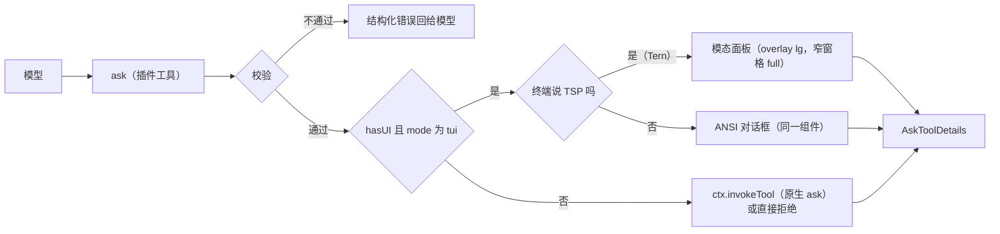

# omp-ask-more

[English](README.md) | 简体中文

一个影子替换原生 `ask` 的 OMP 插件。参数是原生参数**加上扩展字段**：原生组件渲染原生部分、忽略其余；ask-more 组件两者都渲染。答案形状、结果渲染器与持久化调用的契约保持原生。

状态：**已实现，v0.1.0**。在 omp 18.13.3 + Tern 0.9.6 上验证：单测、Tern 面板端到端（键盘、指针、Other、取消、窄窗格）、ANSI 对话框端到端、无 UI 路径。见[验证](#验证)。

## 为什么

原生 `ask` 本来就有这些字段：`question` 按 Markdown 渲染（Tern 是 `md` 节点，`packages/tui/src/overlays/ask-dialog.ts:884`；TUI 走带代码高亮的 Markdown，`:298-311`），每个选项都有自由文本 `preview`（`:939`、`:501-503`）。两件事让它用不起来：

1. 模型被要求不要用。原生工具 prompt 只有七行，写着 "short labels, tradeoffs in `description`"（`packages/coding-agent/src/prompts/tools/ask.md:1-7`）；`preview` 一次都没出现。
2. 表面太小。对话框挂在 composer 容器里（`packages/coding-agent/src/modes/controllers/extension-ui-controller.ts:887-905`），标题最多四行、整块最多占终端 70%（`packages/tui/src/overlays/ask-dialog.ts:116-123`），在 Tern 里 describe 成 `omp.editor.ask`——dock 里的 `col`：`md` 问题、选项 `list`、以及只有一个选项的 `preview`（`:762-940`）。

本插件改两件事：模型必须往里面写什么，以及作答表面怎么画。它不改"一个问题是什么"。

## 安装

```sh
omp plugin install https://github.com/oh-my-omp/omp-ask-more
```

本地开发用 `omp plugin link /path/to/omp-ask-more`。插件入口是包根 `index.ts`，由 `package.json` 的 `omp.extensions` 声明；不需要任何配置节，并必须保留原生 `ask` 开启，供无 UI 路径委托。

## 参数

schema 是原生参数按 omp-todo-more 扩展 `todo` 的方式加上扩展字段：

| 保持 | 新增 |
|---|---|
| 工具名 `ask`；`id`、`question`、`header?`、`options[{label, description?, preview?}]`、`multi?`、`recommended?`（`packages/coding-agent/src/tools/ask.ts:52-88`） | `brief {where, what, how, evidence?, diagram?, risks?}`；每选项 `tradeoff`、`holds_when?`、`cost?` |

`arktype` 保留未声明键，因此持久化的扩展调用仍能通过 `recoverAskQuestions`（`ask.ts:94-109`），`/tree` 重答会重新打开它；那里原生对话框只渲染原生字段。

## 契约

`question` 只当问题用：一两句话。简报是独立字段。

```
ask({
  questions: [{
    id: "retry-strategy",
    header: "重试策略",
    question: "重试应该怎么做？",
    recommended: 0,
    brief: {
      where: "retry() 与 3 处调用点，429 后上游出现重复写入。",
      what: "选择失败后的重试策略，决定是否引入幂等键。",
      how: "选 A 要加迁移；选 B 只改 retry() 内部，不动调用方。",
      evidence: [
        { path: "src/retry.ts", lines: "41-58", note: "现有重试只有 1 次" },
        { path: "src/order/paid.ts", lines: "88-96" }
      ],
      diagram: "flowchart LR\n  client --> retry --> write",
      risks: ["迁移期间双写"]
    },
    options: [
      { label: "指数退避 + 幂等键",
        description: "需要 1 表 2 字段",
        tradeoff: "重试安全，代价是迁移",
        holds_when: "下游能给出稳定请求键",
        cost: "1 张表、2 个字段，可回滚" },
      { label: "固定 3 次重试", description: "改动最小",
        tradeoff: "不动 schema，但重复写会继续发生",
        cost: "只改 retry() 内部" }
    ]
  }]
})
```

- `brief.where/what/how` 画在选项上方，默认不折叠。
- `evidence[].path` 加可选 `lines` 由工具按会话工作目录解析、在渲染时读取，因此面板用带 `path` 与 `start` 的 `code` 节点画**真实行**（`packages/wire/src/tsp.ts:222-236`），而不是模型敲进去的代码。读不到的引用用错误色画出原因，不阻塞这次 ask。
- `diagram` 是 Mermaid 源码：Tern 由 `md` 节点原生绘制，TUI 由 Markdown 渲染器画成 ASCII（`packages/tui/src/theme/mermaid-cache.ts:66,100`）。
- `tradeoff` / `holds_when` / `cost` 各一行，画在聚焦选项下方。

限制：一次一个问题、2–5 个选项、最多 6 条证据引用、每条引用最多 80 行、不支持 `multi`。

## 校验

校验发生在工具边界、任何 UI 打开之前，一次返回全部问题，绝不降级成更薄的 ask。

| 规则 | 拒绝信息 |
|---|---|
| 恰好一个问题 | `questions: expected exactly one question` |
| `brief.where/what/how` 非空 | `questions[0].brief.<field>: empty` |
| 每个选项 `tradeoff` 非空 | `questions[0].options[i].tradeoff: empty` |
| 至少两个选项 | 决定至少需要两个选项 |
| 标签唯一且不是保留标签（`Other (type your own)`、`Chat about this`、`Next →`） | 逐项指明 |
| 不设 `multi` | 不支持；调两次 |
| `recommended` 是选项下标 | 指明非法值 |
| 证据 ≤ 6 条；`lines` 为 `N` 或 `N-M` 且跨度 ≤ 80 行 | 指明第几条与跨度 |

## 表面



两个表面是同一个 pi-tui 组件（`src/component.ts`），经 `ui.custom` 挂载（`extension-ui-controller.ts:1283-1360`）：终端说 TSP 时由 Tern 后端调用 `describe()` 而不是 `render()`（`packages/tui/src/tui.ts:264-272,294-305`）。两种情况下键盘都在组件手里，`↑↓`、`enter`、`o`、`esc`、`ctrl+o` 行为一致；在 Tern 里 `PgUp`/`PgDn`/`Home`/`End` 还会滚动面板。

在 Tern 里，组件仍挂在 composer 的 dock，描述一个 `overlay` 节点（`anchor: "center"`、`size: "lg"`，窄于 `NARROW_SHEET_COLS` 列时为 `"full"`、`modal`），由 reconciler 提升进 `layer`（`packages/tui/src/native/reconcile.ts`）：盖在 transcript 上的不透明面板，标题取 `header`。Tern 把面板正文当作一列整体滚动，并在列表选中项出现或移动时按正文底边把它滚进视野，而面板最后一行 `omp.actions` 若固定在底部会正好盖住它，所以动作条不做那一行。正文依次是：问题与 Where/What/How；然后是决定区——选项列表（单击选中、双击作答、最后一行是 `Other…`）、聚焦选项的取舍卡、Other 输入框和 Cancel/Submit 动作条，动作条在面板打开时把自己滚进视野，因此简报再长，打开时整个决定区也在视野内；最后是证据 `code` 节点（折叠到 12 行，由 Tern 自带的 "more lines" 展开）、Mermaid 的 `md` 和风险。Other 输入框是作为子组件放进去的 pi-tui `Input`：它的值是文本的唯一一份，由面板转交的按键和 Tern 的 edit/undo 事件编辑；`esc` 回到选项。不支持 `overlay` 的终端在 dock 里得到同一列内容。

`ctx.hasUI` 为假或模式不是 `tui` 时，工具用原生子集调 `ctx.invokeTool`（`src/schema.ts#nativeQuestion`），由原生对话框渲染原生字段；没有原生解析器时（例如 print 模式）返回结构化拒绝，而不是挂住。

## 答案与生命周期

| 关注点 | 行为 |
|---|---|
| 答案 | 原生 `AskToolDetails`（`results[{id, question, options, multi, selectedOptions, customInput}]`），由 `askToolRenderer` 渲染（渲染器按工具名选取，`packages/tui/src/tools/index.ts:37`） |
| 取消 | `ctx.abort()`，然后返回取消结果（`id: (cancelled)`），与原生措辞一致 |
| 并发 | 同时只允许一个；第二次调用被拒绝，而不是替换已打开的面板 |
| 超时 | 无；原生超时自动选择读的是扩展拿不到的 session settings（`ask.ts:742-745`） |
| 审批 | `approval: "read"`，与 `ask.ts:544-551` 一致 |
| 表面内部失败 | `ui.notify` 警告，然后委托原生对话框 |

## 已知限制

- **`/tree` 重答**直接 `new AskTool()`（`packages/coding-agent/src/modes/controllers/selector-controller.ts:1723-1748`）。扩展参数能通过它的 schema 检查，所以 ask 会重新打开——用原生 dock，只画原生字段。
- **协作 guest** 走原生镜像通道（`extension-ui-controller.ts:923-1025`），该通道没有 `ui.custom` 表面的表示：ask-more 面板打开期间 guest 无法作答。
- **print 与没有原生解析器的 RPC** 得到结构化拒绝；原生工具会中止整个操作。
- **没有 plan mode 超时自动选择**，没有 `multi`，没有多问题标签页，没有 note。
- 工具以原生名注册：模型读到的是本插件的描述，而不是 `prompts/tools/ask.md`。改写 ask prompt 的扩展必须针对最终描述。

## 文件

```
index.ts        插件入口：注册 ask、校验、选择表面、委托
src/schema.ts   原生字段 + brief/tradeoff、zod 参数、语义校验
src/brief.ts    按工作目录解析 path:lines，限界读取
src/nodes.ts    Tern 面板：overlay、简报各段、选项列表、取舍卡、证据代码、动作条
src/component.ts 单个组件：render() 给 ANSI，describe() 给 Tern
src/result.ts   AskToolDetails 构造、取消与拒绝结果
src/i18n.ts     界面标签取自 OMOMP_LANG / LC_*；协议字段保持英文
src/description.ts 面向模型的工具描述
test/           校验与原生投影测试（bun test）
```

## 验证

2026-10-29 执行，omp 18.13.3、Tern 0.9.6、`opencode-go/deepseek-v4.1-flash`；无 UI 一行在 2026-10-28 执行（此后该代码路径未改动）。

| 检查 | 命令 | 观察结果 |
|---|---|---|
| 类型 | `bun run check` | `tsc --noEmit` 无错误 |
| 单测 | `bun test` | 10 通过 0 失败：每条拒绝信息、证据上下界、`nativeQuestion` 投影 |
| Tern 表面 | 无头 `tern serve --control …`，在其窗格里带 `PI_TUI_TSP_RECORD` 运行 omp；`ctl shot`、`tree`、`dump`、`click`、`dblclick`、`key`、`type` | `tree .sf-overlay` → `sf-overlay sz-lg at-center modal`（720 px 宽窗口下为 `sz-full`）；面板在 transcript 上不透明；简报短时打开停在问题处（y 120），选项、取舍与按钮都在视野内；Where/What/How 超过一屏时打开即可见选项、取舍与按钮，`↓↓` 后选中行（y 669）与动作条（y 848–882）仍在正文区（104–882）内，`enter` 返回 `cache-invalidation: 事件驱动主动失效广播`；单击一行发出 `select … option:N` 并切换取舍卡；`↓` + `enter` 返回 `retry-limit: 5 次`；`dblclick` 发出 `activate … option:2` 并返回 `retry-limit: 5 次`；`Other…` 行打开获得焦点的 `sf-input`，键入的文本进入其中，`esc` 移除它后 `↑` 重新移动选中项；Other + Submit 按钮返回 `retry-cap: "seven"`；Cancel 按钮与 `esc` 返回 `(cancelled)` 并停止本轮；每次作答后 `tree .sf-overlay` 为空 |
| ANSI 表面 | PTY 里 `omp --no-extensions -e …/index.ts`，提示词「立即调用 ask 工具…」 | 面板画出标题、Where/What/How、证据行、带单选标记与 `（推荐）` 的选项、聚焦选项的取舍；`o`、`abc`、Backspace、`d`、`enter` 返回 `User answers: retry-limit: "abd"` |
| 无 UI 路径 | `omp -p … "调用 ask…"` | 载荷通过校验后得到 `ask rejected: … no native ask is available to delegate to here` |

尚未在 runtime 验证：委托原生这条路本身（需要一个 `ctx.invokeTool` 存在而 `ui.custom` 不存在的环境）、协作 guest、以及带扩展参数的 `/tree` 重答。
