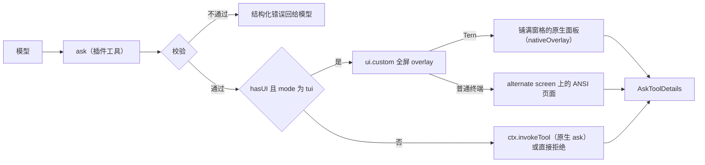

# omp-ask-more

[English](README.md) | 简体中文

一个影子替换原生 `ask` 的 OMP 插件，让 `ask` 成为代理把决定交给用户的唯一入口。参数是原生参数**加上扩展字段**：原生组件渲染原生部分、忽略其余；ask-more 组件两者都渲染。答案形状、结果渲染器与持久化调用的契约保持原生。

状态：**已实现，v0.1.0**。在 omp 18.13.3 + Tern 0.9.6 上验证：单测、ANSI 页面与 Tern 面板端到端（单题与三题一批）、无 UI 路径。见[验证](#验证)。

## 为什么

原生 `ask` 太弱，模型也不用它把话说清楚，于是决定都在 chat 里做：“grill”一类的 skill 不能指望宿主有 ask 工具，只能在对话里问用户。原生 `ask` 其实已有承载更多内容的字段——`question` 按 Markdown 渲染（Tern 是 `md` 节点，`packages/tui/src/overlays/ask-dialog.ts:884`；TUI 走带代码高亮的 Markdown，`:298-311`），每个选项都有自由文本 `preview`（`:939`、`:501-503`）——但两件事让它们用不起来：

1. 模型被要求不要用。原生工具 prompt 只有七行，写着 "short labels, tradeoffs in `description`"（`packages/coding-agent/src/prompts/tools/ask.md:1-7`）；`preview` 一次都没出现。
2. 表面太小。对话框挂在 composer 容器里（`packages/coding-agent/src/modes/controllers/extension-ui-controller.ts:887-905`），标题最多四行、整块最多占终端 70%（`packages/tui/src/overlays/ask-dialog.ts:116-123`），在 Tern 里 describe 成 `omp.editor.ask`——dock 里的 `col`：`md` 问题、选项 `list`、以及只有一个选项的 `preview`（`:762-940`）。

本插件要求每个问题写明现状/决定/后果、每个选项写明取舍，鼓励引用真实代码行和画示意图，并把作答界面画成全屏。工具说明把所有需要用户决定的事都导向 `ask`，因此不必在 chat 里做决定；读取会话的观察者（见[观察者](#观察者)）把这些回答当作用户亲口说的话。

## 安装

```sh
omp plugin install https://github.com/oh-my-omp/omp-ask-more
```

本地开发用 `omp plugin link /path/to/omp-ask-more`。插件入口是包根 `index.ts`，由 `package.json` 的 `omp.extensions` 声明；不需要任何配置节，并必须保留原生 `ask` 开启，供无 UI 路径委托。

## 参数

schema 是原生参数按 omp-todo-more 扩展 `todo` 的方式加上扩展字段：

| 保持 | 新增 |
|---|---|
| 工具名 `ask`；`questions[]`，每题 `id`、`question`、`header?`、`options[{label, description?, preview?}]`、`multi?`、`recommended?`（`packages/coding-agent/src/tools/ask.ts:52-88`） | 每题 `brief {where, what, how, evidence?, diagram?, risks?}`；每选项 `tradeoff`、`holds_when?`、`cost?` |

`arktype` 保留未声明键，因此持久化的扩展调用仍能通过 `recoverAskQuestions`（`ask.ts:94-109`），`/tree` 重答会重新打开它；那里原生对话框只渲染原生字段。

## 契约

工具说明（`src/description.ts`）要求模型：

- `ask` 是把决定交给用户的唯一途径——方案、取舍、偏好、范围、有风险或不可逆的步骤都算。在文字里以提问或列选项结束本轮是错的。
- skill、工作流或其他指令要求问用户、请用户确认或让用户挑选时，用 `ask` 来做；该指令的其余要求照旧。
- 不问工具查得到的事实，不问本该自己做的选择。
- 写给没看过会话的人：说人话、短句、写具体名字。
- 决定涉及代码时引用真实代码行；涉及流程、时序、状态、依赖或结构时画 Mermaid 图。两者在 schema 中都是可选字段。
- 彼此独立的决定放进同一次调用、每题一个；选项依赖另一个答案的决定放到后一次调用。

`question` 只当问题用：一两句话。简报是独立字段。

```
ask({
  questions: [{
    id: "retry-strategy",
    header: "重试策略",
    question: "重试应该怎么做？",
    recommended: 0,
    brief: {
      where: "retry() 与 3 处调用点，429 后上游出现重复写入。",
      what: "选择失败后的重试策略，决定是否引入幂等键。",
      how: "选 A 要加迁移；选 B 只改 retry() 内部，不动调用方。",
      evidence: [
        { path: "src/retry.ts", lines: "41-58", note: "现有重试只有 1 次" },
        { path: "src/order/paid.ts", lines: "88-96" }
      ],
      diagram: "flowchart LR\n  client --> retry --> write",
      risks: ["迁移期间双写"]
    },
    options: [
      { label: "指数退避 + 幂等键",
        description: "需要 1 表 2 字段",
        tradeoff: "重试安全，代价是迁移",
        holds_when: "下游能给出稳定请求键",
        cost: "1 张表、2 个字段，可回滚" },
      { label: "固定 3 次重试", description: "改动最小",
        tradeoff: "不动 schema，但重复写会继续发生",
        cost: "只改 retry() 内部" }
    ]
  }, {
    id: "log-level",
    header: "日志级别",
    question: "默认日志级别用哪一档？",
    brief: { where: "…", what: "…", how: "…" },
    options: [ /* … */ ]
  }]
})
```

- `brief.where/what/how` 画在选项上方，不折叠。
- `evidence[].path` 加可选 `lines` 由工具按会话工作目录解析、在 ask 打开时读取，因此页面画的是**真实行**（Tern 中为带 `path` 与 `start` 的 `code` 节点，`packages/wire/src/tsp.ts:222-236`），而不是模型敲进去的代码。读不到的引用用错误色画出原因，不阻塞这次 ask。
- `diagram` 是 Mermaid 源码：Tern 由 `md` 节点原生绘制，TUI 由 Markdown 渲染器画成 ASCII（`packages/tui/src/theme/mermaid-cache.ts:66,100`）。
- `tradeoff` / `holds_when` / `cost` 各一行，画在聚焦选项下方。

限制：每题 2–5 个选项，每题最多 6 条证据引用，每条引用最多 80 行，不支持 `multi`。

## 校验

校验发生在工具边界、任何 UI 打开之前，检查每一题，一次返回全部问题，绝不降级成更薄的 ask。

| 规则 | 拒绝信息 |
|---|---|
| 至少一个问题 | `questions: empty` |
| id 非空且在本次调用内唯一 | `questions[i].id: duplicate "<id>"` |
| `brief.where/what/how` 非空 | `questions[i].brief.<field>: empty` |
| 每个选项 `tradeoff` 非空 | `questions[i].options[j].tradeoff: empty` |
| 至少两个选项 | 决定至少需要两个选项 |
| 同一题内标签唯一且不是保留标签（`Other (type your own)`、`Chat about this`、`Next →`） | 逐项指明 |
| 不设 `multi` | 不支持；拆成多个问题 |
| `recommended` 是选项下标 | 指明非法值 |
| 证据 ≤ 6 条；`lines` 为 `N` 或 `N-M` 且跨度 ≤ 80 行 | 指明第几条与跨度 |

## 表面



一个 pi-tui 组件（`src/component.ts`）经 `ui.custom(factory, { overlay: true, overlayOptions: { fullscreen: true, width: "100%", maxHeight: "100%", margin: 0 } })` 挂载（`extension-ui-controller.ts:1283-1369`）。每题状态（`src/state.ts`）保存光标、答案（光标停在某个选项上不等于作答）、Other 输入框、证据折叠与滚动，切换题目不丢任何东西。组件持有 overlay 焦点，Other 输入框打开时由它把按键转交给输入框。

**ANSI。** `fullscreen` 把页面放到 alternate screen。标题和（多题时的）标签行（已答题带 `✓`，最后是 `汇总`）固定在顶部，键位提示固定在底部；中间的正文是按实时终端高度调整的 pi-tui `ScrollView`，带滚动条，可用 `PgUp`/`PgDn`/`Home`/`End`/`Shift+↑↓` 和鼠标滚轮滚动，`↑↓` 移动选项时自动滚到聚焦选项。

**Tern。** 组件声明 `nativeOverlay`（`role: "omp.overlay.askMore"`、`size: "full"`，`head` 为该题的 `header`，多题时为“N 个决定”），后端把它包进一张铺满窗格的不透明面板（`packages/tui/src/native/backend.ts:873-900`），`describe()` 只返回内容：多题时一个 `tabs` 节点（按位置编号，已答题带 `✓`，最后是 `汇总`，点击切换）；问题与 Where/What/How；然后是决定区——每题一个以 `qN` 为 key 的选项列表（单击选中、双击作答、最后一行是 `其他…`）、聚焦选项的取舍卡、Other 输入框和动作条（`全部取消`，以及 `下一题` / `提交` / `保存答案`）；最后是证据 `code` 节点（折叠到 12 行，由 Tern 自带的 "more lines" 展开）、Mermaid 的 `md` 和风险。Tern 把面板正文当作一列整体滚动，并按正文底边把列表选中项滚进视野，因此动作条紧跟决定区，并在每页打开时把自己滚进视野：简报再长，打开时整个决定区也在视野内。键盘滚动以正文上的 `scroll` 请求交给 Tern。

**按键与指针。**

| 输入 | 问题页 | 汇总页 |
|---|---|---|
| `↑` `↓` / 单击一行 | 移动光标（光标下的行还不是答案） | 滚动 |
| `enter` / 双击 / `下一题`、`提交` | 以该行作答；单题直接提交，多题跳到下一题，最后一题之后进入汇总 | 提交整批 |
| `o` / 点击 `其他…` | 打开 Other 输入框；`enter` 把非空文字存为答案，`esc` 关闭输入框 | — |
| `tab` `→` / `shift+tab` `←` / 点击标签 | 下一题 / 上一题（仅多题） | 同左 |
| `ctrl+o` | ANSI 页面中展开证据行 | — |
| `esc` / `全部取消` | 取消整次调用 | 同左 |

Other 输入框是 pi-tui `Input`，每题一个：它的值是文本的唯一一份，由组件转交的按键编辑；在 Tern 中也由终端自己的 edit/undo 事件编辑（输入框是子组件，reconciler 把事件路由给它）。

`ctx.hasUI` 为假或模式不是 `tui` 时，工具把每一题的原生子集交给 `ctx.invokeTool`（`src/schema.ts#nativeQuestion`），由原生对话框渲染原生字段；没有原生解析器时（例如 print 模式）返回结构化拒绝，而不是挂住。

## 答案与生命周期

| 关注点 | 行为 |
|---|---|
| 答案 | 原生 `AskToolDetails`：`results[{id, question, options, multi, selectedOptions, customInput}]`，每题一项、按输入顺序；文本为 `User answers:` 加每行 `id: 选项`、`id: "自填文字"` 或 `id: (cancelled)`，与原生多题措辞一致。由 `askToolRenderer` 渲染（渲染器按工具名选取，`packages/tui/src/tools/index.ts:37`） |
| 未作答的题 | 汇总页列出；提交仍会发送其余答案，未作答的题为 `id: (cancelled)`（与原生对话框一致） |
| 取消（`esc`、`全部取消`、abort signal） | `ctx.abort()`，然后所有题都为 `(cancelled)`；已作答的部分不提交 |
| 并发 | 同时只允许一个；第二次调用被拒绝，而不是再开一张面板 |
| 超时 | 无；原生超时自动选择读的是扩展拿不到的 session settings（`ask.ts:742-745`） |
| 审批 | `approval: "read"`，与 `ask.ts:544-551` 一致 |
| 表面内部失败 | `ui.notify` 警告，然后把整批委托给原生对话框 |

## 观察者

`ask` 里的回答是工具结果，不是用户消息，读取会话的工具要专门去找。配套的改动：

- [omp-config](https://github.com/oh-my-omp/omp-config) 的 `turn-judge` 把 `用户在ask中回答`（每个已作答的问题一行 `问题 → 答案`）放进判定时间线，其 `gpt-talk-only` 规则把这些回答当作用户亲口说的话：用户只要求作出决定时，确认决定后结束是正当的；复述已选的做法却不去做，仍会被拦下。
- omp-config 的 `user-prompt-inject` 渲染 `{{ask_answers}}`，让 `mentor:default` 和 `discuss:*` 在用户打字的请求旁边看到用户在 `ask` 中作的决定。
- [omp-todo-more](https://github.com/oh-my-omp/omp-todo-more) 把在 `ask` 里等用户作答的时间从 in_progress 用时中扣除，长时间讨论不会触发超时警告；ask 未结束时不运行任何 deadline。

它们读取的是原生结果形状，对原生 `ask` 同样有效。

## 已知限制

- **`/tree` 重答**直接 `new AskTool()`（`packages/coding-agent/src/modes/controllers/selector-controller.ts:1723-1748`）。扩展参数能通过它的 schema 检查，所以 ask 会重新打开——用原生 dock，只画原生字段。
- **协作 guest** 走原生镜像通道（`extension-ui-controller.ts:923-1025`），该通道没有 `ui.custom` 表面的表示：ask-more 面板打开期间 guest 无法作答。
- **print 与没有原生解析器的 RPC** 得到结构化拒绝；原生工具会中止整个操作。
- **没有 plan mode 超时自动选择**，没有 `multi`，没有 note。
- 工具以原生名注册：模型读到的是本插件的描述，而不是 `prompts/tools/ask.md`。改写 ask prompt 的扩展必须针对最终描述。

## 文件

```
index.ts           插件入口：注册 ask、校验、挂载全屏 overlay、委托
src/schema.ts      原生字段 + brief/tradeoff、zod 参数、逐题校验
src/brief.ts       按工作目录解析 path:lines，限界读取
src/state.ts       每题状态（光标、答案、Other 输入框、折叠、滚动）与当前标签
src/component.ts   单个组件：ANSI 页面（render）与 Tern 内容（describe）、按键与事件
src/nodes.ts       Tern 内容：标签、简报各段、选项列表、取舍卡、动作条、汇总页
src/result.ts      Answer 变体、AskToolDetails 构造、取消与拒绝结果
src/i18n.ts        界面标签取自 OMOMP_LANG / LC_*；协议字段保持英文
src/description.ts 面向模型的工具描述
test/              校验与原生投影测试（bun test）
```

## 验证

2026-10-29 执行，omp 18.13.3、Tern 0.9.6、`opencode-go/deepseek-v4.1-flash`。

| 检查 | 命令 | 观察结果 |
|---|---|---|
| 类型 | `bun run check` | `tsc --noEmit` 无错误 |
| 单测 | `bun test` | 12 通过 0 失败：每条拒绝信息、逐题下标与重复 id、证据上下界、`nativeQuestion` 投影 |
| ANSI 多题 | 130×40 PTY 里 `omp --no-extensions -e …/index.ts`，提示词要求一次问三个独立问题 | alternate screen 页面画出标题、标签行 `重试上限 日志级别 缓存 汇总`、滚动条与键位提示；`enter` 回答第 1 题（`✓ 重试上限`）并打开第 2 题；`o`、`warn`、`enter` 作答；第 3 题 `PgDn` 滚动；`tab` 打开汇总，列出两题答案与 `1 题未回答`；`enter` 返回 `retry-limit: 固定 3 次，指数退避`、`log-level: "warn"`、`cache: (cancelled)` |
| ANSI 单题 | 同一会话 | 无标签行；`↓`、`enter` 直接提交：`cap: 3 次` |
| Tern 多题 | 无头 `tern serve --control …`，在其窗格里带 `PI_TUI_TSP_RECORD` 运行 omp；`ctl shot`、`tree`、`click`、`dblclick`、`key`、`type` | 一张 `sf-overlay sz-full at-center modal` 面板，标题 `3 decisions`，带 `tabs` 行；单击一行发出 `select … q0/option:2` 并切换取舍卡；`Next` 作答并打开下一题；点击标签回到第 2 题，原答案保留；`Other…` 打开获得焦点的 `sf-input`，键入的文字进入其中，`Save answer` 作答并前进；`tab` 打开汇总；`enter` 返回 `retry-limit: 10 次(长退避)`、`log-level: "warn and above"`、`cache: 定时过期(TTL 固定)`，面板离开 `layer`。`OMOMP_LANG=zh` 下汇总行与取舍行为“标签 值”且不重叠，`esc` 返回三题均为 `(cancelled)` |
| Tern 长简报 | 同上，单题且 Where/What/How 超过一屏 | 打开即可见选项、取舍与 `Cancel all` / `Submit`；`↓↓` 后选中行（y 659）与动作条（y 852–886）仍在正文区（100–886）内；`enter` 返回 `cache-invalidation: 生存时间被动过期` |
| 无 UI 路径 | `omp -p … "调用一次 ask 工具，一次问两个问题…"` | 载荷通过校验后得到 `ask rejected: … no native ask is available to delegate to here` |

尚未在 runtime 验证：委托原生这条路本身（需要一个 `ctx.invokeTool` 存在而 `ui.custom` 不存在的环境）、协作 guest、带扩展参数的 `/tree` 重答，以及 ANSI 页面打开时调整终端大小。
