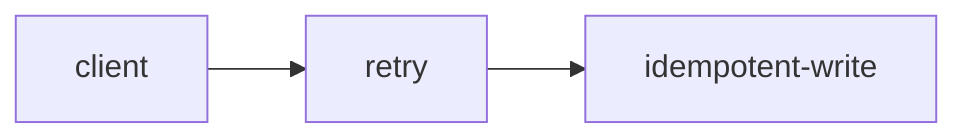
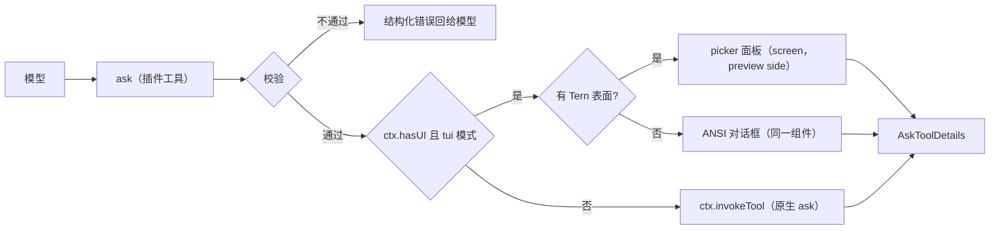

# omp-ask-more

[English](README.md) | 简体中文

状态：**仅设计**。尚未写代码，本文件不声明任何已实现行为。

`omp-ask-more` 是一个 omp 插件：保留原生 `ask` 的工具名、参数 schema、答案形状与生命周期契约，只替换两件事——模型必须往里面写什么，以及用户作答时看到什么。

## 这个设计要解决的问题

原生 `ask` 已经具备本功能需要的字段：`question` 按 Markdown 渲染（Tern 是 `md` 节点，`packages/tui/src/overlays/ask-dialog.ts:884`；TUI 走带代码高亮的 Markdown，`:298-311`），每个选项都有自由文本 `preview`（Tern 画当前聚焦选项的 `preview`，`:939`；TUI 画在聚焦选项下方，`:501-503`）。

这两个字段没被用起来，原因有两层：

1. 模型被要求不要用。工具 prompt 总共七行，写着 "short labels, tradeoffs in `description`"（`packages/coding-agent/src/prompts/tools/ask.md:1-7`）；`preview` 一次都没出现，而 `description` 只是单行。
2. 表面太小。对话框挂在 composer 容器里（`packages/coding-agent/src/modes/controllers/extension-ui-controller.ts:887-905`），标题最多四行、整块最多占终端 70%（`packages/tui/src/overlays/ask-dialog.ts:116-123`），在 Tern 里 describe 成 `omp.editor.ask`——一个 dock 里的 `col`：`md` 问题、选项的 `list`、以及**只有一个**选项的 `preview`（`:762-940`）。再长的简报也没地方放，于是模型写一行，用户无法据此决定，ask 被丢掉重问。

## 改什么、不改什么

| 与原生完全一致 | 被替换 |
|---|---|
| 工具名 `ask` 与参数 schema `{questions: [{id, question, header?, options: [{label, description?, preview?}], multi?, recommended?}]}`（`packages/coding-agent/src/tools/ask.ts:52-88`） | 面向模型的工具描述：写清下面的契约，而不是 "short labels" |
| 答案形状 `AskToolDetails` 与 `askToolRenderer` 结果卡片（渲染器按工具名选取，`packages/tui/src/tools/index.ts:37`） | 有 Tern 时可用的作答表面：整屏 `picker` 面板 |
| 持久化的调用参数，`/tree` 重答仍能恢复同一组问题（`recoverAskQuestions`，`packages/coding-agent/src/tools/ask.ts:94-109`） | 其余都不动。原生 `AskTool.execute()` 的校验、超时、朗读、图片、note、chat redirect 通过委托仍然可达 |
| 子会话、RPC、print：没有富 UI 时委托原生实现 | — |

保持 schema 不变是刻意的。这样富内容就落在**所有其他路径本来就在渲染和持久化的字段**里：`/tree` 重答、协作镜像、回退到原生对话框，都仍能看到简报与逐选项取舍，只是表面更小。若另开一个 `brief` 对象，原生恢复会失败（`arktype` 对象拒绝未声明键），所有非 ask-more 路径都会丢内容。

## 模型必须满足的契约

`question` 是 Markdown，必须以三个标题开头；标题是协议记号，不翻译：

```
## Where
现在有什么：路径、符号、观察到的失败。引用 `path:line`。

## What
在决定什么，以及为什么代码/文档/惯例无法替它决定。

## How
每种答案之后会发生什么，哪条约束起决定作用。


```

每个选项的 `preview` 必须写自己的取舍，含 `取舍` / `Tradeoff` 一行、`成立条件` / `Holds when` 一行、`成本` / `Cost` 一行。`description` 仍只做一行消歧：预览未展开时选项行显示它。

```
ask({
  questions: [{
    id: "retry-strategy",
    question: "## Where\n...\n## What\n...\n## How\n...\n```mermaid\nflowchart LR\n  c --> r\n```",
    header: "重试策略",
    recommended: 0,
    options: [
      { label: "指数退避 + 幂等键",
        description: "需要 1 张表、2 个字段",
        preview: "### 取舍\n重试安全，代价是迁移。\n### 成立条件\n下游能给出稳定请求键。\n### 成本\n1 张表、2 个字段，可回滚。\n```ts src/retry.ts:41-58\n```" },
      { label: "固定 3 次重试", description: "改动最小", preview: "### 取舍\n..." }
    ]
  }]
})
```

info string 为 `lang path:lines` 的围栏是证据引用。渲染器在绘制时读取该文件，用带 `path` 与 `start` 的 `code` 节点画出真实行（`packages/wire/src/tsp.ts:222-236`），因此片段无法编造：文件或行段读不到时，表面用错误色显示模型写的文本并给出原因。

## 校验

校验发生在工具边界、任何 UI 打开之前，返回结构化工具错误并列出全部违规项，绝不静默降级成薄 ask。

| 规则 | 拒绝信息 |
|---|---|
| `questions.length === 1` | 一次一个决定；拆成多次调用 |
| `question` 依次含 `## Where`、`## What`、`## How` | 缺哪段，给出期望标题 |
| 每个选项的 `preview` 非空且含取舍行 | 选项 `<label>` 没有取舍 |
| 至少一条证据引用（`path:lines`）或 `http(s)` 链接 | 没有证据：给出路径或 URL |
| 拒绝保留标签（`Other (type your own)`、`Chat about this`、`Next →`） | 与原生规则一致，`ask.ts:52-58` |
| `multi` 不设 | 面板只选一个答案；要选两个就调两次 |

## 表面



两个富表面是同一个 pi-tui 组件，经 `ui.custom()` 挂载（`extension-ui-controller.ts:1283-1360`）；终端说 TSP 时由 Tern 后端调用它的 `describe()` 而不是 `render()`（`packages/tui/src/tui.ts:264-272,294-305`）。

**Tern。** 组件声明 `nativeSheet(cx) => cx.supports("picker")`，`describe()` 返回 `picker` 节点：

| 部位 | 节点 | 内容 |
|---|---|---|
| 头 | `picker.title` / `subtitle` | 正在决定什么 |
| 行 | `picker.items`，`layout: "cards"` | 每个选项一张卡：label、一行 `description`、`Recommended` 徽章、tone |
| 预览 | `picker.preview: "side"` 的子节点 | `card`(简报) 内含 WHERE/WHAT/HOW 各一个 `section.collapsible`、解析后的 `code` 节点、带 Mermaid 围栏的 `md`，随后是每个选项一个 `section.collapsible` 放它的取舍 |
| 动作 | `picker.actions` | `Submit`（enter）、`Skip`（esc）、`Other`（o），各带键帽 |

`picker`（`packages/wire/src/tsp.ts:532-620`）在已安装的 Tern 0.9.6 上以 `size:"screen"`、`layout:"cards"`、`preview:"side"` 实测渲染，预览子树可为 `col → md/code/card → table`；`/tmp/tern-catalog-events.jsonl:1` 的 hello 在 45 个 kind 中列有 `picker`、`section`、`el`、`editor`、`md`、`code`；预览里折叠的 `section` 会本地切换并上报 `toggle`（`:7`），程序发 `set(collapsed:false)` 后展开（`:16-17`）。Mermaid 由 `md` 原生绘制（图注 `mermaid · flowchart`）。键盘留在组件里：`ui.custom` 会聚焦它（`extension-ui-controller.ts:1358`），指针事件经 `handleNativeEvent` 回来（`packages/tui/src/native/backend.ts:860-932`）。

若实测发现 picker 作为 dock 组件根不会被 hoist 到 `layer`，回退为 `ui.custom(factory, {overlay: true})` + 同一 `describe()`——这正是 `reconcile.ts:27-28,426,484` 已用于 `overlay`/`picker` 的路径。

**普通 TUI。** 同一组件的 `render(width)` 用 `Markdown` 画简报、画出单选/多选行，并用 `Ctrl+O` 式按键展开每个折叠段；Mermaid 经 `@oh-my-pi/pi-utils/mermaid-ascii` 画成 ASCII（`packages/tui/src/theme/mermaid-cache.ts:66,100`），与助手正文同一条路径。

**回退。** `ctx.hasUI` 为假、模式不是 `tui`、或组件在挂载前抛错时，工具调用 `ctx.invokeTool(params)`——同名原生实现，带深度保护（`packages/coding-agent/src/extensibility/extensions/types.ts:780-799`）。此时原生对话框显示的仍是同一份富 `question` 与 `preview`，只是表面更小。

## 答案与生命周期

| 关注点 | 行为 |
|---|---|
| 答案 | 原生 `AskToolDetails`：`results[{id, question, options, multi, selectedOptions, customInput}]`，由 `askToolRenderer` 渲染 |
| 取消 | `ctx.abort()`（`types.ts:699`）后返回取消结果；`ToolAbortError` 未向扩展导出，所以结果文本里说明取消 |
| 并发 | 同时只允许一个；第二次调用返回错误而不是再开一个面板（用锁去补共享 composer 正是原生 `exclusive` 标记要避免的事，`ask.ts:568-573`） |
| 超时 | 不设。原生"超时自动选推荐项"读的是扩展拿不到的 session settings（`ask.ts:742-745`），设计选择不做第二个计时器 |
| 审批 | `approval: "read"`，与 `ask.ts:544-551` 一致 |
| 子会话、RPC、print | 委托原生，与今天一样以 "requires interactive mode" 中止 |

## 已知限制

- **`/tree` 重答**走 `new AskTool()`（`packages/coding-agent/src/modes/controllers/selector-controller.ts:1723-1748`），并按原生 schema 校验持久化参数。因为 schema 未变，恢复成功、完整 `question`/`preview` 回来——但用的是原生 dock 表面，不是 picker。
- **协作 guest** 通过原生 ask 镜像通道作答（`extension-ui-controller.ts:923-1025`），该通道没有 `ui.custom` 表面的表示。ask-more 面板打开期间 guest 无法作答；仅 host 作答是本设计接受的范围。
- **plan mode 的超时自动选择**在 ask-more 表面期间不可用。
- **多问题与 `multi: true`** 被拒绝，不实现。
- 工具以原生名注册，模型读到的是 ask-more 的描述而不是 `prompts/tools/ask.md`。通过 `tool-topics` 改写 ask prompt 的其他扩展，只有在它们针对最终描述时才继续生效。

## 文件（计划）

```
index.ts                 插件入口；注册 ask、委托、按 UI 门控
src/schema.ts            原生形状的 schema、边界解析、校验规则
src/contract.ts          question 与 preview 的标题/取舍解析、证据引用
src/component.ts         单个 pi-tui 组件：render() 给 ANSI，describe() 给 Tern
src/nodes.ts             picker/card/section/code/md 组装、tone 与折叠状态
src/evidence.ts          按 ctx.cwd 解析 path:lines，限界读取
src/result.ts            AskToolDetails 构造与取消结果
src/i18n.ts              界面标签；协议标题保持英文
tern/plugin.toml         可选：只有将来需要 Tern 侧命令时才加
```

## 验证计划

1. 单测：schema 接受与每条拒绝信息；标题解析；对 fixture 文件的 `path:lines` 解析；证据读取上界。
2. Tern 端到端（真实 pane）：安装插件，在 Tern pane 里跑 `omp`，让模型问一个决定；观察 `size: screen` 的 picker，展开/折叠一个代码段，按 `o` 输入 Other，提交；确认工具结果含所选 label，且 transcript 卡片仍由原生渲染器画出。
3. 回退：同一 ask 在非 Tern 终端（ANSI 对话框）、`tui` 模式关闭、子会话（委托原生）各跑一次。
4. 回归：用同一组参数持久化的 ask 走 `/tree` 重答，原生对话框里简报仍在。
