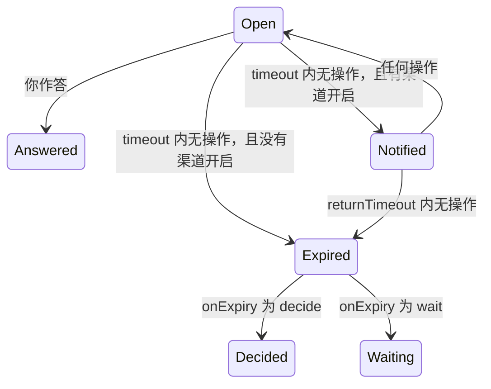

# omp-ask-more

[English](README.md) | 简体中文

一个替换原生 `ask` 工具的 OMP 插件，让 `ask` 成为代理把决定交给你的唯一入口。每个问题都写明现状、要决定什么、各个答案的后果，每个选项都写明取舍；作答界面铺满屏幕——普通终端里是 alternate screen 上的整页，Tern 里是盖在对话记录上的面板。答案以原生形状交回模型，读取会话的工具不用改。

状态：**已实现，v0.1.0**，在 omp 18.14.0 与 Tern 0.9.6 上验证（[验证](docs/verification.zh-CN.md)）。实现方式见[设计](docs/design.zh-CN.md)。

## 为什么

原生 `ask` 太弱，模型也不用它把话说清楚，于是决定都在 chat 里做：“grill”一类的 skill 不能指望宿主有 ask 工具，只能在对话里问用户。原生工具其实已有承载更多内容的字段——`question` 按 Markdown 渲染，每个选项都有自由文本 `preview`——但它的 prompt 要求模型把标签写短、从不提 `preview`，对话框又挂在 composer 里，标题最多四行、整块最多占终端 70%。

本插件要求每个问题写明现状/决定/后果、每个选项写明取舍，鼓励引用真实的文件行和命令输出、画示意图和放演示动画，并把作答界面画成全屏。`xd://ask/routing` topic 要求模型把所有需要用户回答的问题都交给 `ask`，skill 要求在 chat 里问的问题也一样；用户调用的 skill 送到模型时，末尾也带着这条规则。模型是否照做因模型而异（见[已知限制](#已知限制)）。

## 演示视频

下面三段无声视频在无界面的 Tern 0.9.8 窗口里录制，用的是 omp 18.14.0 和真实模型 `opencode-go/deepseek-v4.1-flash`，对象是一个小型订单服务：它的付款重试会把一行写两次。人的请求按画面所示输入；画面上的每个问题、选项、引用的行号范围、图和演示都是模型自己的输出。等模型的时间被剪掉，字幕写明等了多久。每条字幕先写是谁在操作：人、模型或 ask-more。界面是英文，字幕是中文。

| 视频 | 演示内容 |
|---|---|
| [1. 前后对比：一个决定](#1-前后对比一个决定) | 同一个请求、同一个模型，先用 omp 自带的 ask，再用 ask-more；现状 / 决定 / 后果（Where / What / How）；随光标切换的取舍 / 成立条件 / 成本卡片；从磁盘读出的证据；Mermaid 图；风险；选项上的 GIF 演示；提交；原生的结果形状，以及模型接着干活 |
| [2. 一次多个决定，然后走开](#2-一次多个决定然后走开) | 一次 ask 里的三个问题；带 `✓` 的标签；通过 `Other…` 自己写答案；切换标签不丢答案；问题上的分帧演示；汇总页里有一题未答；倒计时行、终端通知和 `(timed out: …)`；模型自己决定未答的题并说明选了什么 |
| [3. 普通终端](#3-普通终端) | 同一个请求，omp 用经典渲染器（`PI_TUI_NATIVE=0`）：alternate screen 上的页面、键位提示、滚动条、带帧计数的分帧演示、`PgDn`、`ctrl+o`、用 `enter` 作答 |

没有拍到的：普通终端里 GIF 或视频的半块字符画面、APNG/WebP/视频演示文件、`esc` / `全部取消`、`onExpiry: wait`、通知命令、没有 TUI 的会话、`/tree` 重答、观察者和协作 guest。

### 1. 前后对比：一个决定

https://github.com/user-attachments/assets/e29b2bea-7166-4028-80a5-3c1e4ac38689

### 2. 一次多个决定，然后走开

https://github.com/user-attachments/assets/26b8729a-83f0-484b-ace5-03ee4f82a668

### 3. 普通终端

https://github.com/user-attachments/assets/101da4a7-ec8b-4c83-8286-2cd0d8a7d1fe

## 安装

```sh
omp plugin install https://github.com/oh-my-omp/omp-ask-more#release
```

`#release` 是发布通道：`main` 上是开发中的改动，每天的发布运行把它们变成一个版本。每个版本的变更写在 [`CHANGELOG.md`](CHANGELOG.md) 里，升级后 omp 会把它们作为 What's New 显示出来。

本地开发用 `omp plugin link /path/to/omp-ask-more`。不需要任何配置：[超时设置](#超时与通知)和[可读性检查](#可读性检查)都有默认值。原生 `ask` 要保持开启，没有 TUI 的会话会把提问交给它。

在 Tern 中还要安装 `tern/` 里的纯样式 Tern 插件：

```sh
tern plugin install github.com/oh-my-omp/omp-ask-more/tern
```

开发时用 `tern plugin link /path/to/omp-ask-more/tern`。两者都会让 Tern 重新加载插件，无需重启。它让 ask 面板用上 omp 其他 overlay 的无衬线字体，并在 Console 聊天风格下留出问题前 `?` 标记所在的左侧空白。不装它面板照常可用，简报以终端字体显示。

## 发布

PR 只在 [`CHANGELOG.md`](CHANGELOG.md) 的 `## [Unreleased]` 下写条目，不改版本号；提交用 [lgit](https://github.com/can1357/llm-git)，条目由它写。发布运行给这一段加上版本号和日期，同步 `package.json` 与 `tern/plugin.toml` 的版本，并把 `release` 分支和版本 tag 移到新提交上。它每天 GMT+9 02:00 运行一次，也可以手动触发；`## [Unreleased]` 下没有条目时不发布。

## 界面语言

Ask-more 面向 OMP，不支持 Pi。界面标签与通知在生成文字时按以下顺序解析语言：

1. `OMOMP_LANG`：去掉首尾空白、忽略大小写后为 `en` 或 `zh` 时采用。
2. `LC_ALL`、`LC_MESSAGES`、`LANG` 中第一个去掉首尾空白后非空的值：以 `zh` 开头（不分大小写）为中文，其余为英文。
3. 英文。

环境变量每次解析时重新读取。发给模型的文字保持英文。Tern 配套插件只有样式，没有独立的语言设置。


## 你会看到什么

每个问题一页：

- 问题，然后是**现状**、**决定**（要决定什么）和**后果**（各个答案之后会怎样），不折叠；
- 选项，推荐项带标记，最后是 `其他…`，可以自己写答案；
- 聚焦选项下方是它的**取舍**、**成立条件**和**成本**，有演示时还有演示；
- 问题的演示、**证据**、Mermaid 图和风险。证据有两种：文件里的行，ask 打开时由 ask-more 自己读取，你读到的是文件本身，不是模型抄的版本；以及模型从别处引用的文字（命令输出、网页、日志），标题是模型写的来源，并标明 ask-more 没有读取核对。读不到的文件写明原因，不阻塞这次 ask。每条证据在普通终端先显示 10 行、在 Tern 先显示 12 行，其余由 `ctrl+o` 或 Tern 的 `N more lines` 展开；比普通终端页面宽的行末尾显示 `… 还有 N 个字符`；
- ask 会超时的话，还有一行倒计时（见[超时与通知](#超时与通知)）。

多个独立问题合成一批：一行标签（已答题带 `✓`），最后一页是**汇总**，列出每题的答案和未答题数。光标停在某个选项上不等于作答；切换标签不丢任何东西。

普通终端里页面在 alternate screen 上，标题和标签在顶部，键位提示在底部，中间的正文可以滚动。Tern 里是盖住窗格的模态面板，配色跟随 Tern 的主题和 Reader、Spine、Console 聊天风格，滚动由 Tern 自己处理。

### 演示

演示展示随时间变化的行为：放在问题上展示现在的样子，放在选项上展示选它之后的结果（光标每次移到该选项都从头播放，在选项间移动就能对比）。

| 来源 | Tern | 普通终端 |
|---|---|---|
| 模型写的分步画面 | 每帧按 Markdown 显示，带 `1/3` 计数和 `Previous` / `Pause` / `Next` | 同样的分步画面，用下表的按键换帧 |
| GIF、APNG、WebP | Tern 按文件自身的节奏播放 | 64 × 20 格的粗略彩色画面，和分步画面一样换帧 |
| mp4、mov、webm、mkv、m4v | 由 ffmpeg 转成 GIF 后播放 | 和动画一样解码 |

普通终端页面和视频需要 `PATH` 里有 `ffmpeg`/`ffprobe`；缺工具、缺文件或格式不对时显示为写明原因的错误行，ask 照常打开。

### 按键与指针

| 输入 | 问题页 | 汇总页 |
|---|---|---|
| `↑` `↓` / 单击一行 | 移动光标（光标下的行还不是答案） | 滚动 |
| `enter` / 双击 / `下一题`、`提交` | 以该行作答；单题直接提交，多题跳到下一题，最后一题之后进入汇总 | 提交整批 |
| `o` / 点击 `其他…` | 打开 Other 输入框；`enter` 把非空文字存为答案，`esc` 关闭输入框 | — |
| `tab` `→` / `shift+tab` `←` / 点击标签 | 下一题 / 上一题（仅多题） | 同左 |
| `PgUp` `PgDn` `Home` `End` `Shift+↑↓` / 滚轮 | 滚动页面 | 同左 |
| `ctrl+o` | 普通终端里一次展开本页全部证据；Tern 里每条证据有自己的 `N more lines` | — |
| `p` / `Pause`、`Play` | 暂停或继续本页的演示 | — |
| `[` `]` / `Previous`、`Next` | 本页的演示后退或前进一帧 | — |
| `esc` / `全部取消` | 取消整次调用 | 同左 |

## 超时与通知

打开的 ask 在没人操作时倒计时。这些是原生**插件设置**，由 `package.json` 的 `omp.settings` 声明。全局值通过 `/settings` → Plugins → `omp-ask-more` 或 `omp plugin config set omp-ask-more <key> <value>` 设置；项目值写入 `.omp/plugin-overrides.json`，覆盖全局值。每次 ask 打开时读取并校验一份快照，改动从下一次 ask 生效。超时值必须为 0 到 2147483 之间的整数秒。

| 设置 | 默认 | 含义 |
|---|---|---|
| `timeout` | `1800` | 无操作多少秒后进入第一步；`0` 关闭计时 |
| `notify.terminal` | `true` | 在这一步发终端通知（OSC 99、OSC 9 或 BEL，取终端支持的那种） |
| `notify.command` | 未设置 | 在这一步以 `sh -c` 运行的 shell 命令；`OMP_ASK_MORE_NOTIFY_COMMAND` 优先，包括空值（关闭命令）。与可信全局基线不同的项目命令被忽略并给出警告 |
| `returnTimeout` | `1200` | 通知之后留给你回来的秒数 |
| `onExpiry` | `decide` | 最后一段倒计时结束时：`decide` 把未答的问题交给模型，`wait` 让 ask 一直开着 |

例如项目 `.omp/plugin-overrides.json` 可以缩短倒计时，而不提供 shell 命令：

```json
{
  "settings": {
    "omp-ask-more": {
      "timeout": 60,
      "returnTimeout": 30,
      "notify.terminal": true,
      "onExpiry": "decide"
    }
  }
}
```



- 任何按键、点击、普通终端页面里的滚轮，或在 Other 输入框里打字，都让第一段倒计时从头开始。通知之后回来操作也一样，之后再闲置会再次通知。
- 两个渠道都关闭时，第一段倒计时结束就结束 ask（`decide`），或什么都不发生（`wait`）。
- 交给模型时，你已给出的答案照旧有效，每道未答的题以 `(timed out: …)` 交给模型；模型自己决定这些题、说明选了什么，本轮继续。Other 输入框里没保存的文字不算答案。
- 倒计时那一行只在上述步骤变化：`无操作 30 分钟 后通知你，再过 20 分钟 交给模型决定`，之后是 `14:03 已通知；14:23 前无操作则交给模型决定`。
- 通知不带问题正文、证据或答案。终端通知为 `omp: <标题>：等待你的回答；14:23 交给模型决定`。
- 命令在会话工作目录运行，环境是它自己的环境加上：

  | 变量 | 值 |
  |---|---|
  | `OMP_ASK_MORE_EVENT` | `timeout` |
  | `OMP_ASK_MORE_TITLE` | 面板标题：该题的 `header`，或“N 个决定” |
  | `OMP_ASK_MORE_BODY` | 终端通知的文字 |
  | `OMP_ASK_MORE_QUESTIONS` | 题数 |
  | `OMP_ASK_MORE_CWD` | 工作目录 |
  | `OMP_ASK_MORE_DUE` | 交给模型的时间（ISO 8601），`wait` 时为空 |

  输出被忽略，30 秒后被结束。非零退出、被结束或启动失败都显示一条只写结果的警告，因为命令里可能带 token；不重试，失败也不改变 ask。
- 密钥放在命令读取的环境里，不写进命令文字。例如由启动 omp 的一方导出 `NTFY_TOPIC`：

  ```sh
  omp plugin config set omp-ask-more notify.command 'curl -fsS -d "$OMP_ASK_MORE_BODY" "https://ntfy.sh/$NTFY_TOPIC"'
  ```

- 项目覆盖不能引入命令：否则克隆来的仓库可以借 `.omp/plugin-overrides.json` 在你的机器上运行程序，并决定你的通知发往哪里。请通过插件设置界面/CLI 全局设置，或使用可信的环境变量。项目值与可信全局基线完全相同时可以使用，因为运行的仍是你已经选定的命令。机器管理员设置的根目录覆盖也属于此基线。项目命令被拒绝时，其余项目超时设置仍然生效。
- 这里不使用原生 `ask.timeout` 与 `ask.notify`：它们属于原生对话框，`ask.timeout` 在那里会替你选推荐项。

## 模型发出什么、收到什么

参数是原生参数（不含 `multi`）加上扩展字段：

| 沿用原生 `ask` | 新增 |
|---|---|
| 工具名 `ask`；`questions[]`，每题 `id`、`question`、`header?`、`options[{label, description?, preview?}]`、`recommended?` | 每题 `brief {where, what, how, diagram?, risks?}`；每选项 `tradeoff`、`holds_when?`、`cost?`；问题旁边另有 `evidence[]` 与 `demos[]`，都用 `id` 指明属于哪个问题，选项的演示另用 `label` 指明属于哪个选项 |

工具按严格工具调用注册，provider 会把模型的参数限定在 schema 之内。schema 是单个根对象，任何层级都没有对象联合，嵌套最深到问题的 `brief` 与 `options`：证据条目由 `kind` 选形状（`file` 的行号是数字而不是文本，或 `text`），演示同样由 `kind` 选（`frames` 或 `file`），另一形状的字段留空。一次调用的证据和演示与问题并列，用 `id` 指明所属问题；选项的演示另用 `label` 指明所属选项。严格模式下，模型把没用到的可选字段都填成 `null`，omp 在检查调用之前把它们去掉。

工具说明只保留用途和指向 `docTopics()` 返回的纯正文 topic 的指针：`xd://ask/routing`（提问及 skill/工作流映射）、`xd://ask/rounds`（对话框行为、批次与重试）、`xd://ask/results`（答案变体）。它们共同说明：

- `ask` 打开一个全屏对话框，每个问题一个标签页，显示简报和选项，一直等到用户作答。光标起始停在 `recommended` 选项上，用户按回车就采纳推荐，相当于回答“是”。答案作为工具结果返回，模型在同一轮里接着做。
- 凡是模型需要用户回答的问题都必须（MUST）交给 `ask`：决定、偏好、范围、只有用户知道的事实、有风险或不可逆的步骤前的确认。绝不（NEVER）把这类问题写在回复里，也不以它结束本轮。
- skill、工作流或其他指令要求提问、访谈、确认或让用户挑选时也一样，包括指令说在对话里问、或规定问题在回复里长什么样的时候：这类指令假定没有对话框，有 `ask` 时，调用它就是在照指令办。routing topic 用通用的话把这类问题的各部分对应到 `ask`（编号或标题 → `header`，背景与分析 → `brief`，候选项与推荐 → 带 `recommended` 的 `options`，等用户回答 → 这次调用本身）；该指令的其余要求照旧。
- 不问工具查得到的事实，不问本该自己做的选择。
- 写给没看过会话的人；一轮里彼此独立的问题放进同一次调用，指令要求一次问一题时每题一次调用，选项依赖某个答案的问题放到后一次调用；被拒的调用会列出全部问题，模型改好后重新调用。
- 怎样读结果；结果里某题为 `id: (timed out: …)` 时由模型自己决定这一题，并说明选了什么。

有 `ask` 时用户调用 skill（`/skill:<name>`），送给模型的那份 skill 消息在 skill 正文和用户的话之后，多出一段：“[IMPORTANT: Any question, confirmation or choice the skill above puts to the user MUST go through the `ask` tool, NEVER into your reply, even where the skill says to ask in chat or shows how the questions look in your reply. Keep their content, order and recommendations.]” 这条消息由 omp 用固定模板渲染，所以这段话是在 omp 的 `context` 事件里、发往模型的途中加上的：会话文件、`/tree` 和导出的对话记录里显示的 skill 消息不带它。子代理自行加载的 skill 不改动。

各字段的含义写在参数 schema 里。下面的限制不写进说明：违反限制的调用被拒绝，拒绝信息点名该限制；页面放不了的演示文件则在页面上显示一行错误。

`question` 只当问题用：一两句话。简报是独立字段。

```
ask({
  questions: [{
    id: "retry-strategy",
    header: "重试策略",
    question: "重试应该怎么做？",
    recommended: 0,
    brief: {
      where: "retry() 与 3 处调用点，429 后上游出现重复写入。",
      what: "选择失败后的重试策略，决定是否引入幂等键。",
      how: "选 A 要加迁移；选 B 只改 retry() 内部，不动调用方。",
      diagram: "flowchart LR\n  client --> retry --> write",
      risks: ["迁移期间双写"]
    },
    options: [
      { label: "指数退避 + 幂等键",
        description: "需要 1 表 2 字段",
        tradeoff: "重试安全，代价是迁移",
        holds_when: "下游能给出稳定请求键",
        cost: "1 张表、2 个字段，可回滚" },
      { label: "固定 3 次重试", description: "改动最小",
        tradeoff: "不动 schema，但重复写会继续发生",
        cost: "只改 retry() 内部" }
    ]
  }, {
    id: "log-level",
    header: "日志级别",
    question: "默认日志级别用哪一档？",
    brief: { where: "…", what: "…", how: "…" },
    options: [ /* … */ ]
  }],
  evidence: [
    { question: "retry-strategy", kind: "file", path: "src/retry.ts", start: 41, end: 58, note: "现有重试只有 1 次" },
    { question: "retry-strategy", kind: "file", path: "src/order/paid.ts", start: 88, end: 96 },
    { question: "retry-strategy", kind: "text", source: "server.log, 2026-10-30 14:02", text: "POST /orders 429\nPOST /orders 200\nPOST /orders 200", note: "同一笔订单写了两次" }
  ],
  demos: [
    { question: "retry-strategy", kind: "frames",
      frames: [
        { body: "`write #1` → 429", caption: "第一次写入被限流" },
        { body: "`write #1` → 200 · `write #1` → 200", caption: "重试后同一笔写了两次" }
      ],
      interval_ms: 1500 },
    { question: "retry-strategy", option: "指数退避 + 幂等键", kind: "file", path: "docs/retry-idempotent.gif", caption: "第二次写入被幂等键拦下" }
  ]
})
```

限制：每题 2–5 个选项；不支持 `multi`。每条证据和演示都用 `id` 指明所属问题，选项的演示另用 `label` 指明所属选项；指向调用里不存在的问题或选项、带上另一种 `kind` 的字段、或在同一简报或选项上给第二个演示，都会被拒绝并点名字段。证据不限条数和行数：文件证据只读到行段的 `end` 为止，所以大文件里的几行和小文件一样便宜；只给 `start` 就是一行，两个都不给就显示文件前 40 行，不相邻的几段各写一条。文字证据的 `source` 只能是一行。演示：2–12 帧，每帧 300–5000 毫秒（默认 1200）；文件最大 16 MB，只播前 15 秒。违反规则的调用在任何界面打开之前就被拒绝，一次列出全部问题，由模型改好再调用。

结果是原生形状：`User answers:` 加每题一行，按提问顺序：

| 行 | 含义 |
|---|---|
| `id: 选项` | 你选了这个选项 |
| `id: "文字"` | 你自己写了答案 |
| `id: (cancelled)` | 从汇总页提交时没答的题；或 `esc` / `全部取消` 后的每一题，此时本轮也随之结束 |
| `id: (timed out: …)` | ask 超时时没答的题；由模型决定，本轮继续 |

同时只开一个 ask；第二次调用被拒绝，而不是再开一张面板。

## 可读性检查

ask 送到你面前之前，OMP 的 `judge` 角色会逐题检查：每题按它的页面（没有 TUI 时按原生对话框）实际显示的内容，站在一个只看得到这个对话框、从没见过这个项目的工单、文档和代码，也没看过 agent 之前工作的软件工程师的位置。它对每个句子回答是非题（这句是否说了谁或什么在做；是否只用名称或编号提到某个测试、审查轮次、结果、一组东西或以前的决定；是否含有这位读者解释不了的词、缩写、名称或数字），也对文字里找到的每个编号或缩写回答是非题，如 `F106`、`#243`、`§3`、提交哈希或 `VM110`（没做过这个项目的工程师是否知道它；只看对话框能否说出它是什么）。

只要有一个句子不过关，或有一个既不是常识、对话框里也没说明的编号，整次调用就在任何界面打开前被拒绝；多拦一次只多花一次改写，漏掉一次是让你在看不懂的情况下做决定。拒绝里引用每个不合格的句子并说明原因，列出每个不合格的编号，要求模型把句子写成有主语、说明谁做什么，写全缩写，并用平白的话说明每个名称、编号或以前的决定是什么；在原生对话框里还会注明那里不显示 brief 和取舍。模型改写后再调用，这第二次调用不再判断、直接通过，因为会话里最近一次 `ask` 的结果就是这次拒绝，所以一次拒绝最多花一次改写，把清楚的文字也拒掉的判断模型挡不住 ask。再下一次调用重新判断。

判断用的是 OMP 的 `judge` 角色链，解析方式与 OMP 自己做判定时相同：先是 `modelRoles.judge` 及其后备模型；只有这条链里没有原生判定模型时，才由会话模型作为 OMP 的兜底。每个句子和每个编号各一次请求，同时最多十六个，费用记在会话上，用途标为 `ask-readability`。这些问题是在 `typesafe/jev-1.14.0` 上挑定的；在 44 条记录下来的 ask 上它全部拒绝，其中 PR #265 那条因 18 个句子和 5 个编号被拒，把它改写成每句都有主语后则通过（[验证记录](docs/verification.zh-CN.md#可读性检查)）。`futureppo-jev/decision-model-preview` 对同样的问题，对照原文读是答错的。在 omp 配置里设 `retry.fallbackChains.judge: []`，判断模型出错时就直接报错，不会悄悄换成别的模型。

| 设置 | 默认值 | 含义 |
|---|---|---|
| `readability.judge` | `true` | 只要 judge 链能解析出模型就检查；`false` 时从不调用 |

它和[超时设置](#超时与通知)一样是原生插件设置，每次调用 ask 时读取。判断模型出错或 30 秒内没给结果时，放行这次 ask 并显示警告；设置值无效时也一样。检查进行中中止本轮，ask 随之取消。

## 没有 TUI 的会话

会话没有 UI 或不在 TUI 模式时，ask-more 把每一题的原生字段交给原生 `ask`，由它用自己的对话框显示，超时与通知也按它自己的 `ask.timeout` 和 `ask.notify`；[可读性检查](#可读性检查)只读这些原生字段。连原生 ask 都没有时（例如 print 模式），模型收到拒绝，而不是一直挂着。全屏界面在打开时出错的话，会显示一条警告，整批交给原生对话框。

## 观察者

`ask` 里的回答是工具结果，不是用户消息，读取会话的工具要专门去找。配套的改动：

- [omp-config](https://github.com/oh-my-omp/omp-config) 的 `turn-judge` 把 `用户在ask中回答`（每个已作答的问题一行 `问题 → 答案`）放进判定时间线，其 `gpt-talk-only` 规则把这些回答当作用户亲口说的话：用户只要求作出决定时，确认决定后结束是正当的；复述已选的做法却不去做，仍会被拦下。
- omp-config 的 `user-prompt-inject` 渲染 `{{ask_answers}}`，让 `mentor:default` 和 `discuss:*` 在用户打字的请求旁边看到用户在 `ask` 中作的决定。
- [omp-todo-more](https://github.com/oh-my-omp/omp-todo-more) 把在 `ask` 里等用户作答的时间从 in_progress 用时中扣除，长时间讨论不会触发超时警告；ask 未结束时不运行任何 deadline。

它们读取的是原生结果形状，对原生 `ask` 同样有效。

## 已知限制

- **规定在 chat 里提问的 skill 在部分模型上仍可能占上风。** 以 `/skill:grilling` 调用 `grilling` skill 时，在所调用 skill 末尾加上规则后，`opencode-go/kimi-k2.7-code` 15 次里有 15 次把第一轮问题放进 `ask`；同一份代码不加规则时是 15 次里 11 次，各次共用了十一条不同的请求。只靠工具说明、尚未加这条规则时，`opencode-go/deepseek-v4.1-flash`（9 次里 9 次）、`qwen3.8-flash`、`glm-5.3-flash` 以及 `openai-codex` 的 `gpt-5.6-luna`、`gpt-6-luna`、`gpt-6.1-terra` 都把第一轮问题放进了 `ask`，`opencode-go/minimax-m3.1-flash` 先在回复里写了这一轮，再把同样的问题放进 `ask`。不加载本插件时 deepseek 和 kimi 都在 chat 里问，有原生 `ask` 也一样。运行记录、对话记录、早先的说明和试过的改动见[验证](docs/verification.zh-CN.md#要求在对话中提问的-skill)。
- **可读性检查没有测过精确率。** 这些问题是在 `typesafe/jev-1.14.0` 上对 44 条记录下来的 ask 挑定的，其中 16 条由 agent 自己标注、没有一条由人标注；检查把它们全部拒绝，包括标成可读的 10 条，并放过了 575 个句子里的 28 个，这 28 个只在 eval 输出里读过，有些可疑。PR #265 那条的改写版通过。没有在会话里经 `resolveJudge` 跑过，这些句子和编号的问题也没在别的判断模型上测过。
- **`/tree` 重答**会在原生对话框里重新打开带扩展字段的 ask，只显示原生字段。
- **协作 guest** 在 ask-more 面板打开期间无法作答。
- **print 与没有原生 ask 的 RPC** 收到拒绝；原生工具会中止整个操作。
- **plan mode 下同样计时**；原生 ask 在那里会关闭自己的超时。没有 `multi`，没有 note。
- **对话记录里的卡片把超时的题显示为 `Cancelled`**：所有 `ask` 结果都由原生渲染器绘制，它没有“未作答、交给模型”这种状态。模型读到的是 `(timed out: …)`。
- **没有 TUI 的会话里**生效的是原生 `ask.timeout` 与 `ask.notify`，本插件的超时设置不起作用。
- **终端通知只在终端会把 OSC 99、OSC 9 或 BEL 变成通知时出现**；通知命令需要 POSIX `sh`。
- **普通终端里的演示很粗。** 文件按 64 × 20 格播放、每格两个像素：动作看得出，录屏里的小字看不清，所以 caption 要写清看什么。每帧最多重写 20 行 24 位色（画面复杂时约 16–17 KB），慢速 SSH 下会有感觉。画面宽度在 ask 打开时就定了，不随终端大小变化。
- **文字证据没有核对。** ask-more 按模型写的原样显示，标题是模型写的来源；只有文件证据由 ask-more 自己读取。
- **证据不限大小，Tern 一次收到全部内容。** 面板打开时就带着引用的每一行，不论是否折叠：一条 3000 行的证据 211 KB，六条 1.24 MB，无头 Tern 0.9.8 打开时没有一帧超过 17 ms；真实窗口和远程连接没有实测。Tern 对一行最多显示约 4000 个字符，后面是它自己的 `… N more characters`；长行横向滚动时行号跟着滚走。
- **不装 Tern 样式插件时**，Reader 与 Spine 下简报以终端字体显示，Console 下问题前的 `?` 标记贴在面板左边缘。
- 模型读到的是本插件的工具说明，而不是原生 `ask` 的 prompt；改写 ask prompt 的扩展必须针对最终的说明。
