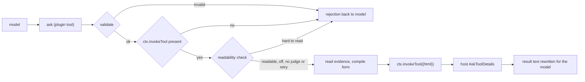

# Design

How omp-ask-more is built. What a user sees and configures is in the [README](../README.md); what ran against it is in [verification](verification.md). Source references of the form `packages/<package>/src/…` point into the oh-my-pi monorepo as published at 19.0.0 (installed under `node_modules/@oh-my-pi/pi-<package>`).

## Why the native ask falls short

The native `ask` takes one HTML `<form>` (`packages/coding-agent/src/tools/ask.ts`) and draws it in every session with a UI: a whole-form dialog where the host has `formDialog`, one prompt per named field elsewhere. What it lacks is not a surface but the content to put on it. Its prompt asks the model for short questions with the context a field needs (`packages/coding-agent/src/prompts/tools/ask.md`), so the reader gets a title, a question and bare option labels: no situation, no cited file lines, no tradeoff per option.

## Division of work

ask-more owns what the model writes and what the model reads back; the host owns everything the user touches.

| ask-more | host `ask` |
|---|---|
| the parameter schema and the model-facing description and topics | drawing the form, keys, the Other answer, option notes |
| validation of every question at once | its timeout (`ask.timeout`) and notification (`ask.notify`), off in plan mode |
| the readability check | closing the form when the user sends a message instead, with the answers given so far |
| reading file evidence from disk | field-by-field prompts where no form dialog exists |
| compiling the batch into one form | the transcript card (`askToolRenderer`) and `/tree` re-answer |
| the result text the model reads | `details: {answers, notes?, timedOut?}` |



The entry is the package-root `index.ts`, declared by `omp.extensions` in `package.json`. It registers the tool under the native name `ask`, so the model reads this plugin's description (`src/description.ts`) instead of `prompts/tools/ask.md`, and the transcript card stays the native renderer, which the tool hands the host's `details` to. It declares `approval: "read"` and `concurrency: "exclusive"`, as the native `AskTool` does: the host has one ask slot over the composer, and a second form would take it from the first.

**Why `ctx.invokeTool` and not `ctx.ui.formDialog`.** The host's `ask` closes its form when the user sends a message, through the tool call's steering signal, and tells the user so. The extension context passes no steering signal (`packages/coding-agent/src/extensibility/extensions/runner.ts`), so a plugin calling `formDialog` itself would show a form that ignores the message the host says will skip it. Invoking the host's tool also brings its timeout, notification, plan-mode rule and field-by-field fallback without a second copy. `ctx.invokeTool` exists only where the host built its own `ask`, which it does only for sessions that can prompt the user; without it the call is rejected before any check, so print mode never hangs.

## The compiled form

`src/form.ts#compileForm` turns the batch into one `<form>`, a `<fieldset>` per question in the order a reader needs it: the header as the `<legend>`, Where / What / How, the evidence, the diagram, the risks, the question's demo, the options with their tradeoffs, the option demos, then the question and its radios. The host takes the paragraph right before a radio group as the field's question (`packages/tui/src/html-form/data.ts#fieldQuestions`) and every block above it as the field's context (`#fieldContexts`), so a field-by-field prompt carries the whole brief too.

- **Nothing is preselected.** The host reports a choice by its label text (`formAnswers`) and its timeout submits the form's current values. A preselected recommendation would come back indistinguishable from the user's choice, so the recommendation is a marker on the option's line and a question still blank when the timeout fires is the model's to decide.
- **Radio values are the option labels.** The host returns the label as the answer, so a label must survive the parser unchanged: one line, single spaces. A label starting with "Other" is refused, because the parser then withholds the host's own free-text answer for that group (`packages/tui/src/html-form/parse.ts`) and a typed answer, reported as `Other: <text>`, would be ambiguous.
- **Evidence is read by ask-more.** File evidence is resolved against the session's working directory and read when the ask opens, so the reader sees the real lines with their numbers rather than code the model typed. Text evidence is a quote ask-more cannot check, and its head says so.
- **The diagram is text art.** Mermaid is drawn by the host's own renderer (`packages/tui/src/theme/mermaid-cache.ts#resolveMermaidAscii`) into a `<pre>`, since a form has no diagram element; source the renderer cannot draw is shown as source.
- **Demos are pictures.** A form shows ``; GIF, APNG and WebP animate there. The image path goes in absolute, because the host resolves a relative one against a directory of its own choosing.

## Result

The host's result keeps its `details` and the image blocks of pasted option notes; `src/result.ts#answeredResult` replaces only its first text block with one line per question in input order, the contract `xd://ask/results` describes, then the option notes. `details.timedOut` turns every blank line into "decide it yourself", which is sound only because nothing was preselected. A host error passes through unchanged, and so does a form closed by a message: the host's `ask` throws its own interruption notice carrying the answers given so far (`packages/coding-agent/src/tools/ask.ts`, `abortError`), which never reaches the plugin as a result.

## The rule in an invoked skill

omp renders `/skill:<name>` from a fixed template (`packages/coding-agent/src/prompts/skills/user-invocation.md`): the `IMPORTANT` header, the skill body, the skill directory and the user's words, sent as a custom message with `customType: "skill-prompt"` and `attribution: "user"`. Nothing lets a plugin change the template. A skill that shows how its questions look in the reply sits closer to generation than the tool description, and on kimi it won.

While `ask` is active, a `context` handler (`index.ts`) passes the history to `src/skill-prompt.ts#withSkillAskRule`, which appends one `[IMPORTANT: …]` paragraph to every user-invoked skill prompt, after the whole message, so it is the last thing the model reads before it answers. Messages are copied with object spread, which keeps the symbol-keyed history index omp uses to pair a copy with its persisted message (`extensibility/extensions/runner.ts#emitContext`). Autoloaded skills are not user-attributed and stay as they are.

The change exists only on the way to the model: the session file, `/tree` and transcripts show omp's message. Registering a `context` handler makes omp clone the history before every model call, and omp marks the changed skill message as per-call context, which Anthropic's explicit cache breakpoints skip (`packages/ai/src/providers/anthropic.ts`); the paragraph is the same on every call, so automatic prefix caching still matches it.

## Schema

The model's parameters are a batch of decisions in `questions[]`, a shape of the plugin's own, extended the way `omp-todo-more` extends `todo`:

| Per question | Added |
|---|---|
| `id`, `question`, `header?`, `options[{label, description?}]`, `recommended?`; not `multi`, since every question takes one answer | `brief {where, what, how, diagram?, risks?}`; per option `tradeoff`, `holds_when?`, `cost?`; beside the questions, `evidence[]` and `demos[]`, each naming its question by `id` and, for an option's demo, its option by `label` |

The parameter definition follows the plugin rule's required shape: one root object, no union of objects at any depth, no object nested deeper than a question's `brief` and `options`. An evidence entry is a single object whose `kind` enum picks the form, the other kind's fields left out; `src/schema.ts#parseParams` maps the call into the internal discriminated union, attaching every evidence entry and demo to its target.

The shapes are chosen for strict mode, where the model has to produce every field: omp makes every optional field nullable and drops a null before validation (`packages/ai/src/utils/schema/normalize.ts`, `packages/ai/src/utils/validation.ts`). Each field a `kind` does not use stays optional, and required-with-kind is checked in `parseParams`, not the schema, because two optional fields under an "exactly one" rule once made strict models send both. Every optional string rejects `""`, so an empty placeholder is dropped the way a null is. Line numbers are integers, not a `"41-58"` string. `tryEnforceStrictSchema` must keep the schema strict (`test/schema.test.ts`); a shape it cannot express falls back to non-strict without notice.

omp's parameter check words a rejection as `<path> must be <the field's description> (was …)`, so each field's description opens with the value it expects and then says what the value is for. A description holds at most one " or "; with more, the check rewrites it as a list of alternatives.

Validation runs before any judge or form, checks every question, and returns every problem at once, named by field; it never degrades into a thinner ask.

## Readability check

After validation and before the form, `index.ts#screen` reads `readability.judge` and, when it is on and a judge resolves, runs `src/readability.ts#readabilityGate`.

- **One call per question.** Each question is judged alone, with its header, brief, options and tradeoffs as the form shows them. One state for the whole call made the scores follow the index: a question full of unexplained codes scored 0.91 inside its seven-question call and 0.05 alone.
- **Sentences and terms, chosen by code.** Code splits the prose into sentences and picks the candidate terms (issue and section numbers, codes such as `F106` or `K6`, commit hashes, long numbers, upper-case abbreviations), because a model does not list them reliably. Each sentence is asked whether it says who or what acts, whether it mentions something only by a name or number, and whether it holds a word a reader of this section alone could not explain; each term whether an outside engineer would know it and whether the section says what it is.
- **Zero tolerance.** One failing sentence or term rejects its question, and one rejected question rejects the call. A wrongly rejected ask costs one rewrite; a missed one costs the reader's decision.
- **Fixed rejection text.** The model reads its own failing sentences and terms with fixed reasons; no judge output reaches it. The next call goes through unjudged: the gate reads the last `ask` result in the session's own branch, whether the model called `ask` directly or through omp's `xd://ask` device, so no flag is kept and a restart, fork or `/tree` sees what its history holds. A judge that rejects clear text cannot keep the ask from the reader.
- **Which judge.** OMP's own `resolveJudge` over the calling session's settings, registry, ledger and cost gate, found through `AgentRegistry.global()` for the context's `sessionManager`, since the extension context carries no settings. The `judge` role decides; the session model answers only when OMP itself falls back to it.
- **Failure.** A judge that fails or misses its deadline lets the ask through with a warning; the caller's own abort cancels the ask.

`eval/readability.ts` runs the same chain over `eval/readability-labelled.json` (recorded calls with human labels) and prints how many questions the gate rejects, how many labelled `hard` ones it misses and how many labelled `readable` ones it rejects.

## Host constraints behind the known limitations

- **`/tree` re-answer** reopens a persisted `ask` call through the host's own `AskTool` (`packages/coding-agent/src/tools/ask.ts#recoverAskHtml`), not through this plugin. The persisted arguments are the model's `questions[]`, from which the host builds a plain form of questions and labels with the recommended option preselected; the brief, evidence and tradeoffs are not in it, and the answer comes back in the host's own result text.

## Files

```
index.ts            plugin entry: registers ask, validates, runs the readability check, compiles the form, invokes the host ask; adds the rule to invoked skills
src/schema.ts       wire and internal zod shapes, entry map, per-question validation
src/brief.ts        evidence: file windows read up to their last line against the working directory, quoted text as lines
src/form.ts         the batch compiled into one HTML form for the host ask
src/result.ts       the host result with the model's answer text, and rejected results
src/settings.ts     the readability.judge plugin setting
src/readability.ts  the readability check: per-question dialog, sentences and terms, the yes/no questions, the rejecting rule, rejection text, deadline
src/skill-prompt.ts the rule appended to a user-invoked skill prompt on its way to the model
src/description.ts  model-facing purpose, topic pointers and body loader; typed docTopics registered in index.ts
src/topics/         shipped routing, rounds and results markdown bodies
omomp-shared/i18n.ts UI labels: live OMOMP_LANG, live LC_* / LANG; protocol fields stay English (copy of shared src/i18n.ts)
eval/               the readability judge over labelled recorded asks (bun run eval:readability)
test/               validation, evidence windows and quoted text, the compiled form read back through the host's form parser,
                    the result text, the skill rule, the readability check and its setting (bun test)
```
