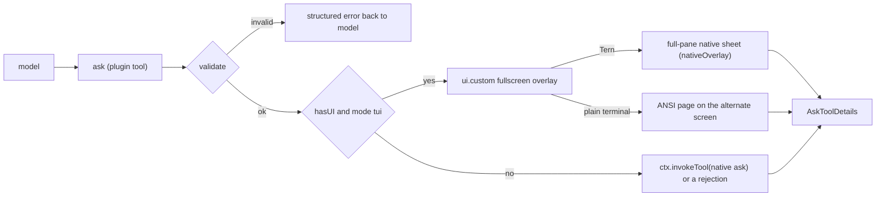
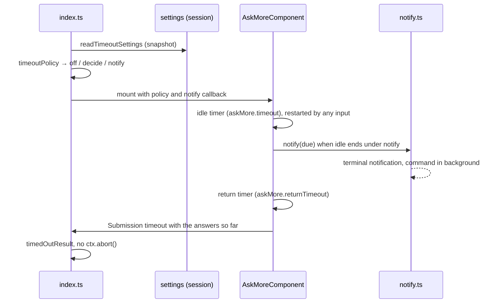

# Design

English | [简体中文](design.zh-CN.md)

How omp-ask-more is built. What a user sees and configures is in the [README](../README.md); what ran against it is in [verification](verification.md). Source references of the form `packages/<package>/src/…:<lines>` point into the oh-my-pi monorepo as published at 18.14.0 (installed under `node_modules/@oh-my-pi/pi-<package>`).

## Why the native ask falls short

Native `ask` already has fields for richer questions — `question` is Markdown (Tern: an `md` node, `packages/tui/src/overlays/ask-dialog.ts:884`; TUI: Markdown with fenced-code highlighting, `:298-311`) and every option has a free-form `preview` (`:939`, `:501-503`) — but two things stop them from being used:

1. The model is told not to. The native tool prompt is seven lines and says "short labels, tradeoffs in `description`" (`packages/coding-agent/src/prompts/tools/ask.md:1-7`); `preview` is never mentioned.
2. The surface is small. The dialog is mounted in the composer container (`packages/coding-agent/src/modes/controllers/extension-ui-controller.ts:887-905`), capped at four header rows and 70% of the terminal (`packages/tui/src/overlays/ask-dialog.ts:116-123`), and in Tern it describes as `omp.editor.ask` — a dock `col` with the `md` question, a `list` of options, and exactly one option's `preview` (`:762-940`).

## Flow



The plugin entry is the package-root `index.ts`, declared by `omp.extensions` in `package.json`. It registers the tool under the native name `ask` (`approval: "read"`, matching `packages/coding-agent/src/tools/ask.ts:544-551`), so the model reads this plugin's description (`src/description.ts`) instead of `prompts/tools/ask.md`, and the result renderer stays the native `askToolRenderer`, since renderers are keyed by tool name (`packages/tui/src/tools/index.ts:37`). It sets `strict: true`: the provider holds the arguments to the schema's grammar, and omp makes every optional field nullable and drops a null before validation (`packages/ai/src/utils/schema/normalize.ts`, `enforceStrictSchema`; `packages/ai/src/utils/validation.ts`, `normalizeOptionalNullsForSchema`). OpenAI-family backends apply strict mode even when the flag is absent, so the schema is written for it either way (see Schema).

One pi-tui component (`src/component.ts`) is mounted with `ui.custom(factory, { overlay: true, overlayOptions: { fullscreen: true, width: "100%", maxHeight: "100%", margin: 0 } })` (`extension-ui-controller.ts:1283-1369`). Per-question state (`src/state.ts`) holds the cursor, the answer (a cursor resting on an option is not an answer), the Other field, evidence folding, scrolling and demo playback, so switching questions loses nothing. The component holds the overlay focus and hands keys to an open Other field itself. One ask is in flight at a time: a second call is rejected instead of opening a second sheet and orphaning the first one's promise.

## Schema

The schema is the native one extended the way `omp-todo-more` extends `todo`:

| Kept | Added |
|---|---|
| Tool name `ask`; `questions[]` with `id`, `question`, `header?`, `options[{label, description?, preview?}]`, `recommended?` (`packages/coding-agent/src/tools/ask.ts:52-88`); not `multi`, since every question takes one answer | per question `brief {where, what, how, evidence?, diagram?, demo?, risks?}`; per option `tradeoff`, `holds_when?`, `cost?`, `demo?` |

`arktype` keeps undeclared keys, so a persisted extended call still passes `recoverAskQuestions` (`ask.ts:94-109`) and `/tree` re-answer reopens it; the native dialog there renders the native fields only.

The shapes are chosen for strict mode, where the model has to produce every field. A choice between two shapes is a union tagged by `kind`, so the model builds one branch and never fills the other; two optional fields with an "exactly one" rule made strict models send `{frames: […], path: ""}`. Every optional string rejects `""`, so an empty placeholder is dropped before validation the way a null is. Line numbers are integers, not a `"41-58"` string. `tryEnforceStrictSchema` must keep the schema strict (`test/schema.test.ts`); a shape it cannot express falls back to non-strict without notice.

How the fields are drawn:

- `brief.where/what/how` are drawn above the options and never collapsed.
- `evidence[].path` with optional `start` and `end` is resolved against the session's working directory and read when the ask opens, so the page shows the real lines (in Tern a `code` node with `path` and `start`, `packages/wire/src/tsp.ts:222-236`) instead of model-typed code. Neither line shows the file's first 40 lines, `start` alone one line, both an inclusive window; a window past the end of the file is cut there, and one starting past it is an error. Lines that are not adjacent are separate references. An unreadable reference is drawn in an error tone with the reason and never blocks the ask.
- `diagram` is Mermaid source: the `md` node draws it natively in Tern, and the TUI Markdown renderer draws it as ASCII (`packages/tui/src/theme/mermaid-cache.ts:66,100`).
- `tradeoff` / `holds_when` / `cost` are one line each and are drawn under the focused option.
- `demo` is one of two kinds. `{kind: "frames", frames[{body, caption?}], interval_ms?}` are Markdown frames the sheet steps through in a loop (text, a ` ```mermaid ` diagram, a fenced text drawing), every frame padded to the tallest so nothing below moves. `{kind: "file", path}` names an animation (GIF, APNG, WebP) or a video (mp4, mov, webm, mkv, m4v), resolved against the session's working directory like evidence. A question's demo sits under the decision; an option's demo sits in its tradeoff card and restarts whenever the cursor moves onto that option. `caption` says what to watch.

## Validation

Validation runs at the tool boundary, before any UI opens, checks every question, returns every problem at once, and never degrades into a thinner ask.

| Rule | Rejection |
|---|---|
| at least one question | `questions: empty` |
| ids non-empty and unique in the call | `questions[i].id: duplicate "<id>"` |
| `brief.where/what/how` non-empty | `questions[i].brief.<field>: empty` |
| every option has a non-empty `tradeoff` | `questions[i].options[j].tradeoff: empty` |
| ≥ 2 options | a decision needs at least two options |
| labels unique within a question and not reserved (`Other (type your own)`, `Chat about this`, `Next →`) | named per option |
| `recommended` is an index into the options | names the bad value |
| ≤ 6 evidence references; `end` only with `start`, not before it, and the window ≤ 80 lines | names the reference, the lines and the span |
| 2–12 frames, none blank; `interval_ms` from 300 to 5000 | names the count, the frame or the interval |
| a file demo's `path` ends in `.gif`, `.png`, `.apng`, `.webp`, `.mp4`, `.mov`, `.webm`, `.mkv` or `.m4v` | names the path and the accepted extensions |

## ANSI page

`fullscreen` puts the page on the alternate screen. The title and, for a batch, a tab row (`✓` on answered questions, then `Review`) stay at the top; the key hints, and above them the countdown line when the ask has one, stay at the bottom; the body between them is a pi-tui `ScrollView` sized from the live terminal height, with a scrollbar, scrolled by `PgUp`/`PgDn`/`Home`/`End`/`Shift+↑↓` and the mouse wheel, and pulled to the focused option when `↑↓` moves it.

## Tern sheet

The component declares `nativeOverlay` (`role: "omp.askMore"`, `size: "full"`, `head`: the question's `header`, or "N decisions" for a batch), so the backend wraps it in one opaque sheet filling the pane (`packages/tui/src/native/backend.ts:873-900`), and `describe()` returns the content in the native ask's roles, which Tern's color themes and its Reader, Spine and Console chat styles already style: for a batch an `omp.ask.head` row holding the `omp.ask.questions` tabs (positional ids, `✓` on answered questions, `Review` last; click switches), the question (`omp.ask.question`) and Where/What/How, then the decision — the options as an `omp.ask.options` list keyed `qN` per question, rows `omp.ask.option` and a last `omp.ask.other` (`click` selects, `dblclick` answers; the answered row carries the accent tone, which Tern draws as the filled radio mark, `(•)` in Console, while the cursor is the list's highlighted row), the focused option's tradeoff card, the Other field and the action bar (the countdown line on its left when the ask has one, then `Cancel all`, and `Next` / `Submit` / `Save answer`) — then the evidence `code` nodes (folded to 12 lines behind Tern's own "more lines" control), the Mermaid `md` and the risks. The Review page is an `omp.ask.notice` line and one row per question, label then answer: Reader gives the native answers grid (`omp.ask.answers`) a fixed key column, and a long CJK chip runs into its answer there. The sheet role stays outside `omp.overlay.*` on purpose: Tern's list rule for those overlays (`.sf-overlay[data-role^='omp.overlay.'] .sf-ov-card .sf-list .sf-item`) outranks the ask list styling and draws each option's mark over its label. Tern scrolls a sheet body as one column and brings a list's selection into view against the body's bottom edge, so the action bar sits right after the decision and reveals itself when a page opens: after a long brief the whole decision is in view. Keyboard scrolling reaches Tern as `scroll` requests on the body.

Every button's action id names the page and the state it was drawn for (`answer:<page>:<option>`, `other:<page>`, `save:<page>`, `demo:<page>:question:<move>`, `demo:<page>:option:<option>:<move>`, `submit`, `cancel`; `src/nodes.ts#SheetAct`). Tern keeps routing a click to a node the sheet has since redrawn, so a click that arrives after its page, its cursor row or the Other field changed — a second click on `Next`, a demo control of an option the cursor left, `Submit` after leaving Review — is dropped instead of acting on the new state. The options list is keyed per question for the same reason.

**Stylesheet.** Outside `omp.overlay.*` the sheet keeps Tern's base overlay face. `tern/` is a styles-only Tern plugin (`plugin.toml`, `ask-more.css`, and a one-comment `window.luau` because a manifest needs one entry) whose three rules match only `omp.askMore`: the sans text face of omp's overlays, and in Console its terminal face plus the three-cell gutter the question's `?` marker hangs in.

## Other field

The Other field is a pi-tui `Input`, one per question: its value is the only copy of the text, edited by the keys the component forwards and, in Tern, by the terminal's own edit/undo events (the field is a child component, so the reconciler routes them to it).

## Demos

Files are loaded with the evidence, before the surface opens, for the surface in use (`src/demo.ts`):

| Source | Tern | ANSI page |
|---|---|---|
| `frames` | an `md` node per frame plus the frame's caption, a `1/3` counter and `Previous` / `Pause` / `Next` buttons; the component steps the frame and Tern receives only the changed text | the frame's Markdown rows in a slot as tall as the tallest frame, with the counter and the key hints under it |
| GIF, APNG, WebP | the file's bytes as an `image` node (a content-addressed blob, sent once); Tern plays the animation itself at the file's own timing, so there are no buttons | decoded by ffmpeg to 10 frames per second, at most 64 × 20 cells, and drawn as `▀` half-blocks in 24-bit color (upper pixel as foreground, lower as background); stepped like frames |
| mp4, mov, webm, mkv, m4v | converted by ffmpeg to a GIF (12 frames per second, at most 720 px wide, a palette per frame) and shown as an image; every container goes through the same ffmpeg call, of which mp4 was exercised | decoded like an animation |

One timer, scheduled on the TUI's render clock, steps the playing demos of the open page, each at its own interval; it runs only while that page is open, the Other field is closed and something plays, and it stops when the ask closes. ffmpeg and ffprobe run without a shell, under a 20-second timeout, killed on abort, and stop as soon as their output passes its bound (the decoded frames, or 16 MB for a converted GIF). A file that is missing, unreadable, not an image the sheet can play, too large, or needs ffmpeg that is not on `PATH` becomes an error row with the reason; the ask still opens.

## Delegation

When `ctx.hasUI` is false or the mode is not `tui`, the tool calls `ctx.invokeTool` with the native subset of every question (`src/schema.ts#nativeQuestion`), so the native dialog renders the native fields; without a native resolver — print mode, for instance — it returns a structured rejection instead of hanging. A failure inside the full-screen surface becomes a `ui.notify` warning and the whole batch goes to the native dialog the same way.

## Timeout



- **Settings.** `src/settings.ts` registers `askMore.timeout`, `askMore.returnTimeout`, `askMore.onExpiry`, `askMore.notify.terminal` and `askMore.notify.command` (env `OMP_ASK_MORE_NOTIFY_COMMAND`, marked as a credential) with omp's `register` (`@oh-my-pi/pi-coding-agent/config/registry`), the way omp-roundtable registers its own. The registry is process-wide and rejects a second registration of an id, while the plugin module can be evaluated more than once in a process, so the handles live in a `globalThis` slot. Values are read from the asking session's settings (`AgentRegistry.global().get(ctx.agent.id).session.settings`, as omp-todo-more reads native ones) once per ask, after validation and before the evidence loads.
- **Policy.** `src/timeout.ts` parses that snapshot into `off | decide{idleMs} | notify{idleMs, channels, then: decide{returnMs} | wait}`. `askMore.timeout: 0` is `off`; no channel with `decide` is `decide`, with `wait` is `off`. A command whose `Setting.provenance` is `project` is left out and becomes a problem `index.ts` shows as a warning.
- **Clock.** The countdown belongs to the component, on the render clock's `scheduleAfter`, so it starts once the sheet is built (loading evidence and demos does not count) and every timer is cancelled on a phase change, on submit and on dispose. `handleInput`, `handleNativeEvent` and the Other field's own `handleNativeEvent` (`OtherInput`, since Tern sends its edit/undo events to the field, not the sheet) restart the idle phase. The phases are `stopped | idle | notified{at, due, timer}`. A change made by a timer calls `requestComponentRender`, because no input follows to redraw the sheet. Expiry goes through the same single completion gate as submit and cancel, as `Submission { kind: "timeout", answers }`; `index.ts` returns `timedOutResult` and does not call `ctx.abort()`.
- **Notification.** `index.ts` builds the callback; `src/notify.ts` sends `TERMINAL.sendNotification({ title: "omp", body, type: "ask", urgency: "normal", actions: "focus" })` (`@oh-my-pi/pi-tui`, which picks OSC 99, OSC 9 or BEL per terminal and writes through the active terminal, so it reaches the terminal under the alternate screen and in Tern) and runs the command through `ptree.exec(["sh", "-c", command])` with the `OMP_ASK_MORE_*` variables, a 30-second timeout, and no await: the ask's clock never waits for a channel. A failure is a warning naming only the outcome.
- **Native settings.** The native `ask.timeout` (`packages/coding-agent/src/modes/settings.ts:1266-1294`) auto-selects the recommended option and also bounds `cfg://` approvals; the native `ask.notify` (`:1296-1307`) fires when the dialog opens (`packages/coding-agent/src/tools/ask.ts:592-604`). Neither matches this behaviour, so neither is read; the native ask still applies both when ask-more delegates to it.
- **Wait accounting.** omp counts a `ui.custom` wait as user time unless one of its arguments carries a positive `timeout` (`packages/coding-agent/src/extensibility/extensions/user-wait.ts:34-38`), and `ExtensionCustomOptions` has no such field; native timed dialogs count as agent time. The plugin does not add an undeclared field to change that, so an ask with a timeout stays user time.

## Answer and lifecycle

| Concern | Behavior |
|---|---|
| Answer | native `AskToolDetails`: `results[{id, question, options, multi, selectedOptions, customInput}]`, one entry per question in input order; text `User answers:` then `id: label`, `id: "own text"`, `id: (cancelled)` or `id: (timed out: …)` per line, matching the native multi-question wording (`src/result.ts`) |
| Unanswered questions | the Review page lists them; submitting still sends the rest, an unanswered question reads `id: (cancelled)` (as in the native dialog) |
| Cancel (`esc`, `Cancel all`, abort signal) | `ctx.abort()`, then every question as `(cancelled)`; nothing already answered is submitted |
| Concurrent asks | one in flight; a second call is rejected instead of opening a second sheet |
| Timeout | the answers given so far, the rest as `(timed out: …)` for the model to decide; no `ctx.abort()` |
| Approval | `approval: "read"`, matching `ask.ts:544-551` |
| Failure inside the surface | `ui.notify` warning, then delegation of the whole batch to the native dialog |
| Demo playback | starts when its page opens; an option's demo restarts when the cursor moves onto that option; nothing plays while the Other field is open; no timer outlives the ask |

## Host constraints behind the known limitations

- **`/tree` re-answer** runs `new AskTool()` directly (`packages/coding-agent/src/modes/controllers/selector-controller.ts:1723-1748`). The extended arguments survive its schema check, so the ask reopens — in the native dock, with the native fields only.
- **Collaborator guests** answer through the native mirroring channel (`extension-ui-controller.ts:923-1025`), which has no representation for a `ui.custom` surface.
- **The transcript card** comes from the native renderer, which draws a question with no selection and no custom answer as `Cancelled` (`packages/tui/src/tools/ask.ts:333-335`); it has no state for a question left to the model.
- **Plan mode.** The native ask turns its timeout off in plan mode (`packages/coding-agent/src/tools/ask.ts:755-758`); this plugin's countdown does not look at plan mode.

## Files

```
index.ts           plugin entry: registers ask, validates, mounts the fullscreen overlay, delegates
src/schema.ts      native fields + brief/tradeoff, zod parameters, per-question validation
src/brief.ts       evidence windows (path, start, end) read against the working directory, bounded reads
src/demo.ts        demo specs, file loading and ffmpeg decoding per surface, half-block rows
src/state.ts       per-question state (cursor, answer, Other field, folding, scroll, demo playback) and the active tab
src/component.ts   one component: the ANSI page (render) and the Tern content (describe), keys and events, the countdown
src/nodes.ts       the Tern content in the native ask roles, and the sheet's button acts (SheetAct)
src/result.ts      Answer variants, AskToolDetails construction, cancelled, timed-out and rejected results
src/settings.ts    the askMore.* settings in omp's registry, snapshotted from the asking session
src/timeout.ts     the timeout policy parsed from that snapshot, and the countdown line
src/notify.ts      timeout notifications: the terminal one and the notify command
src/i18n.ts        UI labels from OMOMP_LANG / LC_*; protocol fields stay English
src/description.ts the model-facing tool description
tern/              styles-only Tern plugin: the sheet's text face and Console gutter
test/              validation, native projection, demo loading, half-block rows, the timeout policy and result, and the
                   Tern sheet driven through pi-tui's reconciler and the reference TSP applier, countdown included (bun test)
```
