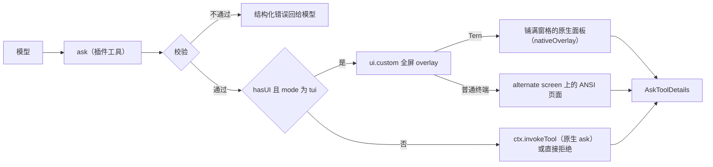
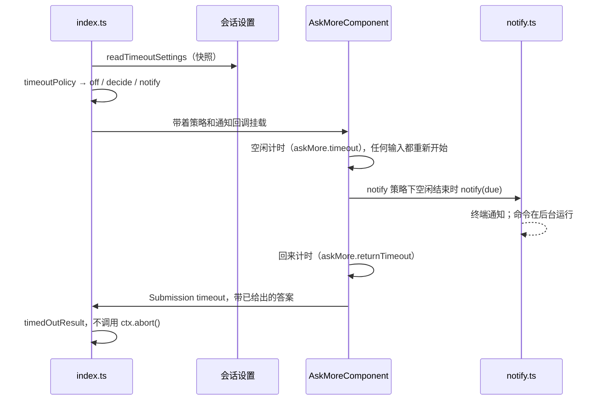

# 设计

[English](design.md) | 简体中文

omp-ask-more 是怎么搭起来的。使用者看到和配置的内容见 [README](../README.zh-CN.md)，跑过的验证见[验证](verification.zh-CN.md)。形如 `packages/<包>/src/…:<行>` 的源码引用指向 oh-my-pi monorepo 的 18.14.0 版本（安装在 `node_modules/@oh-my-pi/pi-<包>` 下）。

## 原生 ask 为什么不够用

原生 `ask` 其实已有承载更多内容的字段——`question` 按 Markdown 渲染（Tern 是 `md` 节点，`packages/tui/src/overlays/ask-dialog.ts:884`；TUI 走带代码高亮的 Markdown，`:298-311`），每个选项都有自由文本 `preview`（`:939`、`:501-503`）——但两件事让它们用不起来：

1. 模型被要求不要用。原生工具 prompt 只有七行，写着 "short labels, tradeoffs in `description`"（`packages/coding-agent/src/prompts/tools/ask.md:1-7`）；`preview` 一次都没出现。
2. 表面太小。对话框挂在 composer 容器里（`packages/coding-agent/src/modes/controllers/extension-ui-controller.ts:887-905`），标题最多四行、整块最多占终端 70%（`packages/tui/src/overlays/ask-dialog.ts:116-123`），在 Tern 里 describe 成 `omp.editor.ask`——dock 里的 `col`：`md` 问题、选项 `list`、以及只有一个选项的 `preview`（`:762-940`）。

## 流程



插件入口是包根 `index.ts`，由 `package.json` 的 `omp.extensions` 声明。它以原生名 `ask` 注册工具（`approval: "read"`，与 `packages/coding-agent/src/tools/ask.ts:544-551` 一致），所以模型读到的是本插件的描述（`src/description.ts`），而不是 `prompts/tools/ask.md`；结果渲染器仍是原生的 `askToolRenderer`，因为渲染器按工具名选取（`packages/tui/src/tools/index.ts:37`）。它设了 `strict: true`：provider 按 schema 的语法约束参数，omp 把每个可选字段改成可为 null，并在校验前去掉 null（`packages/ai/src/utils/schema/normalize.ts` 的 `enforceStrictSchema`；`packages/ai/src/utils/validation.ts` 的 `normalizeOptionalNullsForSchema`）。OpenAI 系后端在没有这个标志时也按严格模式处理，所以 schema 无论如何都按严格模式来写（见 Schema 一节）。

一个 pi-tui 组件（`src/component.ts`）经 `ui.custom(factory, { overlay: true, overlayOptions: { fullscreen: true, width: "100%", maxHeight: "100%", margin: 0 } })` 挂载（`extension-ui-controller.ts:1283-1369`）。每题状态（`src/state.ts`）保存光标、答案（光标停在某个选项上不等于作答）、Other 输入框、证据折叠、滚动与演示播放进度，切换题目不丢任何东西。组件持有 overlay 焦点，Other 输入框打开时由它把按键转交给输入框。同时只允许一个 ask：第二次调用被拒绝，而不是再开一张面板、让第一次的 promise 无人收尾。

## Schema

schema 是原生参数按 omp-todo-more 扩展 `todo` 的方式加上扩展字段：

| 保持 | 新增 |
|---|---|
| 工具名 `ask`；`questions[]`，每题 `id`、`question`、`header?`、`options[{label, description?, preview?}]`、`recommended?`（`packages/coding-agent/src/tools/ask.ts:52-88`）；不含 `multi`，每题只取一个答案 | 每题 `brief {where, what, how, evidence?, diagram?, demo?, risks?}`；每选项 `tradeoff`、`holds_when?`、`cost?`、`demo?` |

`arktype` 保留未声明键，因此持久化的扩展调用仍能通过 `recoverAskQuestions`（`ask.ts:94-109`），`/tree` 重答会重新打开它；那里原生对话框只渲染原生字段。

参数形状按严格模式选定，严格模式下模型必须生成每个字段。两种形状二选一时，用以 `kind` 区分的联合，模型只构造其中一支，不会去填另一支；“两个可选字段、只能给一个”的写法曾让严格模式下的模型发出 `{frames: […], path: ""}`。每个可选字符串都拒绝 `""`，所以空占位值和 null 一样在校验前被去掉。行号是整数，而不是 `"41-58"` 这样的字符串。`tryEnforceStrictSchema` 必须让 schema 保持严格（`test/schema.test.ts`）；它表达不了的形状会悄悄退回非严格模式。

各字段的画法：

- `brief.where/what/how` 画在选项上方，不折叠。
- `evidence[].path` 加可选的 `start`、`end` 由工具按会话工作目录解析、在 ask 打开时读取，因此页面画的是**真实行**（Tern 中为带 `path` 与 `start` 的 `code` 节点，`packages/wire/src/tsp.ts:222-236`），而不是模型敲进去的代码。两个都不给显示文件前 40 行，只给 `start` 是一行，都给是一段闭区间；超出文件末尾的部分被截掉，起点就在文件之外则报错。不相邻的几段各写一条引用。读不到的引用用错误色画出原因，不阻塞这次 ask。
- `diagram` 是 Mermaid 源码：Tern 由 `md` 节点原生绘制，TUI 由 Markdown 渲染器画成 ASCII（`packages/tui/src/theme/mermaid-cache.ts:66,100`）。
- `tradeoff` / `holds_when` / `cost` 各一行，画在聚焦选项下方。
- `demo` 是两种之一。`{kind: "frames", frames[{body, caption?}], interval_ms?}` 是面板循环播放的 Markdown 帧（文字、` ```mermaid ` 图或代码块里的字符画），每帧补齐到最高一帧的高度，下面的内容不会跳动。`{kind: "file", path}` 指向动画（GIF、APNG、WebP）或视频（mp4、mov、webm、mkv、m4v），和证据一样按会话工作目录解析。问题的演示在决定区下方；选项的演示在它的取舍卡里，光标每次移到该选项都从头播放。`caption` 写看什么。

## 校验

校验发生在工具边界、任何 UI 打开之前，检查每一题，一次返回全部问题，绝不降级成更薄的 ask。

| 规则 | 拒绝信息 |
|---|---|
| 至少一个问题 | `questions: empty` |
| id 非空且在本次调用内唯一 | `questions[i].id: duplicate "<id>"` |
| `brief.where/what/how` 非空 | `questions[i].brief.<field>: empty` |
| 每个选项 `tradeoff` 非空 | `questions[i].options[j].tradeoff: empty` |
| 至少两个选项 | 决定至少需要两个选项 |
| 同一题内标签唯一且不是保留标签（`Other (type your own)`、`Chat about this`、`Next →`） | 逐项指明 |
| `recommended` 是选项下标 | 指明非法值 |
| 证据 ≤ 6 条；`end` 只能配 `start`、不能在它之前，且一段 ≤ 80 行 | 指明第几条、行号与跨度 |
| 2–12 帧且没有空帧；`interval_ms` 在 300 到 5000 之间 | 指明帧数、第几帧或间隔 |
| 文件演示的 `path` 以 `.gif`、`.png`、`.apng`、`.webp`、`.mp4`、`.mov`、`.webm`、`.mkv` 或 `.m4v` 结尾 | 指明路径与可用扩展名 |

## ANSI 页面

`fullscreen` 把页面放到 alternate screen。标题和（多题时的）标签行（已答题带 `✓`，最后是 `汇总`）固定在顶部，键位提示（ask 有倒计时时，其上方还有倒计时那一行）固定在底部；中间的正文是按实时终端高度调整的 pi-tui `ScrollView`，带滚动条，可用 `PgUp`/`PgDn`/`Home`/`End`/`Shift+↑↓` 和鼠标滚轮滚动，`↑↓` 移动选项时自动滚到聚焦选项。

## Tern 面板

组件声明 `nativeOverlay`（`role: "omp.askMore"`、`size: "full"`，`head` 为该题的 `header`，多题时为“N 个决定”），后端把它包进一张铺满窗格的不透明面板（`packages/tui/src/native/backend.ts:873-900`），`describe()` 只返回内容，并使用原生 ask 的 role，Tern 的配色主题与 Reader、Spine、Console 三种聊天风格本就为这些 role 写了样式：多题时一个 `omp.ask.head` 行，内含 `omp.ask.questions` 标签（按位置编号，已答题带 `✓`，最后是 `汇总`，点击切换）；问题（`omp.ask.question`）与 Where/What/How；然后是决定区——每题一个以 `qN` 为 key 的 `omp.ask.options` 选项列表，各行为 `omp.ask.option`、最后一行为 `omp.ask.other`（单击选中、双击作答；已作答的行带强调色，Tern 把它画成实心单选标记，Console 下为 `(•)`，光标则是列表的高亮行）、聚焦选项的取舍卡、Other 输入框和动作条（ask 有倒计时时左侧是倒计时那一行，然后是 `全部取消`，以及 `下一题` / `提交` / `保存答案`）；最后是证据 `code` 节点（折叠到 12 行，由 Tern 自带的 "more lines" 展开）、Mermaid 的 `md` 和风险。汇总页是一行 `omp.ask.notice`，加上每题一行“标签 答案”：Reader 给原生答案网格（`omp.ask.answers`）设了固定宽度的键列，较长的 CJK 标签会压到答案上。面板 role 有意不放在 `omp.overlay.*` 下：Tern 给这类 overlay 写的列表规则（`.sf-overlay[data-role^='omp.overlay.'] .sf-ov-card .sf-list .sf-item`）优先级高于 ask 列表样式，会把每个选项的标记画在文字上。Tern 把面板正文当作一列整体滚动，并按正文底边把列表选中项滚进视野，因此动作条紧跟决定区，并在每页打开时把自己滚进视野：简报再长，打开时整个决定区也在视野内。键盘滚动以正文上的 `scroll` 请求交给 Tern。

每个按钮的动作 id 都写明它绘制时所属的页面与状态（`answer:<page>:<option>`、`other:<page>`、`save:<page>`、`demo:<page>:question:<move>`、`demo:<page>:option:<option>:<move>`、`submit`、`cancel`；见 `src/nodes.ts#SheetAct`）。面板重画后，Tern 仍会把点击路由到已被替换的节点，因此在页面、光标所在行或 Other 输入框变化之后才到达的点击——再点一次 `下一题`、光标已离开的选项的演示控件、离开汇总后的 `提交`——会被丢弃，而不是作用在新状态上。选项列表按题目编 key 也是出于同一原因。

**样式表。** 不在 `omp.overlay.*` 下时，面板沿用 Tern 基础 overlay 的外观。`tern/` 是一个纯样式的 Tern 插件（`plugin.toml`、`ask-more.css`，以及因清单至少需要一个入口而放的只含一行注释的 `window.luau`），三条规则只匹配 `omp.askMore`：omp overlay 的无衬线字体；Console 下保留终端字体，并留出问题前 `?` 标记所在的三格左侧空白。

## Other 输入框

Other 输入框是 pi-tui `Input`，每题一个：它的值是文本的唯一一份，由组件转交的按键编辑；在 Tern 中也由终端自己的 edit/undo 事件编辑（输入框是子组件，reconciler 把事件路由给它）。

## 演示

文件和证据一起、在界面打开前按当前界面加载（`src/demo.ts`）：

| 来源 | Tern | ANSI 页面 |
|---|---|---|
| `frames` | 每帧一个 `md` 节点，加上帧说明、`1/3` 计数和 `Previous` / `Pause` / `Next` 按钮；组件负责换帧，Tern 只收到变化的文字 | 帧的 Markdown 行放在一块与最高一帧等高的区域里，下面是计数和按键提示 |
| GIF、APNG、WebP | 文件原始字节作为 `image` 节点（按内容寻址的 blob，只发一次），由 Tern 按文件自身的节奏播放，因此没有按钮 | 由 ffmpeg 解成每秒 10 帧、最大 64 × 20 格的画面，用 24 位色的 `▀` 半块画出（上像素作前景，下像素作背景），和分步画面一样换帧 |
| mp4、mov、webm、mkv、m4v | 由 ffmpeg 转成 GIF（每秒 12 帧、最宽 720 px、每帧独立调色板）后当图片显示；各容器格式走同一条 ffmpeg 调用，实测过的是 mp4 | 和动画一样解码 |

打开的那一页上所有正在播放的演示由一个计时器推进，计时器挂在 TUI 的渲染时钟上，各演示按自己的间隔换帧；只有该页打开、Other 输入框关闭且有演示在播放时它才运行，ask 关闭即停止。ffmpeg 和 ffprobe 不经 shell 运行，有 20 秒超时，中止时被结束，输出一超过上限（解出的帧，或转出的 GIF 16 MB）就立即结束。文件不存在、读不了、不是面板能播放的图片、太大，或者需要的 ffmpeg 不在 `PATH` 里时，都显示为写明原因的错误行；ask 照常打开。

## 委托

`ctx.hasUI` 为假或模式不是 `tui` 时，工具把每一题的原生子集交给 `ctx.invokeTool`（`src/schema.ts#nativeQuestion`），由原生对话框渲染原生字段；没有原生解析器时（例如 print 模式）返回结构化拒绝，而不是挂住。全屏表面内部出错时，先显示一条 `ui.notify` 警告，再以同样方式把整批交给原生对话框。

## 超时



- **设置。** `src/settings.ts` 用 omp 的 `register`（`@oh-my-pi/pi-coding-agent/config/registry`）注册 `askMore.timeout`、`askMore.returnTimeout`、`askMore.onExpiry`、`askMore.notify.terminal` 与 `askMore.notify.command`（环境变量 `OMP_ASK_MORE_NOTIFY_COMMAND`，标为凭据），做法与 omp-roundtable 注册自己的设置一样。设置表是整个进程共用的，同一个 id 注册第二次会报错，而插件模块在一个进程里可能被求值不止一次，所以这些句柄放在 `globalThis` 的一个槽里。值从发起提问的会话读取（`AgentRegistry.global().get(ctx.agent.id).session.settings`，与 omp-todo-more 读取原生设置的方式相同），每次 ask 读一次，时机在校验之后、加载证据之前。
- **策略。** `src/timeout.ts` 把这份快照解析成 `off | decide{idleMs} | notify{idleMs, channels, then: decide{returnMs} | wait}`。`askMore.timeout: 0` 为 `off`；没有渠道时，`decide` 为 `decide`，`wait` 为 `off`。`Setting.provenance` 为 `project` 的命令不进入渠道，而成为一条问题，由 `index.ts` 显示为警告。
- **时钟。** 倒计时属于组件，挂在渲染时钟的 `scheduleAfter` 上，所以面板建好才开始计时（加载证据和演示的时间不算），每次切换阶段、提交和销毁时都取消它持有的全部计时器。`handleInput`、`handleNativeEvent`，以及 Other 输入框自己的 `handleNativeEvent`（`OtherInput`：Tern 把 edit/undo 事件直接发给输入框，而不是发给面板）都会让空闲阶段重新开始。阶段为 `stopped | idle | notified{at, due, timer}`。由计时器引起的变化会调用 `requestComponentRender`，因为之后没有输入来触发重画。到期走与提交、取消同一个唯一的收尾入口，即 `Submission { kind: "timeout", answers }`；`index.ts` 返回 `timedOutResult`，不调用 `ctx.abort()`。
- **通知。** 回调由 `index.ts` 构造；`src/notify.ts` 发出 `TERMINAL.sendNotification({ title: "omp", body, type: "ask", urgency: "normal", actions: "focus" })`（`@oh-my-pi/pi-tui`，它按终端选择 OSC 99、OSC 9 或 BEL，并经当前终端写出，所以在 alternate screen 下和 Tern 里都能到达终端），并通过 `ptree.exec(["sh", "-c", command])` 运行命令，带上 `OMP_ASK_MORE_*` 变量和 30 秒超时，且不等待它结束：ask 的时钟从不等任何渠道。失败只产生一条只写结果的警告。
- **原生设置。** 原生 `ask.timeout`（`packages/coding-agent/src/modes/settings.ts:1266-1294`）会自动选推荐项，还限制 `cfg://` 审批；原生 `ask.notify`（`:1296-1307`）在对话框打开时发通知（`packages/coding-agent/src/tools/ask.ts:592-604`）。两者都不符合这里的行为，所以都不读取；ask-more 委托给原生 ask 时，原生 ask 仍按它们执行。
- **等待计时。** omp 把 `ui.custom` 的等待算作用户时间，除非某个参数带正数 `timeout`（`packages/coding-agent/src/extensibility/extensions/user-wait.ts:34-38`），而 `ExtensionCustomOptions` 没有这个字段；原生带超时的对话框算作代理时间。插件不为改变这一点而塞进未声明的字段，所以带超时的 ask 仍算用户时间。

## 答案与生命周期

| 关注点 | 行为 |
|---|---|
| 答案 | 原生 `AskToolDetails`：`results[{id, question, options, multi, selectedOptions, customInput}]`，每题一项、按输入顺序；文本为 `User answers:` 加每行 `id: 选项`、`id: "自填文字"`、`id: (cancelled)` 或 `id: (timed out: …)`，与原生多题措辞一致（`src/result.ts`） |
| 未作答的题 | 汇总页列出；提交仍会发送其余答案，未作答的题为 `id: (cancelled)`（与原生对话框一致） |
| 取消（`esc`、`全部取消`、abort signal） | `ctx.abort()`，然后所有题都为 `(cancelled)`；已作答的部分不提交 |
| 并发 | 同时只允许一个；第二次调用被拒绝，而不是再开一张面板 |
| 超时 | 返回已给出的答案，其余为 `(timed out: …)` 由模型决定；不调用 `ctx.abort()` |
| 审批 | `approval: "read"`，与 `ask.ts:544-551` 一致 |
| 表面内部失败 | `ui.notify` 警告，然后把整批委托给原生对话框 |
| 演示播放 | 所在页打开时开始；光标移到某个选项时它的演示从头播放；Other 输入框打开时不播放；计时器不会比 ask 活得更久 |

## 已知限制背后的宿主约束

- **`/tree` 重答**直接 `new AskTool()`（`packages/coding-agent/src/modes/controllers/selector-controller.ts:1723-1748`）。扩展参数能通过它的 schema 检查，所以 ask 会重新打开——用原生 dock，只画原生字段。
- **协作 guest** 走原生镜像通道（`extension-ui-controller.ts:923-1025`），该通道没有 `ui.custom` 表面的表示。
- **对话记录里的卡片**来自原生渲染器，它把既没有选项也没有自填答案的题画成 `Cancelled`（`packages/tui/src/tools/ask.ts:333-335`），没有“交给模型”这种状态。
- **plan mode。** 原生 ask 在 plan mode 下关闭超时（`packages/coding-agent/src/tools/ask.ts:755-758`）；本插件的倒计时不看 plan mode。

## 文件

```
index.ts           插件入口：注册 ask、校验、挂载全屏 overlay、委托
src/schema.ts      原生字段 + brief/tradeoff、zod 参数、逐题校验
src/brief.ts       按工作目录读取证据行段（path、start、end），限界读取
src/demo.ts        演示规格、按界面加载文件与 ffmpeg 解码、半块画面
src/state.ts       每题状态（光标、答案、Other 输入框、折叠、滚动、演示播放）与当前标签
src/component.ts   单个组件：ANSI 页面（render）与 Tern 内容（describe）、按键与事件、倒计时
src/nodes.ts       使用原生 ask role 的 Tern 内容，以及面板按钮动作（SheetAct）
src/result.ts      Answer 变体、AskToolDetails 构造、取消、超时与拒绝结果
src/settings.ts    注册在 omp 设置表里的 askMore.* 设置，从发起提问的会话取快照
src/timeout.ts     由该快照解析出的超时策略，以及倒计时那一行
src/notify.ts      超时通知：终端通知与通知命令
src/i18n.ts        界面标签取自 OMOMP_LANG / LC_*；协议字段保持英文
src/description.ts 面向模型的工具描述
tern/              纯样式 Tern 插件：面板字体与 Console 左侧空白
test/              校验、原生投影、演示加载、半块画面、超时策略与结果，以及经 pi-tui reconciler 与参考 TSP
                   applier 驱动的 Tern 面板（含倒计时）（bun test）
```
