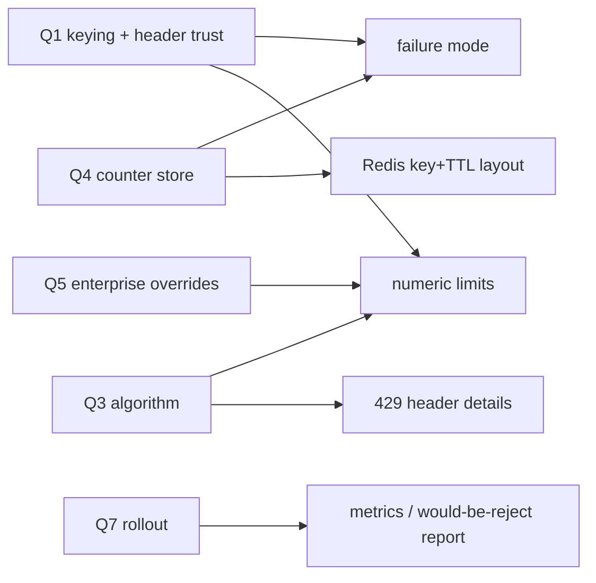

## Person: `/skill:grilling Grill me on the unresolved decisions in PLAN.md. Do not implement the plan.`

omp injected the skill as a user-attributed message: its first line, then the 25 lines of `grilling/SKILL.md`.

```text
[IMPORTANT: User invoked the "grilling" skill; follow its instructions. Full skill below.]
```

### Model reply

I'll read the plan and the repo state first.

- tool `read` PLAN.md

- tool `read` .

### Model reasoning

```text
Read src files to ground facts about how orders are written, whether customer id exists, auth.
```

- tool `read` src/server.ts

- tool `read` src/orders.ts

- tool `read` src/db.ts

### Model reasoning

```text
Facts: `x-customer-id` is a caller-supplied header with no auth — so keying on it is spoofable. There is no auth layer; anyone can send any customer id. That's a crucial fact the plan doesn't acknowledge. Keying on customer-id alone means the attacker can rotate the header and bypass limits entirely (and also impersonate other customers to blame them).

Let me check for any package.json / tests / config for more facts? Repo is basically 3 files. No package.json. Let me check for hidden things—maybe git? Only files listed. That's enough.

Now build design tree and ask the frontier round. Root decision clusters:

Frontier round 1 — questions whose prerequisites are settled (none depend on other answers):

Q1: Keying. Depends on nothing. Note spoofability. Recommendation: composite — limit per authenticated identity... but there's no auth. So recommend: key on customer id as the primary bucket AND IP as a secondary guard — actually the real recommendation: fix identity first? That's a "fact" not a decision. The decision on identity trust belongs to user: do we add HMAC/signature pinning or assume LB auth. Hmm, careful: Q1 keying depends on the answer to "is x-customer-id trustworthy?" which is a user decision (deployment fact maybe — could be that LB strips the header). That's a fact from environment I cannot find. So I should ask it as a decision? Ask: "who guarantees x-customer-id is authentic" — that's a fact only the user knows. Fine to ask as question but skill says facts are my job. This one is not discoverable in repo. I can frame as decision: "Do we treat x-customer-id as trusted (LB strips/overwrites it), or add a signature?" That's a decision about scope.

So round 1 questions:

Q1 — Identity trust / what to key on. Combine? They're coupled: keying depends on trust. Better: Q1 = identity trust model (trusted header vs. require signature vs. add IP component). Then Q2 keying in later round. But I want a round with the whole frontier; keying is downstream of trust, so it belongs to round 2. Hmm, but that makes round 1 thin. Let's enumerate independent root decisions:

A. Identity/trust (root).
B. Scope of limiting: only POST /orders, or all routes / GET too? Independent of A. (Plan says POST expensive, GET cheap — but the incident was 40k orders.)
C. Algorithm — independent of everything. Recommend token bucket (bursts + steady rate, cheap, works with 20 bursting enterprises). Actually depends on whether per-instance memory or Redis (for atomicity), but token bucket works both. Independent.
D. Counter store: Redis vs in-memory. Independent-ish; depends on whether we need global accuracy → depends on limit tightness. Recommend Redis. But: using another service's Redis cluster — coupling, blast radius. Independent decision, can ask now.
E. Fail-open vs fail-closed when Redis unreachable. Depends on D (if in-memory, no store to fail). So later round if D=Redis. Hmm — but that's a real dependency. Skill says question whose answer depends on an open question goes later. D is open, so E waits. But practically E is a core decision and user expects it. I'll put E in round 2 after D settles. Actually I could ask E conditionally... no, respect the rule.

Hmm, but is that over-strict? The frontier is decisions whose prerequisites are settled. E's prerequisite is D. So round 2.

F. Enterprise higher limits: mechanism + ownership of numbers. Depends on keying? Not really. Independent. Recommend: per-customer override table in Postgres/config, owned by support/CS with a cap, defaults by tier. Ask now.
G. Rejected client's response: status code, headers, body, Retry-After. Depends on algorithm (fixed window → reset time; token bucket → retry-after computed). Loose dependency. Could ask now since recommendation is Retry-After regardless. Smoke: 429 + Retry-After + body. Independent enough. Ask now.
H. Rollout: shadow/observe → enforce; depends on G? Not really. Ask now: recommend log-only mode first, then enforce with generous ceilings.

Also: Q about numbers themselves — what actual limit? That depends on keying/algorithm/enterprise. Maybe partly independent: baseline rate. And what "40,000 in ten minutes" means vs normal p99 — needs data I don't have. That's a fact from user's metrics; I can't look it up (no metrics access). Could ask as decision: what baseline (e.g. 60 req/s? 5/s?). Depends on algorithm? Not strictly. But depends on tiering. I'd ask in round 2 to avoid overload? Round 1 should be the whole frontier, and limit values' prerequisites are basically settled except keying granularity. I'll defer numeric values to round 2 since enterprise tier + keying shape them.

Also cost/blast radius: does the other service own Redis, can we create keys, is there a separate logical db? That's a fact — I can't discover it (no access to infra). Ask as decision? It's deployment fact the user knows. Per skill, facts are my job but I can't reach their infra; state that and ask it as a constraint confirmation. I'd fold into D's question body rather than a separate question.

So round 1: Q1 identity trust, Q2 keying scope/route scope, Q3 counter store, Q4 algorithm, Q5 enterprise mechanism, Q6 429 shape, Q7 rollout. That's 7 — a lot but "ask the whole frontier in one round". Reasonable. Hmm Q5 enterprise depends on... keying? overrides are per-customer key. If keying were per-IP, enterprise overrides would be different. Mild dependency. But the decision "who owns numbers + mechanism" is largely independent. Keep it, flag.

Actually wait: Q1 (trust) and Q2 (route scope) — Q2's recommendation doesn't depend on trust. Fine.

Let me be careful with Q3: Redis unreachable handling is downstream of Q3, so mention nothing about fail-open in Q3's options except as a consideration? I'd rather keep it clean: Q3 options = shared Redis (separate logical DB or key prefix), in-memory per instance, or hybrid (Redis for POST, memory for GET). Then round 2 asks failure mode.

Hmm, but the user's plan explicitly lists fail-open/closed as unresolved and they might want it now. I'll note in Q3 brief that failure semantics come next round.

Efficiency: 3 instances round-robin → in-memory means effective limit ×3 and each instance sees ~1/3 of traffic; for expensive Postgres writes that's a real accuracy problem but also simple. Recommend Redis with a key prefix + fail-open? Recommendation for Q3: Redis, shared, namespaced, with the plan to decide failure semantics next round.

Recommendation for algorithm: token bucket (allows 20 enterprises to burst legitimately, smooths steady rate, O(1) per request, no boundary-burst flaw of fixed window, no per-request sorted-set memory of sliding log). Sliding window counter is a middle ground. Recommend token bucket with capacity = burst, refill = sustained.

Q6 429: include `Retry-After`, `RateLimit-Limit/Remaining/Reset` (IETF draft) headers, JSON body with code + customerId + limit; do not close connection. Recommend 429 with Retry-After and RateLimit headers; body `{error:"rate_limited", retryAfterMs}`.

Q7 rollout: log-only observation for 48h measuring would-be rejections per customer, then enforce at 2× observed p99.9, then tighten. Enterprise allowlisted. Recommend that.

Q2 route scope: only POST /orders? GET is cheap but 40k GETs could still hurt. Recommend limit POST /orders strictly; GET with a much looser bucket (or none initially). Also /nonexistent routes — cheap to rate limit at edge but 404s are cheap. Recommend POST strict, GET loose.

Q1 identity: Options: (a) treat header as trusted because LB overwrites it (needs confirmation + defense: also key on IP as secondary), (b) add signature (HMAC shared secret) — scope creep, breaks 20 integrations? No, integrations call us, they'd need secrets. (c) key on customer id + IP pair so spoofing a header doesn't multiply the budget. My recommendation: verify with user's LB reality; absent proof, do client-id primary + IP secondary cap, and add a `X-Forwarded-For`-trust note. That means keying is "both" — which answers Q1: recommend "both": customer id for fairness/overrides, IP as a coarse global safety cap to stop header rotation. Hmm, that merges Q1 and Q2-keying. Maybe restructure: Q1 = trust in identity header (a security decision), Q2 = what to key on (dependent on Q1). Ugh, dependency.

Let me instead make Q1 = "is x-customer-id authentic and does it need IP as a second dimension?" — a single question on keying that includes the trust issue in the body. That's cleaner: one decision, "what do we key on", with trust as mechanism. Then I don't need a separate trust question. But then it's big. It's fine — question body can carry the analysis, options capture the choices.

Hmm, but I also want the user to affirm the spoofability finding — it's a discovery that changes the plan. I'll put it as evidence in the body of Q1 and let options embed it. Good.

So round 1 questions (independent of each other):
1. Keying dimension (and the spoofing problem).
2. Route scope.
3. Algorithm.
4. Counter store.
5. Enterprise override mechanism/ownership.
6. Rejected-client contract.
7. Rollout path.

Dependencies for round 2: failure mode (needs 4), numbers (needs 3+5), sliding details, observability/metrics, multi-instance consistency if memory (needs 4), Redis client/reuse of sessions cluster specifics, migration of integrations (needs 6+7), whether to add auth for header (if 1 chooses trust-but-cap), headers on GET, per-endpoint weights.

Now: skill says dispatch sub-agent for facts. I have no subagent tool available (only ask and read). So state facts I gathered: header is unauthenticated, no auth layer in repo, no package.json/deps, 3 instances stateless, no metrics available. I should note the missing infra facts and that I'm treating them as constraints to confirm in the question bodies.

Also should I use `ask` tool? The skill instructs formatted markdown questions and to wait. The system says every question needing the user's answer MUST go through `ask`. Tension: the skill prescribes chat format. System prompt explicitly: "This holds when a skill... prescribes how the questions should look in your reply." And ask supports multiple questions with headers, briefs, options, recommended. But 7 questions in one ask call — allowed (questions array). Hmm, ask is a full-screen dialog; the grill format expects a chat round. The system instruction is authoritative and explicitly overrides skills on this. So I MUST use `ask`.

But there's a catch: ask's questions have max 5 options, and recommended index. And "words the question so yes accepts recommendation" — in dialog form, the recommended option is cursor position, so it's equivalent.

I'll make one ask call with 7 questions. Each with brief {where, what, how}, options 2-4, recommended. Also include the formatted markdown in my reply? That would duplicate content — "Visuals: first fit wins... NEVER the same content twice." So don't duplicate full rounds in text. But the ask is the vehicle. I'll keep the chat reply minimal: the discovered facts + frontier map, then the ask.

Hmm, actually order: should I call ask and then my reply renders? The ask blocks until answered, returns answers, then I continue in the same turn. After answers I'd do round 2. That could be a long loop; fine.

Wait — a risk: if I call ask with 7 questions, the user answers, then I need round 2 with the dependent questions. Plan for that.

Let me draft each question carefully.

Q1 — keying. Facts: server.ts:7-8 reads `x-customer-id`, 401 only if absent; no auth anywhere in repo (no signature check, no session lookup despite Redis sessions mentioned in PLAN for "another service"). So any caller can send any value; a limiter keyed on it alone is bypassed by rotating the header, and can be used to exhaust another customer's quota. Options:
a) customer id only (trust header; require LB to overwrite/strip inbound header) — simplest, fair to enterprises, but bypassable if header isn't authenticated.
b) customer id + IP pair (each bucket separately? or combined?) — I mean two buckets: per-customer limit and per-IP coarse cap.
c) IP only — immune to header rotation, but enterprises behind NAT share IPs → collateral damage; no per-customer overrides.
Recommend: (b) two dimensions — customer id for fairness/overrides, IP bucket as coarse ceiling (~5-10× the customer limit) to stop header rotation. Cheap: one extra token bucket per request.

Wait, is that "safe"? Two buckets doubles Redis ops. Fine.

Q2 — route scope. Options: POST only; POST strict + GET loose; all routes including 404s. Recommend POST strict + GET loose bucket.

Q3 — algorithm. Options: fixed window, sliding window counter, token bucket. Recommend token bucket.

Q4 — counter store. Options: shared Redis (new logical DB / key prefix on the existing cluster), per-instance memory, Postgres. Recommend Redis shared with prefix + separate DB index, TTLs. Note: dependency on other service's cluster = shared failure domain; ask whether we can get a dedicated logical DB.

Q5 — enterprise overrides. Options: (a) static config per deploy (env/JSON in repo), (b) Postgres table `rate_limits(customer_id, burst, rate)` owned by support via SQL, (c) no overrides — one global limit generous enough. Recommend (b) Postgres table + a documented cap, owner = support/CS with an on-call-approved ceiling; cached in memory for 30s (but caching is downstream). Hmm, keep recommendation simple: table, read-through cache, owner named.

Q6 — rejected client contract. Options: 429 + Retry-After + RateLimit headers + JSON body; 429 bare; 503 queueing. Recommend 429 with standard headers, JSON body matching existing plain-text? Existing responses are `Response.json` for orders and plain text for errors ("not found", "missing x-customer-id"). So body style is inconsistent. Recommend JSON `{error, retryAfterMs}` + `Retry-After` seconds.

Q7 — rollout. Options: (a) shadow/log-only 48h then enforce at generous values; (b) enforce immediately at 2× p99; (c) per-customer canary. Recommend (a) with per-customer would-be-rejection report, then enforce, enterprises allowlisted during observation.

Also I should flag: unknown whether p99 data exists. That's a fact I lack; put in Q7 body as a constraint.

Maybe also a question on "should this ship this week at all given no auth" — that's basically Q1's risk. Skip.

Let me also consider: is a question about `GET /orders` cheap but the 40k incident was POST — covered.

Also the plan mentions "who owns those numbers" — Q5.

One more possibly-frontier decision: where in the code the limiter lives (middleware in fetch vs separate module) — that's my call, not user's. Skip. Redis client choice — mine.

Now write ask. Keep briefs dense, evidence paths with line ranges.

For header labels: short.

Let me write the chat reply: concise findings + frontier diagram? A mermaid of the design tree might be useful but adds content; the ask dialog shows questions. Maybe a compact tree showing rounds. That's genuinely structure. I'll include a small mermaid design tree with round 1 vs round 2 nodes — helps the user see the frontier. Keep it small.

Actually careful about duplication: the tree lists decision names that the ask also lists. It adds frontier structure (what's deferred), which the ask doesn't say. Worth it, minimal.

Let me call ask now.

Option counts ≤5, ≥2. recommended index.

Write briefs: where = concrete fact, what = decision + why not code-decidable, how = consequence of each answer.

Q1 brief.where: "src/server.ts:7-8: `customerId = req.headers.get('x-customer-id')`; 401 only when absent. No auth, signature or session check anywhere in src/ (db.ts, orders.ts, server.ts). PLAN.md:9 assumes the key is `x-customer-id`, PLAN.md:7 says 3 stateless instances behind round-robin."

what: "PLAN pins keying on x-customer-id, but nothing authenticates that header: a script can rotate it per request and never hit a limit, and can also burn another customer's quota. The repo cannot tell me whether the LB strips/overwrites inbound x-customer-id — you know that." — this is asking a fact but framed as decision options; option (a) requires LB guarantee.

how: describe.

Evidence entries with paths/lines.

Q4 brief: mention PLAN.md:8 "Redis 7 cluster already used for sessions by another service; we may use it" → shared failure domain and no guarantee of a separate logical DB. Ask: is a separate DB index obtainable? Hmm, that's a fact question embedded. Keep it as an option variant? I'll put in how: if you can't get a dedicated DB index, prefix + per-key TTL is the fallback I'd write.

OK, compose. 7 questions in one call. Also concise.

For Q3 recommendation token bucket: parameters later.

After ask returns, I'll do round 2. Let's go.

I must also include in my reply text a note that I found the unauthenticated-header issue (grounded). And say I'm not implementing.

Let me write the ask JSON.

Q5 "who owns those numbers": owner not code-decidable. Options for ownership woven into mechanism options.

I'll write options with label + tradeoff, sometimes description/holds_when/cost. Keep it tight but informative.

Let me draft Q1 options:

1. label: "Customer id + per-IP ceiling (recommended)" — tradeoff: "stops header rotation with one extra counter per request; NAT'd enterprises can still burst because their customer bucket is the binding one"
   Wait—if IP ceiling is 5-10x, a NAT'd enterprise with many customers could hit IP ceiling. Tradeoff noted.
2. "Customer id only, LB guarantees the header" — tradeoff: "simplest and fair; total bypass if the LB passes inbound x-customer-id through"
3. "IP only" — tradeoff: "no overrides needed for spoofing, but shared NAT/corp egress collides and per-customer enterprise overrides become impossible"

recommended 0.

Q2 options:
1. "POST strict, GET loose" recommended
2. "POST only"
3. "Every route incl. 404/401"

Q3:
1. "Token bucket" recommended
2. "Sliding window counter (1-min buckets, 2 buckets weighted)"
3. "Fixed window"

Q4:
1. "Shared Redis" recommended
2. "Per-instance memory"
3. "Postgres table" (avoid)

Q5:
1. "Postgres row per override, support-owned" recommended
2. "Static config in repo, eng-owned"
3. "No overrides, one generous global limit"

Q6:
1. "429 + Retry-After + RateLimit-* + JSON body" recommended
2. "429, Retry-After only"
3. "429 plain text matching existing error style"

Q7:
1. "Shadow 48h → enforce generous → tighten" recommended
2. "Enforce immediately at 2×"
3. "Per-customer canary by traffic share"

Good. Write it.

Note about option "yes accepts recommendation" — the recommended cursor. Fine.

Also system says ask questions must not be answerable by tools: these are user decisions. Good.

Let me include evidence arrays.

Finally the reply text before/after ask: The tool call happens, then results come back; my message content accompanies the call. I'll write the findings + tree, then call ask. Then after results, round 2.

Since the ask blocks, I should put my text now. I'll write short text, then the ask call. Then in the same turn after results, compose round 2.

Hmm, but text before the tool call is shown? Yes, message content then tool calls. Fine.

Careful: the reply text shouldn't restate all 7 questions. I'll list the frontier as a compact tree with round-2 deferred items.

Round 2 deferred (dependent) items to name: failure mode when store unreachable (needs Q4), numeric limits (needs Q3+Q5), per-customer observability/metrics (needs Q7), header auth follow-up if Q1 picks trust (needs Q1), Redis key/TTL layout (needs Q4).

Now write.
```

### Model reply

Read `src/server.ts`, `src/orders.ts`, `src/db.ts`. One finding changes the plan's framing:

**`x-customer-id` is unauthenticated.** `src/server.ts:7-8` reads it and 401s only when absent; nothing in the repo verifies it — no signature, no session lookup, despite `PLAN.md:8` saying a Redis session cluster exists for another service. So a limiter keyed on that header alone is bypassed by rotating it per request, and can be aimed at another customer's quota. Whether that matters depends on a fact I can't reach from here: does the load balancer strip or overwrite inbound `x-customer-id`? That is your call to make in Q1.

Other grounded constraints: 3 stateless instances (`PLAN.md:7`), `POST /orders` = one Postgres insert, `GET /orders` = one select, no metrics/p99 data anywhere in the repo, no rate-limit deps to inherit. No auth middleware exists to hang the limiter on, so identity and limiting are the same decision here.

Frontier map — round 1 (now) and what hard-depends on it:



Not implementing anything.

### ask call

```json
{"questions":[{"id":"keying","header":"Keying","question":"What do we key the limit on, given `x-customer-id` is caller-supplied and unverified?","recommended":0,"options":[{"label":"Customer id + a coarse per-IP ceiling","tradeoff":"One extra counter per request; closes header rotation; NAT'd enterprises can collide on the IP bucket if it is set tight"},{"label":"Customer id only, trusting the LB","tradeoff":"Simplest, cheapest, fair to enterprises; complete bypass unless the LB overwrites inbound x-customer-id"},{"label":"Client IP only","tradeoff":"Unspoofable-ish and no identity work, but shared corporate egress collides and per-customer enterprise overrides become impossible"}],"brief":{"where":"src/server.ts:7-8 reads `x-customer-id` and returns 401 only when it is absent. Nothing in src/ verifies it: db.ts is a bare Postgres wrapper, orders.ts trusts the string as `customerId`. PLAN.md:9 proposes keying on that header; PLAN.md:9 also lists client IP as an alternative.","what":"The plan treats keying as a preference between two keys. It is a security decision: an unverified header is attacker-chosen, so per-customer-only limiting is bypassable and can be weaponised against a third party (spend their quota, get their integrations 429'd). I cannot determine from the repo whether the round-robin LB strips or overwrites `x-customer-id` — that is deployment knowledge only you have.","how":"Pick per-customer+IP and I write two buckets: the customer bucket is the advertised limit and drives overrides; the IP bucket is a much higher ceiling (~5-10x) that only fires on header rotation. Pick customer-only and the design collapses to one bucket, but the guarantee is exactly as strong as the LB's header handling. Pick IP-only and the enterprise override table in Q5 becomes dead weight."},"evidence":[{"path":"src/server.ts","lines":"7-12","note":"Header read, no verification path"},{"path":"PLAN.md","lines":"7-9","note":"3 instances round-robin; keying listed as undecided"}]},{"id":"scope","header":"Route scope","question":"Which routes get limited?","recommended":0,"options":[{"label":"POST /orders strict, GET /orders loose","tradeoff":"Protects the Postgres write path that caused the incident, still bounds read amplification; two shapes of limit to explain"},{"label":"POST /orders only","tradeoff":"Smallest change and matches PLAN.md:9 ('the expensive call'), but a 40k-request GET loop still degrades the box"},{"label":"Every request, including 401/404","tradeoff":"Best DoS posture, but you now need a bucket for unauthenticated traffic and the numbers get much harder to explain to customers"}],"brief":{"where":"src/server.ts:10-17: `POST /orders` does a Postgres insert via orders.ts:10-14; `GET /orders` is a single select via orders.ts:16-18. PLAN.md:9 calls POST expensive and GET cheap.","what":"PLAN.md leaves this implicit ('rate limiting') while describing the cost asymmetry. Limiting scope is a product decision: what you bound determines what the enterprise burst conversations are about, and whether a customer's read-heavy dashboard breaks.","how":"POST+loose GET means two limits per customer (say a write and a read allowance) and two sentences in the docs. POST-only means one number to explain and a known read-side hole. All-routes means an unauthenticated bucket, which is really a separate edge/WAF concern."},"evidence":[{"path":"src/server.ts","lines":"10-17","note":"Both handlers, one insert one select"},{"path":"PLAN.md","lines":"9","note":"Cheap/expensive asymmetry stated"}]},{"id":"algorithm","header":"Algorithm","question":"Which algorithm?","recommended":0,"options":[{"label":"Token bucket","tradeoff":"Burst capacity and sustained refill are separate knobs — fits 20 bursting enterprises; Retry-After is computed, not read off a window"},{"label":"Sliding window counter (two weighted 1-min buckets)","tradeoff":"Smooth boundary behaviour and a trivially explainable 'requests per minute'; no burst dimension, so bursts need a larger minute-limit"},{"label":"Fixed window","tradeoff":"One INCR + EXPIRE, easiest to reason about and cheapest; boundary bursts allow 2x the limit and Retry-After is coarse"}],"brief":{"where":"No limiter, no deps in the repo — src/ is three files and there is no package.json. PLAN.md:15 lists the three algorithms as undecided.","what":"The decisive input is the 20 enterprise integrations that 'legitimately burst' (PLAN.md:10). That is a burst-tolerance requirement, not an average-rate requirement, which is exactly the distinction fixed and sliding windows cannot express without inflating the sustained limit.","how":"Token bucket: each customer holds `burst` tokens, refills at `rate`, one atomic op per request, Retry-After = ceil(tokens_needed/rate). Sliding counter: two ops per request, no burst knob. Fixed window: one op, double-burst at the boundary — worst fit for scripted integrations that fire at :00."},"evidence":[{"path":"PLAN.md","lines":"10","note":"20 enterprises burst legitimately"},{"path":"PLAN.md","lines":"15","note":"Algorithm undecided"}]},{"id":"store","header":"Counter store","question":"Where do the counters live?","recommended":0,"options":[{"label":"Shared Redis 7 cluster, namespaced keys","tradeoff":"One global limit across 3 instances; you inherit another service's failure domain and need capacity/eviction reassurance from its owner"},{"label":"Per-instance memory","tradeoff":"Zero new infra and no network hop, but the effective limit is 3x what you configure and each instance sees ~1/3 of a customer's traffic — limits drift with LB luck"},{"label":"Postgres table","tradeoff":"One store you already run and can inspect with SQL, but every request becomes an extra write on the database you are trying to protect"}],"brief":{"where":"PLAN.md:7: 3 instances behind round-robin. PLAN.md:8: 'A Redis 7 cluster already used for sessions by another service; we may use it.' src/db.ts is the only shared state today. src/server.ts keeps nothing between requests, so all instances are interchangeable.","what":"Accuracy vs blast radius. In-memory is only sound if the configured limit is deliberately set to 1/3 of the intended per-customer rate and you accept per-instance variance — that subtly changes Q7's rollout numbers. Redis couples order throughput to a cluster you do not own. I have no way to check whether that cluster has headroom, eviction policy, or a free logical DB index.","how":"Redis: key layout and failure semantics become your next decisions (failure mode is round 2, and it must be answered before shipping). Memory: no failure mode to decide, but I will set the limit as limit/instance-count and document it. Postgres: I would push back — it puts the limiter on the same hot path as the 40k-insert incident."},"evidence":[{"path":"PLAN.md","lines":"7-8","note":"Topology and the borrowed Redis cluster"},{"path":"src/db.ts","lines":"1-12","note":"Only existing shared dependency"}]},{"id":"enterprise","header":"Overrides","question":"How do enterprise customers get higher limits, and who owns the numbers?","recommended":0,"options":[{"label":"Postgres override table, support-owned via SQL","tradeoff":"Changeable without a deploy and auditable; needs a cache or a read per request, and support can raise a limit without engineering review"},{"label":"Static config in the repo, eng-owned","tradeoff":"Reviewable and versioned with the code, but every limit change is a deploy and support will file tickets"},{"label":"No per-customer overrides, one generous global limit","tradeoff":"Zero new surface and no ownership question, but the 40k-order abuser gets the same allowance as a legitimate enterprise burster"}],"brief":{"where":"PLAN.md:9-10: 20 enterprise customers with scripted integrations that legitimately burst. PLAN.md:18 asks how they get higher limits and who owns those numbers. There is no customer/tier table in the repo — db.ts only knows 'orders'.","what":"This is an ownership decision, not a technical one: whoever can change the number can cause or prevent an outage. The mechanism follows from the owner. Nothing in the code constrains it.","how":"Table: I add read-through caching (short TTL) so the limiter does not add a Postgres round trip per request, plus a hard ceiling so a typo cannot disable limiting. Config: overrides live with the code and deploy cadence becomes the SLA for limit changes. Global: no new schema; Q1's per-customer bucket stops being per-customer in any meaningful sense."},"evidence":[{"path":"PLAN.md","lines":"10","note":"20 bursting enterprises"},{"path":"PLAN.md","lines":"18","note":"Ownership explicitly open"}]},{"id":"rejection","header":"Rejection contract","question":"What does a rejected client see?","recommended":0,"options":[{"label":"429 + Retry-After + RateLimit-* headers + JSON body","tradeoff":"Scripted integrations can back off correctly without parsing prose; a few more header names to document and hold stable"},{"label":"429 + Retry-After only","tradeoff":"Enough for correct backoff, minimal surface to keep stable; clients cannot see how close they were to the limit"},{"label":"429 plain text, matching existing error style","tradeoff":"Consistent with today's 'missing x-customer-id' and 'not found' bodies, but integrations must parse a string to find the retry delay"}],"brief":{"where":"src/server.ts:8 returns plain text 'missing x-customer-id' with 401; src/server.ts:17 returns 'not found'; orders responses are Response.json. Error style is already inconsistent. PLAN.md:19 leaves this open.","what":"The consumers are scripts written by 20 enterprises. A rejection that does not say when to retry turns a limit into a retry storm, which is worse than the original incident.","how":"All three options reject with 429 and retry guidance; the choice is how machine-readable it is. JSON body plus RateLimit-Limit/Remaining/Reset (IETF draft names) gives integrations everything; Retry-After alone is sufficient to be correct; plain text is legible but forces string parsing."},"evidence":[{"path":"src/server.ts","lines":"8-17","note":"Existing error bodies, mixed styles"}]},{"id":"rollout","header":"Rollout","question":"How do we turn it on without breaking the 20 scripted integrations?","recommended":0,"options":[{"label":"Log-only shadow 48h, then enforce ~2x observed peak, then tighten","tradeoff":"Almost no chance of breaking a real integration, costs a day or two and a log pipeline; the plan's 'ship this week' becomes 'ship shadowing this week'","cost":"2 days of observation before enforcement; needs would-be-rejection logging"},{"label":"Enforce immediately at a generous limit (~2x estimated peak)","tradeoff":"Protection this week and one config change to tune; the estimate is a guess because there is no p99 data in the repo, so the first real burster defines the incident"},{"label":"Per-customer canary by traffic share","tradeoff":"Blast radius limited to a few customers and easy to roll back, but you need a cohort list and the worst offender may not be in it"}],"brief":{"where":"PLAN.md:3: 40k orders in ten minutes from one customer; wants it shipped this week. PLAN.md:10: 20 enterprises burst legitimately. PLAN.md:20 asks how to roll out. No metrics, dashboards, or traffic data exist in the repo, so I have no observed peak to size anything against.","what":"Speed vs correctness of the limit. The 40k-in-10-min number bounds one side (about 67 req/s from one customer) but says nothing about what a legitimate enterprise peak looks like. Without that, any number you enforce is a guess that lands on a paying customer.","how":"Shadow: I compute would-be rejections per customer for 48h, log them, enforce nothing; then set burst/rate from the observed maxima and tighten on evidence. Immediate: one number, enforced now, tuned after the first complaints. Canary: needs a cohort, which is a decision about which customers you are willing to annoy."},"evidence":[{"path":"PLAN.md","lines":"3","note":"Incident magnitude and the ship-this-week constraint"},{"path":"PLAN.md","lines":"20","note":"Rollout listed as undecided"}]}]}
```

### ask result

```text
User answers:
keying: (cancelled)
scope: (cancelled)
algorithm: (cancelled)
store: (cancelled)
enterprise: (cancelled)
rejection: (cancelled)
rollout: (cancelled)
```

